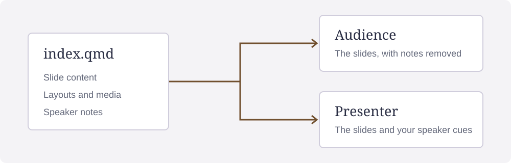

## {#statement data-title="A statement"}

::: {.statement}
Structure makes the argument memorable.
:::

::: notes
A single statement is the dominant idea. There is no hidden title and no authored size.
:::

## Importance in context {#roles}

Ordinary body text gives the context.

[The dominant statement.]{.statement}

[The slide's key point.]{.key}

[A qualification.]{.aside}

::: {.source}
Source: a demonstration of semantic roles, not research evidence.
:::

## A picture with attribution {#picture data-section="A picture, with a source"}

::: {.ds-full .ds-media .ds-fill .ds-no-pad}
{.ds-fill}
:::

::: {.ds-layer .card}
The picture supports the idea. Attribution stays with the picture without covering this text.
:::

[Diagram: htmpres authors. This deliberately longer credit demonstrates a wrapped attribution; see the appendix for the complete source record.](#sources){.credit}

::: {.credit}
Example image shared with the editable demonstration deck.
:::

## A quotation and its source {.quote #quotation}

> An effective slide gives the audience [one idea to remember.]{.key}
>
> [Example quotation written for this demonstration.]{.source}

## {#fitted-statement data-title="A fitted statement"}

::: {.statement}
A clear presentation gives each idea room to be understood, connects every explanation to its evidence, and keeps enough context for the audience to follow the argument without reading ahead or losing the main conclusion. Every supporting detail earns its place by making that central point easier to understand. When the story needs more space, the renderer fits this statement within its slide, rather than cutting the argument off at the edge of the screen.
:::

## Source record {#sources data-kind="appendix"}

The diagram is the htmpres project's original “one source, two views” SVG.
The quotation is original demonstration copy.

[Back to the picture](#picture).
