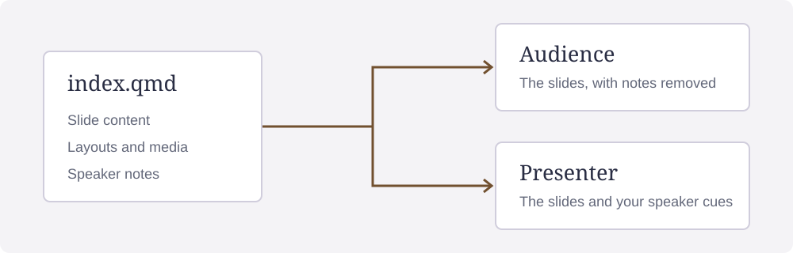

## One *source* for slides and notes {.hero-title .example-cover data-section="htmpres example"}

::: hero-subtitle
[Write the talk in Markdown.]{.key}

[Share the slides and keep your speaking cues.]{.aside}
:::

::: example-byline
An editable deck for the htmpres HTML renderer
:::

::: notes
Presenter cue 1. Both views come from one Quarto Markdown (QMD) file. Open the
audience and presenter pages to compare them. The audience page omits the notes
below each slide.
:::

## Write and render a deck {data-section="The workflow"}

<div class="example-path" role="img" aria-label="QMD source becomes HTML slides, with separate audience and presenter views">
  <div><small>Write</small><strong>QMD source</strong><span>Content, layouts, and notes</span></div>
  <span class="example-arrow" aria-hidden="true">→</span>
  <div><small>Render</small><strong>HTML deck</strong><span>Render the Markdown source</span></div>
  <span class="example-arrow" aria-hidden="true">→</span>
  <div><small>Present</small><strong>Two views</strong><span>Audience slides and presenter notes</span></div>
</div>

::: example-caption
Render the source, then open the view you need.
:::

::: notes
Presenter cue 2. Write slides and notes in the QMD file, then render it. Open
`index.html` for the audience or `presenter.html` for your cues. The
[quick-start guide](https://rahuldave.com/htmpres/quickstart.html) gives render
and preview commands.

The diagram is ordinary HTML in the Markdown source. Quarto supplies Pandoc,
runs the script, and converts Markdown fragments. htmpres supplies the slide
layout, navigation, interactions, and browser behavior.
:::

## Mark main points and qualifications {#importance data-section="Meaning and layout"}

Use `.key` for a main point and `.aside` for supporting text. The theme sets
each role's appearance relative to ordinary body text.

[The main point.]{.key} [A minor qualification.]{.aside}

:::: {.two-col}
::: {.key .card .example-principle}
A main point can occupy a whole block.
:::
::: {.aside .callout .example-principle}
Supporting context uses the secondary role. The role stays the same when its
appearance changes.[^1]
:::
::::

[^1]: This slide's footnote stays separate when another slide reuses the label.

::: notes
Presenter cue 3. Compare ordinary text, key and aside in your chosen theme's
light and dark modes.
Choose roles in the source, then let the theme set sizes and colors. Follow the
footnote and its return arrow. The appendix reuses the same label with its own
footnote.
:::

## Reveal points one at a time {#layering data-section="Progressive disclosure"}

:::: {.two-col}
::: {.incremental data-fragment-effect="dim"}
[Start with the question.]{.fragment data-fragment-index="1"}

[Then state the answer.]{.fragment data-fragment-index="2"}
:::
::: {.incremental data-fragment-effect="dim"}
- Show the evidence.
- Explain the implication.
:::
::::

::: example-caption
Advance four times to reveal the points. Future points stay hidden, and only
earlier points dim.
:::

::: notes
Presenter cue 4. The left column uses inline spans, the bracketed phrases in
the source. The right column uses list items. Select Next, or press Space or
Right, to reveal one point. Each incremental container sets the dim effect.
Future points stay hidden until the speaker advances.
:::

## Reveal code with its explanation {#code-steps data-section="Synchronized code" data-step-summary="match"}

:::: {.two-col}
::: {}
```{.python .numberLines data-steps="1|2|3" data-step-indices="1|3|7" data-line-matches="1:observations|2:total|3:mean"}
observations = [2, 4, 6]
total = sum(observations)
mean = total / len(observations)
```
:::
::: {.example-step-copy}
[Collect three observations.]{.fragment data-match="observations" data-fragment-index="1"}

[Add them to get a total of 12.]{.fragment data-match="total" data-fragment-index="3"}

[Divide by three to get a mean of 4.]{.fragment data-match="mean" data-fragment-index="7"}
:::
::::

::: example-caption
Each reveal colors a line number and its explanation. Advance once more to
show all matches together.
:::

::: notes
Presenter cue 5. Begin with all explanations hidden. Select Next to highlight
one code line and reveal its explanation in the same color. Earlier explanations
stay fully visible. Step labels 1, 3 and 7 take three clicks, despite the gaps.
Previous reverses the code highlight and its explanation together.

A fourth click shows all matches in theme colors. Previous returns to the last
code highlight.
:::

## Reveal equation terms with their explanations {#equation-steps data-section="Synchronized equations" data-step-summary="match"}

:::: {.two-col}
::: {.equation-steps .example-equation data-equation-steps="mean|total|count" data-step-indices="1|3|7"}
$$
\htmlClass{mean}{\bar{x}} = \frac{\htmlClass{total}{\sum_{i=1}^{n} x_i}}{\htmlClass{count}{n}}
$$
:::
::: {.example-step-copy}
[The mean is the quantity we want.]{.fragment data-match="mean" data-fragment-index="1"}

[Add the observations in the numerator.]{.fragment data-match="total" data-fragment-index="3"}

[Divide by the number of observations.]{.fragment data-match="count" data-fragment-index="7"}
:::
::::

::: example-caption
Each reveal colors a term and its explanation. Advance once more to show all
three pairs at full strength.
:::

::: notes
Presenter cue 6. Advance three times to emphasize the mean, the numerator and
the denominator. Each term takes the color of its explanation when that pair
appears. At the third reveal, only the denominator has full emphasis. A fourth
advance restores the mean and numerator to full strength beside it. All three
pairs then have full color, while the operators remain unchanged.

Presenter notes use the same locally bundled math engine, as in $\bar{x}=4$.
:::

## Add a zoomable diagram {data-section="Media"}

::: {.ds-media .ds-frame .example-media}
{.ds-fit .zoomable}
:::

::: example-caption
Select the diagram to zoom. It is a local SVG that you can edit.
:::

::: notes
Presenter cue 7. Select the diagram to open its enlarged view. Press Escape to
close it. The image uses fit behavior, so its full content remains visible.
:::

## Add notes for the presenter {data-section="Speaker notes"}

````markdown
## A heading the audience sees

The audience content goes here.

::: notes
A reminder for the person giving the talk.
:::
````

::: example-caption
Notes stay in the QMD source and appear only in the presenter HTML.
:::

::: notes
Presenter cue 8. The Markdown on screen is a literal example, separate from
this note. In the [interactive example](https://rahuldave.com/htmpres/example.html?slide=8),
select Presenter with notes. Its notes panel appears beside or above the slide.
:::

## Compare themes in light and dark modes {data-section="Themes"}

:::: two-col
::: example-copy
### Set the theme and color mode

```yaml
deck:
  theme: nocturne
  color-mode: auto
```
:::
::: example-copy
### Compare the rendered deck

Try the same deck in two themes. Compare headings, body text, code, and media
in both light and dark modes.

Choose a theme in the source declaration, then render again.
:::
::::

::: notes
Presenter cue 9. Nocturne is the default for this example. The documentation's
comparison page starts with Nocturne and Simplex Reading. The catalog has 35
paired theme names, each with light and dark modes. The older names sage,
mono-grid and blank are three fixed looks with no bundled dark pair.
:::

## Adapt this deck {#main-result .section-divider data-section="Your next deck"}

::: lead
Replace the claims and keep your cues in notes. Render the deck, compare the
views, and present.
:::

::: example-final-command
Repository maintainers use `just example` to render this example and
`just docs` to build the documentation.

[Open the supporting data](#appendix-data) during questions.
:::

::: notes
Presenter cue 10. Edit the example QMD, stylesheet, and diagram. Download the
[complete source and files](https://rahuldave.com/htmpres/example.html#edit-the-source),
or follow [Start a deck](https://rahuldave.com/htmpres/quickstart.html) to create
and render your own talk. The commands on this slide are for maintainers
working in the repository.
:::

## Supporting data {#appendix-data data-kind="appendix" data-section="Appendix"}

| Observation | Value |
|---|---:|
| First | 2 |
| Second | 4 |
| Third | 6 |

The mean is $\bar{x}=4$.[^1]

[^1]: The appendix footnote has its own ID, separate from slide 3.

[Back to the result](#main-result) or [More detail](#appendix-detail)

::: notes
Presenter cue 11. The counter shows appendix 1 of 2. The main talk has ten
slides. On the main result, Next and End stop without entering the appendix.
Open the supporting-data link during questions. Use its return link or browser
Back to return to the talk.
:::

## Calculate the mean in the appendix {#appendix-detail data-section="Appendix"}

All slides after the first appendix slide belong to the appendix.

$$
\frac{2+4+6}{3}=4
$$

[Back to the result](#main-result)

::: notes
Presenter cue 12. This slide inherits appendix status from the preceding slide.
It needs no appendix attribute of its own. The main counter remains separate.
Return to the result when the audience has the detail it needs.
:::
