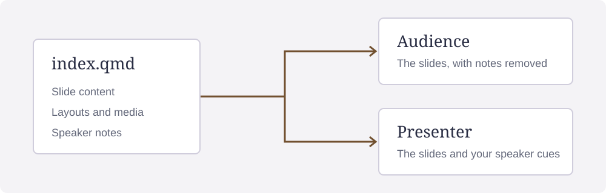

## {#statement data-title="A statement"}

::: {.statement}
State the claim before showing the evidence.
:::

::: notes
Explain the claim before showing its supporting evidence.
:::

## A quotation {.quote #quotation}

> A useful diagram gives the audience [a relationship to follow.]{.key}
>
> [Original demonstration copy, htmpres authors.]{.source}

::: notes
Put the source beside the quote. The quotation is original example copy by
htmpres authors.
:::

## Keep the whole picture visible {#contained data-section="A contained picture"}

{.ds-fit .zoomable}

[Diagram: htmpres authors, [source record](#sources).]{.credit}

::: notes
The full diagram remains visible. Select the image to zoom, then press Escape
to close it.
:::

## {#full data-title="A full-slide picture" data-section="Full-slide media"}

::: {.ds-full .ds-media .ds-no-pad}
{.ds-fill}
:::

[Diagram: htmpres authors, [source record](#sources).]{.credit}

::: notes
Fill crops the picture to cover the slide. To retain every edge, use ds-fit.
:::

## {#overlay data-title="Text over a picture" data-section="Picture and explanation"}

::: {.ds-full .ds-media .ds-no-pad .ds-readable}
{.ds-fill}
:::

::: {.ds-layer .ds-panel}
[Keep your cues in the presenter view.]{.key}
:::

[Diagram: htmpres authors, [source record](#sources).]{.credit}

::: notes
The ds-panel class requests a theme panel behind this text. Omit ds-panel to
leave the background behind the text transparent.
The image keeps its accessible description.
:::

## A decorative background {#background data-background-image="assets/texture.svg" data-background-opacity="0.18" data-section="Backgrounds"}

[The texture shows through behind the heading and body.]{.key}

Use the texture as decoration behind the explanation.

[Texture: htmpres authors, [source record](#sources).]{.credit}

::: notes
Use background layers for decoration. If the image contains information, use a
ds-full image with a description.
:::

## Picture on the left {#left data-section="Two panes"}

::: {.ds-left .ds-media .ds-no-pad}
{.ds-fit}
:::

::: {.ds-right .ds-pane}
::: {.incremental}
- Write the talk in Markdown.
- Keep your cues in notes.
- Render both views together.
:::
:::

[Diagram: htmpres authors, [source record](#sources).]{.credit}

::: notes
Advance three times to reveal the points in order. Earlier points stay visible.
:::

## Picture on the right {#right data-section="Two panes"}

::: {.ds-left .ds-pane}
[Share the audience view.]{.key}

Keep the presenter file and the editable Markdown for yourself.
:::

::: {.ds-right .ds-media .ds-no-pad}
{.ds-fit}
:::

[Diagram: htmpres authors, [source record](#sources).]{.credit}

::: notes
Your cues stay in both the Markdown source and the presenter HTML.
:::

## A grid of pictures {#grid data-section="Several pictures"}

::: {.ds-grid}
::: {.ds-media}
{.ds-fit}
:::
::: {.ds-media}
{.ds-fit}
:::
:::

[Diagram: htmpres authors, [source record](#sources).]{.credit}

::: notes
The grid container places the pictures. Set fit or fill for each picture.
:::

## Notes and counters {#counters}

Set `counter: presenter` to show the slide count in the presenter view and omit
it from the audience view.

[Open the source record](#sources), then return here.

::: notes
Choose the counter policy in the deck front matter. It applies to the whole
deck. End stops on this last main slide. The source record is an appendix slide.
:::

## Source record {#sources data-kind="appendix"}

The diagram and decorative texture are original SVG assets supplied with this example.
The quotation is original demonstration copy.

[Back to the contained picture](#contained), [background](#background), or [last main slide](#counters).

::: notes
The source record is outside the main talk. Use one of the return links to
resume it.
:::
