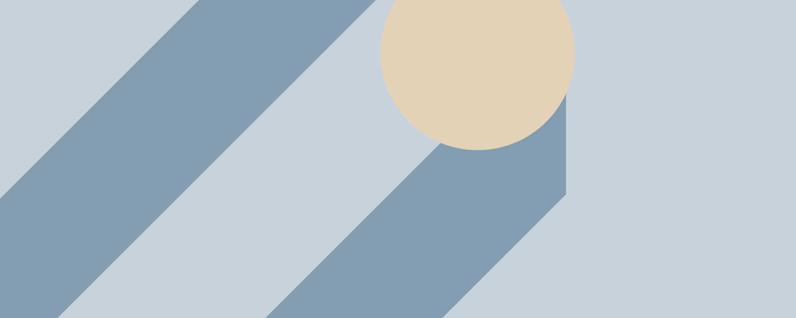
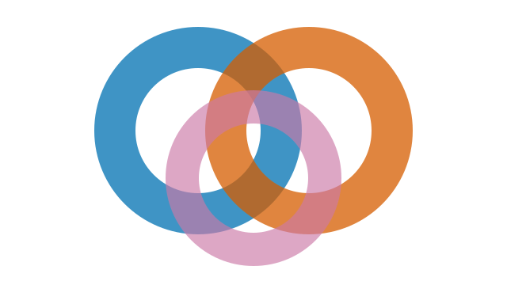
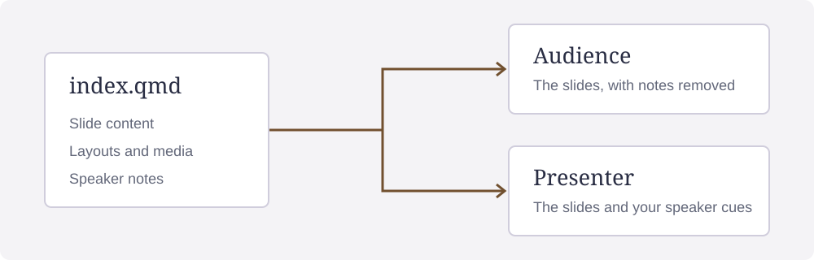

## {#half-left .title-hidden data-title="Background on the left half" .no-background}

:::: {.ds-full .ds-no-pad .half-background}
::: {.ds-left .ds-media .ds-no-pad}
{.ds-fill}
:::
::: {.ds-right .ds-pane}
### Background on the left

[Use the other half for text.]{.key}

The picture fills its half and may crop. The text uses the theme's background.
:::
::::

[Original illustration by htmpres authors.]{.credit}

::: notes
This deck supplies the [visual syntax gallery](https://rahuldave.com/htmpres/syntax-examples.html),
where you can compare each slide with its Markdown. The gallery previews one
selected slide. Use Open full deck for navigation between slides, counters,
and autoplay where the browser permits it.

The outer full-slide layer keeps both halves at the slide edges. Put the
picture in the left media container and the text in the right pane. Swap their
roles for a background on the right.
:::

## {#half-right .title-hidden data-title="Background on the right half" .no-background}

:::: {.ds-full .ds-no-pad .half-background}
::: {.ds-left .ds-pane}
### Background on the right

[Put the explanation on the left.]{.key}

The same containers work with their media and text roles reversed.
:::
::: {.ds-right .ds-media .ds-no-pad}
{.ds-fill}
:::
::::

[Original illustration by htmpres authors.]{.credit}

::: notes
The texture is decorative in this example. If the picture contains evidence,
use a diagram with a description. A half-slide image needs no special
background-position setting.
:::

## An image with transparent areas {#transparent .no-background}

{.ds-fit .ds-original .zoomable .ds-no-border}

[Original illustration by htmpres authors.]{.credit}

::: notes
The SVG has no background rectangle, so its transparent areas show the theme's
slide surface. Switch light and dark modes to see that surface change. A PNG
with transparency in its alpha channel behaves the same way. The image retains
its stored transparency without a class.
:::

## Reduce the whole image's opacity {#opacity .no-background}

:::: {.two-col}
::: {}
{.ds-fit .ds-original}
:::
::: {}
{.ds-fit .ds-alpha}
:::
::::

The right image uses `.ds-alpha`, whose default opacity is 0.6. The text keeps
its normal contrast.

::: notes
Stored transparency comes from the file. Opacity fades the image as a whole,
including parts that were opaque. If only the picture should fade, apply the
class to the image rather than a text container.
:::

## Choose an opacity in CSS {#opacity-css .no-background}

:::: {.two-col}
::: {}
{.ds-fit .ds-original}
:::
::: {}
{.ds-fit .ds-alpha .faint-image}
:::
::::

The custom `.faint-image` class sets `--ds-opacity: .25` in `source.css`.
Copy that rule with the slide, or choose another value from 0 to 1.

::: notes
The class name describes its role, and the stylesheet sets its value. Download
the [supplemental stylesheet](https://rahuldave.com/htmpres/_generated/source/syntax.css.txt)
as `source.css`. Copy its `.faint-image` rule with this slide.
:::

## Position a faint background {#background-opacity data-background-image="assets/texture.svg" data-background-filter="none" data-background-fit="fill" data-background-position="right top" data-background-opacity="0.18" data-background-class="ds-rounded"}

[The words remain fully opaque.]{.key}

Only the decorative background uses opacity 0.18. The theme supplies the text
panels and foreground colors.

::: notes
Heading attributes set this slide's background. Put the same settings under
deck in the front matter to apply them to the whole deck. Background fit retains
the whole image. Background fill may crop it. Set position to choose which edge
stays visible.
:::

## Keep the whole image or fill its box {#fit-fill .no-background}

:::: {.ds-split .example-split}
::: {.ds-media .ds-frame}
{.ds-fit}
:::
::: {.ds-media .ds-frame}
{.ds-fill}
:::
::::

The diagram fits in the left box and fills the right box. Both copies use the
same image and box size.

::: notes
Use fit for a diagram whose edges contain information. Use fill when a crop is
acceptable. Borders show the edges of each media box in this comparison.
:::

## Compare image filter presets {#filter-presets .no-background}

:::: {.ds-grid .example-grid}
{.ds-original}

{.ds-bw}

{.ds-vivid}

{.ds-noir}

{.ds-chrome}

{.ds-fade}
::::

::: notes
The images use the same source and crop. Change only the filter class to
compare presets. Black and white also accepts the alias ds-bn. Each class
selects a browser filter preset.
:::

## Use the theme filter or sharpen {#theme-filter .no-background}

:::: {.ds-grid .example-grid}
{.ds-original}

{.ds-theme-filter}

{.ds-theme-filter .ds-sharpen}
::::

A theme's filter can be neutral. Sharpen is a separate effect that you can
combine with a preset.

::: notes
If the theme uses a neutral filter, its image can look the same as the original.
Copy the class from the source to apply that theme setting.
:::

## Tune a filter and zoom the image {#custom-filter .no-background}

:::: {.ds-grid .example-grid}
{.ds-original}

{.ds-filter .enhanced-image}

{.ds-original .ds-zoom .detail-image}
::::

Set the custom filter values and zoom scale in `source.css`. The original
image file stays unchanged.

::: notes
The enhanced-image rule sets saturation, contrast and exposure. The detail-image
rule sets a scale of 1.35. The media container clips the enlarged edges. Copy
both rules from the [supplemental stylesheet](https://rahuldave.com/htmpres/_generated/source/syntax.css.txt).
:::

## Add an edge overlay to a container {#vignettes .no-background}

:::: {.ds-split .example-triptych}
::: {.ds-media .ds-vignette .example-dark-edge}
{.ds-fill .ds-original}
:::
::: {.ds-media .ds-vignette .ds-vignette-light .example-light-edge}
{.ds-fill .ds-original}
:::
::: {.ds-media .ds-readable}
{.ds-fill .ds-original}
:::
::::

The first two containers add dark and light edge overlays, called vignettes.
The third adds a readability gradient. Put these classes on the container, not
on the image.

::: notes
Use both vignette classes for the light variant. For steady contrast over
mixed imagery, put text on a panel whose colors come from the theme.
:::

## Place small images in a row {#inline-images .no-background}

:::: {.ds-inline .ds-center .example-inline}
{.ds-fit .ds-original}

{.ds-fit .ds-original .ds-rounded}

{.ds-fit .ds-bw}
::::

The row wraps when space runs out. The stylesheet sets its image size through
`--ds-inline-size`.

::: notes
Use inline media to place small images side by side. A grid gives each item a
column.
:::

## Place text and media beneath the heading {#flowing-split .no-background}

:::: {.ds-split .example-split}
::: {.ds-pane .ds-frame .ds-top}
### A text pane

- Read the result.
- Inspect the diagram.
- Ask about the method.
:::
::: {.ds-media .ds-frame}
{.ds-fit}
:::
::::

::: notes
A split container stays beneath the heading in the normal page flow. The
half-background examples use a full-slide layer. On a pane, `.ds-top`,
`.ds-center` and `.ds-bottom` align contents at the top, center and bottom.
:::

## Compare cards and a callout {#cards .no-background}

:::: {.three-col}
::: {.card .metric-card}
### 12 observations

A metric card groups a value and its explanation.
:::
::: {.card}
### The method

An ordinary card groups related content.
:::
::: {.callout}
### Check the sample

A callout sets supporting guidance apart.
:::
::::

::: notes
The bundled theme CSS includes these starter card styles. The deck's
`source.css` adds rules for this example. The theme sets the colors, spacing
and typography. Use two-col for two cards and three-col for three.
:::

## Select a button to change the explanation {#panel-controls .no-background}

::: {.pill-row}
<button class="pill active" data-target="#syntax-detail" data-title="Audience view" data-text="Share index.html and its assets folder.">Audience</button>
<button class="control-chip" data-update-target="#syntax-detail" data-title="Presenter view" data-text="Keep presenter.html for your speaking cues.">Presenter</button>
<button class="action-button" data-target="#syntax-detail" data-html="<h3>Both views</h3><p>Both views come from one Markdown file.</p>">Both</button>
:::

::: {#syntax-detail .focus-panel .compact-panel}
### Audience view

Share index.html and its assets folder.
:::

::: notes
Select each button. The first two replace a heading and paragraph with plain
text. The third uses the HTML string in the source. Press Enter or Space to
activate a focused button.
:::

## Filter the visible cards {#item-filters .no-background}

::: {.pill-row data-choice-group="syntax-candidates"}
<button class="pill active" data-filter="all" data-filter-target=".candidate">All</button>
<button class="pill" data-filter="prototype" data-filter-target=".candidate">Prototypes</button>
<button class="pill" data-item-filter="stable" data-filter-target=".candidate">Stable</button>
:::

:::: {.example-candidates}
::: {.candidate .card data-tags="prototype"}
### Early model

A prototype.
:::
::: {.candidate .card data-tags="stable"}
### Tested model

A stable version.
:::
::: {.candidate .card data-tags="prototype stable"}
### Revised model

Matches both filters.
:::
::::

::: notes
Select Prototypes, Stable and All. The filters affect only this slide and use
no reveal steps. The third card has two tags and belongs to both groups.
:::

## Compare reveal effects {#fragment-effects .no-background}

[Visible before any advance.]{.fragment data-fragment-index="0"}

[Starts in place.]{.fragment data-fragment-effect="none"}

[Rises into place.]{.fragment data-fragment-effect="rise"}

[Enters from the left.]{.fragment data-fragment-effect="left"}

[Enters from the right.]{.fragment data-fragment-effect="right"}

[Scales into place.]{.fragment data-fragment-effect="scale"}

[Becomes sharp.]{.fragment data-fragment-effect="blur"}

[Receives a highlight.]{.fragment data-fragment-effect="highlight"}

::: notes
Advance seven times to compare how each point appears. The example deck
demonstrates dim, which hides future points and dims earlier ones. Rise also
accepts slide as an alias.
:::

## Play a local video {#video .no-background}

::: {.ds-media .example-player}
<video class="ds-fit ds-controls ds-loop ds-muted" src="assets/motion.mp4" aria-label="A generated moving test pattern"><track kind="captions" src="assets/motion.vtt" srclang="en" label="English" default></video>
:::

Select Play. The short, silent pattern repeats until you pause it. The browser's
playback controls work inside the slide.

::: notes
The original sample is a generated four-second video with a caption track. It
is local, so playback needs no video service or network connection.
:::

## Play a local audio file {#audio .no-background}

<audio class="ds-controls ds-keep-time" src="assets/tone.wav" aria-label="A quiet one-second demonstration tone"></audio>

Select Play to hear a quiet tone. The `.ds-keep-time` class retains the playback
position when you leave the slide and return.

::: notes
Audio playback starts only after a user action. Keep-time retains the playback
position, but the audio stops when you leave the slide. The sample is an
original generated tone. A second player uses ds-hide, so it has no visible
controls or entry in the accessibility tree.
:::

<audio class="ds-hide" src="assets/tone.wav" aria-label="Hidden demonstration tone"></audio>

## Advance when the video ends {#media-advance .no-background}

::: {.ds-media .example-player}
<video class="ds-fit ds-controls ds-muted ds-autoplay ds-autoadvance" src="assets/motion.mp4" aria-label="A four-second pattern that advances the deck when finished"><track kind="captions" src="assets/motion.vtt" srclang="en" label="English" default></video>
:::

Open the full deck for this example. If the browser permits muted autoplay,
playback starts when the slide opens. Otherwise select Play. When the video
ends, the next slide opens.

::: notes
When the video ends, the deck advances without a reveal step. To advance at the
end, leave loop off. Browser autoplay restrictions still apply.
:::

## Embed a local interactive page {#embedded-page .no-background}

<iframe class="ds-fit example-embed" title="Local interactive observation counter" src="assets/embedded.html"></iframe>

::: notes
Select Add an observation inside the frame. The embedded page handles the
interaction. An iframe can load a local file or an external URL. Use local files
to keep an offline deck self-contained.
:::

## A section divider {.section-divider #section-divider .no-background}

::: {.lead}
Use a short heading to introduce a section of the talk.
:::

::: notes
The section-divider class belongs on the slide heading. The lead class supplies
supporting text. A statement slide is another way to present a single claim.
:::

## Containers for code and instructions {#containers .no-background}

:::: {.two-col}
::: {.code-card}
```python
values = [2, 4, 6]
mean = sum(values) / len(values)
```
:::
::: {.code-guide .checklist}
- Store the observations.
- Add their values.
- Divide by the count.
:::
::::

::: {.diagram-frame}
Use a frame for a small diagram or a relationship.
:::

::: notes
The CSS bundled with the theme supplies the code-card, code-guide, checklist
and diagram-frame styles. They format content without changing Markdown
rules. Code steps use their own attributes.
:::

## Fit a dense comparison {#text-fit .autoscale data-text-fit-min="0.64" .no-background}

:::: {.three-col}
::: {.card}
### Evidence

A measured result needs its sample, method and uncertainty. Keep the labels
beside the values so the audience can compare the groups.

- Sample size
- Measurement window
- Missing observations
- Measurement units
- Group boundaries
- Source records
- Inclusion rules
- Exclusion rules
- Baseline values
:::
::: {.card}
### Interpretation

Explain the comparison before moving to the next slide. Use a footnote for a short
qualification and an appendix for the full method.

- Group difference
- Uncertainty interval
- Scope of the claim
- Reference group
- Observation window
- Comparison method
- Relevant limitation
- Sensitivity analysis
- Unresolved assumption
:::
::: {.card}
### Next step

State what the result supports. Leave enough room for the audience to read the
figure and listen to the explanation.

- Supported decision
- Remaining question
- Further measurement
- Next observation
- Review date
- Data owner
- Decision owner
- Follow-up comparison
- Communication plan
:::
::::

::: notes
If text overflows, the runtime can reduce it toward the declared minimum
scale. The minimum is a lower limit, not a requested font size. Remove text if
the slide would still be unreadable.
:::

## Stop tap navigation inside a region {#navigation-guard .no-background}

::: {.no-tap-nav .card}
Select this text in the full deck. The slide stays open because the surrounding
region has `.no-tap-nav`.
:::

::: {.card}
Select this text in the full deck to advance normally.
:::

::: notes
Open the full deck to compare these regions. The gallery disables tap navigation
throughout its preview. In the guarded region, clicks and touch gestures do not
navigate. Keyboard shortcuts still work. No-slide-nav is an alias for the same
guard.
:::

## Scroll a long list without shrinking it {#scroll-overflow .no-autoscale data-text-fit="false" data-overflow="scroll" .no-background}

Keep the original text size and scroll to the final entry.

- Record the sample size.
- Name the study population.
- Define the group boundary.
- State the observation window.
- Name the measurement method.
- Give the unit of measurement.
- Explain the missing values.
- Report the comparison value.
- State the uncertainty interval.
- Explain the baseline choice.
- Record the data source.
- Describe any exclusions.
- Check the sensitivity analysis.
- State the scope of the result.
- Name the remaining question.
- End of the scroll example.

::: notes
The list exceeds the slide height. The heading disables text fitting and
selects scroll overflow. Scroll inside the slide to reach the last entry.

The hidden policy clips overflow. The fit policy reduces text size, then clips
content that still overflows. The fit-scroll policy reduces text size first,
then lets you scroll if content still overflows.
:::

## Set a background for the whole deck {#global-background}

[The deck's default background appears here.]{.key}

Set the texture and opacity in the front matter. The heading needs no
background attribute.

::: notes
Most slides in this gallery omit the default background. Compare the next
slide with this one. The complete downloadable source includes the front matter.
:::

## Omit the deck's background {#omit-background .no-background}

[The theme's plain surface appears here.]{.key}

`.no-background` on the heading suppresses the image selected in front matter.
`data-background-image="none"` also suppresses it.

::: notes
Compare this slide with the previous default-background example in both modes.
The text and theme stay the same while the decorative image is absent.
:::

## Choose colors for matching equation terms {#match-overrides .custom-matches data-step-summary="match" data-match-colors="total=#765013" data-match-colors-dark="total=#edc37d" .no-background}

:::: {.two-col}
::: {.equation-steps data-equation-steps="mean|total|count"}
$$
\htmlClass{mean}{\bar{x}} = \frac{\htmlClass{total}{\sum x_i}}{\htmlClass{count}{n}}
$$
:::
::: {}
[Set the mean's color on its explanation.]{.fragment data-fragment-index="1" data-match="mean" data-match-color="#245c88" data-match-color-dark="#91c9f0"}

[Set the total's color on the slide.]{.fragment data-fragment-index="2" data-match="total"}

[Set the count's color in a named CSS variable.]{.fragment data-fragment-index="3" data-match="count"}
:::
::::

::: notes
Advance four times. The mean's explicit colors are on its explanation. The
heading sets the total's light and dark values.

In `source.css`, `.custom-matches` sets `--htmpres-match-count` for both modes.
Copy its two rules from the
[supplemental stylesheet](https://rahuldave.com/htmpres/_generated/source/syntax.css.txt).
Without overrides, the theme sets every group's color.
:::

## Align labels inside their panes {#labels .no-background}

:::: {.ds-split .example-triptych}
::: {.ds-pane .ds-frame .ds-top}
[At the top]{.eyebrow}

A label can introduce a pane.
:::
::: {.ds-pane .ds-frame .ds-center}
[In the center]{.sample-label}

A sample label names an example.
:::
::: {.ds-pane .ds-frame .ds-bottom}
[At the bottom]{.media-caption}

A caption explains the media.
:::
::::

::: {.source-line}
Original demonstration copy by htmpres authors.
:::

::: notes
Top, center and bottom align the contents of panes with equal heights. The
label classes come from the bundled theme CSS. The theme sets their text sizes.
:::

## A slide entrance from the side {#transition-slide .transition-slide .no-background}

The slide moves into place when you open it.

::: notes
Open the full deck and advance to compare this entrance with fade, zoom and
none. The gallery preview reloads a slide when you choose it.
:::

## A zoom entrance {#transition-zoom data-transition="zoom" .no-background}

The slide scales into place when you open it.

::: notes
The heading attribute is an alternative to the transition class. Reduced-motion
preferences can suppress movement.
:::

## No entrance animation {#transition-none .transition-none .no-background}

The slide appears without an entrance effect.

::: notes
None affects the entrance only. The slide can still contain separate reveal steps.
:::

## Link to another slide {#source-links data-transition="fade" .no-background}

[The source record](#source-record) lists the bundled assets.

[Return to the first pattern](#half-left) to compare its halves again.

::: notes
The fade transition runs when the slide opens. Slide transitions also accept
slide, zoom and none. They do not add reveal frames. End stops on this main slide.
:::

## Source record {#source-record data-kind="appendix" .no-background}

The diagram, texture, transparent rings, test video, captions, tone and embedded
page are original demonstration assets by htmpres authors.

[Return to the linking example](#source-links).

::: notes
The appendix stays outside the main slide counter. Each source file comes with
this example. Replace the media, descriptions and credits for your own talk.
:::
