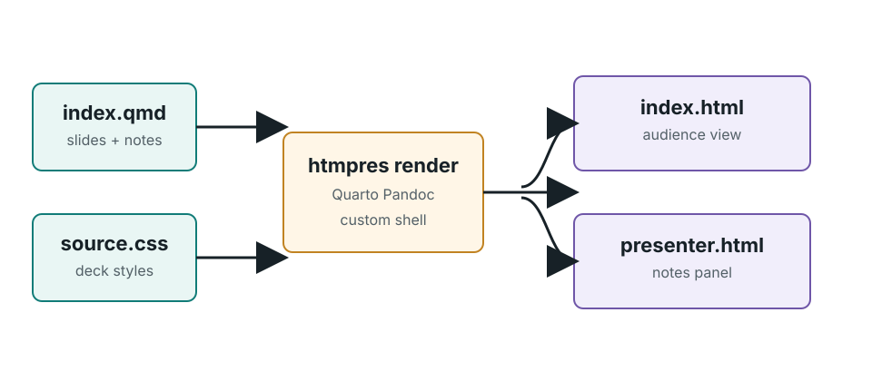
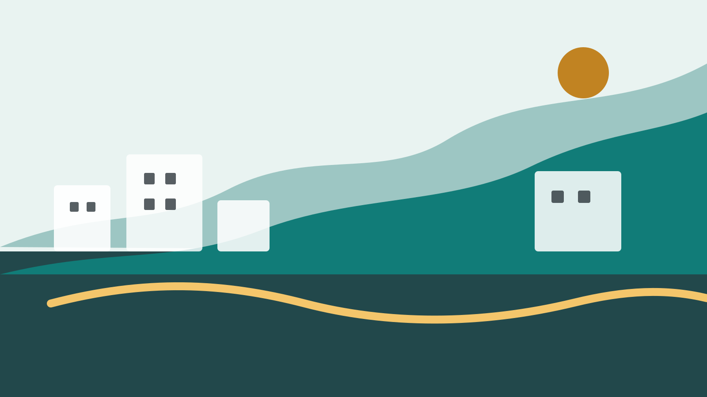
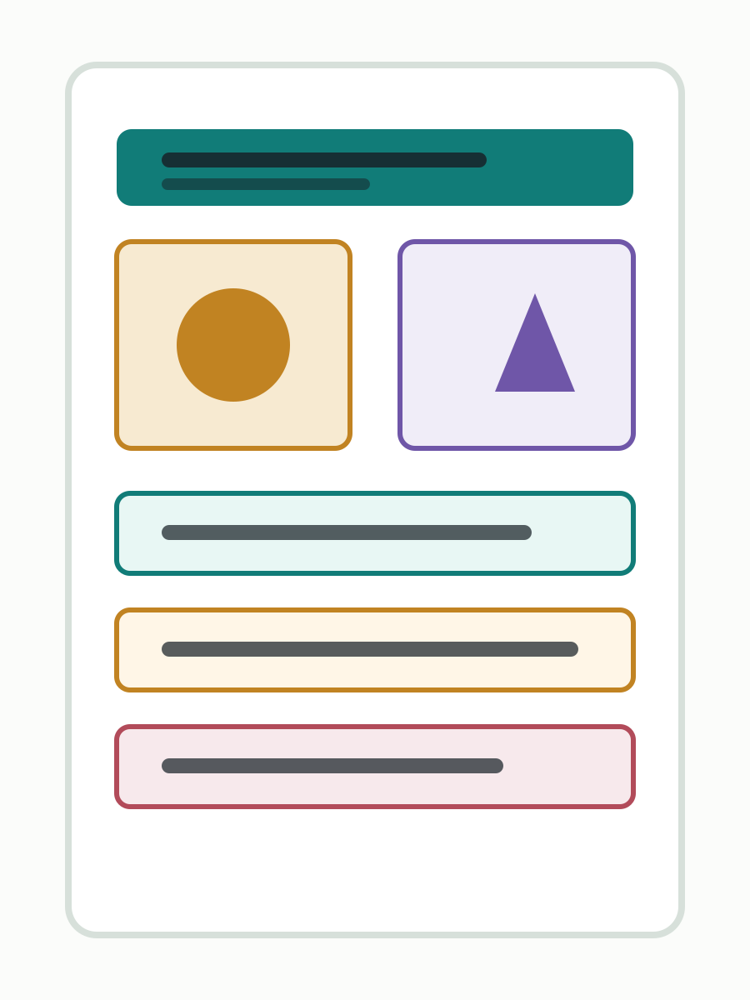

## Customize Layouts And Themes {.hero-title data-section="Customization reference" data-title="Customization Reference"}

[Advanced reference]{.eyebrow}

::: hero-subtitle
Explore optional theme tokens, layout overrides, backgrounds and runtime settings. Start a first talk with the beginner tutorial in docs/quickstart.qmd.
:::

::: callout
The source is plain Markdown plus Quarto fenced divs. The output keeps custom deck navigation, overview, zoom, presenter notes, and small interactions.
:::

::: source-line
Source: docs/build-a-deck-from-markdown.md
:::

::: notes
This opening slide is the orientation: QMD is the authoring layer, but the runtime and slide shell remain custom.
:::

## The Package Shape {.theme-runtime data-section="Packaging" data-title="Package Shape"}

[Recommended packaging]{.eyebrow}

:::: three-col
::: {.card .metric-card style="--accent: var(--teal)"}
**Quarto-run CLI**

Commands import HTML, render QMD, and verify outputs through Quarto's bundled Deno runtime.
:::

::: {.card .metric-card style="--accent: var(--amber)"}
**Installable extension**

`_extensions/htmpres` carries the runner and browser runtime into other projects.
:::

::: {.card .metric-card style="--accent: var(--violet)"}
**Starter template**

A small QMD deck gives authors a working first file instead of a blank page.
:::
::::

::: callout
Quarto stays in the loop as the Pandoc markdown engine. It does not need to own the slide navigation.
:::

::: notes
Make the distinction explicit: this is not a pure Quarto format yet. It is a package that uses Quarto for conversion and owns presentation runtime itself.
:::

## Start With Front Matter {data-section="Authoring" data-title="Front Matter"}

[Deck metadata]{.eyebrow}

Use `pagetitle`, disable execution, point at local assets, and choose the CSS and theme for this deck.

:::: code-card
```yaml
---
pagetitle: "My Deck"
execute:
  enabled: false
resources:
  - assets/**

deck:
  css: source.css
  renderer: custom
  theme: mono-grid
  background-image: assets/tutorial-landscape.svg
  background-filter: theme sharpen
  background-opacity: 0.08
  text-fit: true
---
```
::::

::: callout
The renderer reads `deck.css`, sets `deck.theme` on the generated HTML, inlines the stylesheet, and writes both `index.html` and `presenter.html`.
:::

## Choose A Theme {data-section="Authoring" data-title="Themes"}

[Theme tokens]{.eyebrow}

Themes are CSS variable sets selected by front matter. Keep layout classes structural, then let the theme own color, typography, code tokens, and media filter defaults.

:::: two-col
::: theme-sample
**sage**

The default warm tutorial palette uses proportional display type and gentle media filters.
:::

::: {.theme-sample .mono-theme-sample}
**mono-grid**

This deck uses a sharper blue-gray palette, sans body text, monospaced headings, monospaced code, and a cooler media filter.
:::
::::

:::: code-card
```yaml
deck:
  css: source.css
  renderer: custom
  theme: mono-grid
```
::::

## Set A Global Background {data-section="Authoring" data-title="Global Background"}

[Deck media defaults]{.eyebrow}

Global backgrounds are front matter, not alt-text layout. The renderer adds a low layer to every slide; each slide can opt out or override it with data attributes.

:::: code-card
```yaml
deck:
  background-image: assets/tutorial-landscape.svg
  background-fit: fill
  background-filter: theme sharpen
  background-opacity: 0.08
```
::::

::: callout
Use `.no-background` on a slide or `data-background-image="none"` when an explicit full-slide media container should own the whole background.
:::

## Let Dense Slides Fit {.autoscale data-section="Authoring" data-title="Text Fit"}

[Theme-level text fitting]{.eyebrow}

The deck-level `text-fit` option lets the runtime scale theme typography down when a slide would overflow. Themes decide which text tokens respond.

:::: {.three-col .fit-demo}
::: card
**Narrative**

Dense slide copy can stay readable while avoiding clipped paragraphs, long callouts, and crowded headings.
:::

::: card
**Controls**

Use `deck.text-fit: true` globally, `.autoscale` for one slide, `.no-autoscale` for an exception, and `data-text-fit-min` for a local floor.
:::

::: card
**Boundaries**

The feature scales text tokens. Fixed-size media, custom absolute layouts, and intentionally clipped design elements remain authored by CSS.
:::
::::

:::: code-card
```markdown
## Dense Slide {.autoscale data-text-fit-min="0.62"}

Long paragraphs, cards, and lists can scale through theme tokens.
```
::::

## Use Slide Headings And Div Classes {data-section="Authoring" data-title="Slide Structure"}

[Slide anatomy]{.eyebrow}

:::: two-col
::: card
**Start with `##` or `---`**

A heading supplies the title and slide attributes. A separator followed by a heading makes one slide. Use `## {#backup}` for untitled-slide settings.
:::

::: card
**Layout uses fenced divs**

Use `::: class-name` or `::: {.class-one .class-two}` for blocks that CSS can target.
:::
::::

:::: code-card
```markdown
## Platform Story {.hero-title data-section="Opening" data-title="Platform Story"}

[Architecture]{.eyebrow}

::: hero-subtitle
The short version of the story goes here.
:::
```
::::

## Add Notes For Presenter Only {data-section="Authoring" data-title="Presenter Notes"}

[Speaker notes]{.eyebrow}

Notes are ordinary fenced divs in QMD:

:::: code-card
```markdown
::: notes
This appears only in presenter.html.
:::
```
::::

:::: two-col
::: {.card .metric-card style="--accent: var(--teal)"}
**Audience HTML**

`index.html` has no note content in the slide DOM.
:::

::: {.card .metric-card style="--accent: var(--indigo)"}
**Presenter HTML**

`presenter.html` shows the notes in a right-side panel.
:::
::::

::: notes
This slide should prove the note split: it appears in presenter.html and is stripped from index.html.
:::

## Highlight Code By Line {data-section="Authoring" data-title="Code Highlighting"}

[Syntax plus steps]{.eyebrow}

Use Pandoc code attributes for syntax highlighting, line numbers, persistent highlights, and click-through line steps.

::::: {.two-col .code-split}
:::: {.code-card .code-demo}
```{.python .numberLines data-steps="none|2|3|4|all"}
def render_slide(slide):
    html = markdown_to_html(slide["body"])
    if slide.get("notes"):
        write_presenter_notes(slide["notes"])
    return f"<section>{html}</section>"
```
::::

::: {.card .code-guide}
**Authoring syntax**

- Use `.numberLines` for line numbers.
- Use `data-highlight="2,4-5"` for persistent line highlights.
- Use `data-steps="none|2|3|4|all"` for arrow-key code transitions.
- Line specs accept numbers, ranges, `none`, and `all`.
:::
:::::

::: notes
Advance through the code with Space or the Next button. The renderer lets Pandoc do token highlighting and the htmpres runtime applies the line-step state.
:::

## Reveal Bullets {.transition-fade data-section="Authoring" data-title="Bullet Transitions" data-transition="fade"}

[Incremental lists]{.eyebrow}

:::: {.two-col .transition-demo}
::: {.card .fragment-demo}
**Wrap a list in `.incremental`**

::: {.incremental data-fragment-effect="rise"}
- Write the whole outline in normal Markdown.
- Advance with Space, Next, PageDown, or the right arrow.
- Previous reverses the reveal before leaving the slide.
:::
:::

::: code-card
```markdown
::: {.incremental data-fragment-effect="rise"}
- First point
- Second point
- Third point
:::
```
:::
::::

::: notes
This slide should consume three navigation steps before moving forward. It uses a fade slide transition when entering from another slide.
:::

## Reveal Any Block {.transition-slide data-section="Authoring" data-title="Fragment Transitions" data-transition="slide"}

[Fragments]{.eyebrow}

:::: three-col
::: {.card .fragment data-fragment-index="1" data-fragment-effect="left"}
**Text block**

Any fenced div can become a fragment.
:::

::: {.card .fragment data-fragment-index="2" data-fragment-effect="highlight"}
**Controls**

Buttons, chips, and panels can reveal together.
:::

::: {.card .fragment data-fragment-index="2" data-fragment-effect="scale"}
**Media**

The same class works around image, video, or embed containers.
:::
::::

:::: code-card
```markdown
::: {.card .fragment data-fragment-index="2" data-fragment-effect="highlight"}
**Reveal me later**
:::
```
::::

::: notes
The first card reveals alone. The second and third share the same fragment index and reveal together.
:::

## Slide Transitions {.transition-zoom data-section="Authoring" data-title="Slide Transitions" data-transition="zoom"}

[Per-slide motion]{.eyebrow}

:::: {.transition-strip}
::: {.card .metric-card style="--accent: var(--teal)"}
**Fade**

Use `.transition-fade` or `data-transition="fade"`.
:::

::: {.card .metric-card style="--accent: var(--amber)"}
**Slide**

Use `.transition-slide` or `data-transition="slide"`.
:::

::: {.card .metric-card style="--accent: var(--rose)"}
**Zoom**

Use `.transition-zoom` or `data-transition="zoom"`.
:::
::::

:::: code-card
```markdown
## Enter From The Side {.transition-slide data-transition="slide"}

## Fade In {data-transition="fade"}

## No Motion {.transition-none}
```
::::

::: callout
Transitions are CSS-level choices on the slide. Fragment and code steps still consume navigation before the deck changes slides.
:::

## Mixed Step Order {data-section="Authoring" data-title="Mixed Step Order"}

[One step graph]{.eyebrow}

:::: {.mixed-transition}
::: {.card .mixed-copy}
**On one slide**

::: {.incremental data-fragment-effect="rise"}
- List items reveal as generic fragments.
- Explicit fragments share the same queue.
:::

::: {.fragment .focus-panel .compact-panel data-fragment-effect="highlight"}
### Source order

This example puts text before code. Explicit shared frame numbers can advance both columns together.
:::
:::

:::: {.code-card .mixed-code}
```{.js .numberLines data-steps="2|3|all"}
const frames = compileSteps(slide);
if (frames.hasNext()) {
  return frames.next();
}
return nextSlide();
```
::::
::::

::: callout
Mixed events follow source order unless explicit frame numbers synchronize them. Earlier ordinary text stays visible while code advances. Persistent `data-highlight` lines do not consume a step.
:::

::: notes
Test this with six Next presses: first list item, second list item, focus panel, code line 2, code line 3, all code lines. The next press leaves the slide.
:::

## Add Images And Zoom {data-section="Media" data-title="Images And Zoom"}

[Visual assets]{.eyebrow}

Store images under the deck's `assets/` folder. Put layout classes on containers, and put fit/fill/filter/zoom classes on the media itself.

::: diagram-frame
{.ds-fit .zoomable}
:::

:::: code-card
```markdown
::: diagram-frame
{.ds-fit .zoomable}
:::
```
::::

::: notes
Clicking the diagram should open the custom zoom modal. This is a browser smoke-test target as well as a tutorial example.
:::

## Full-Slide Media {.title-hidden data-section="Media" data-title="Full-Slide Media"}

::: {.ds-full .ds-media .ds-no-pad .ds-readable style="--ds-readable-start: 0.42; --ds-readable-end: 0.08;"}
{.ds-fill .zoomable}
:::

::: {.ds-layer .media-caption}
[Full slide]{.eyebrow}

### Fill the whole slide

The container owns placement. The image owns `ds-fill`, so it crops like a background while text and buttons can sit above it.
:::

::: notes
This is the Deckset full-background image idea translated to Quarto containers: the image fills a full-slide container, and visible text remains ordinary content.
:::

## Half-Slide Left Media {.title-hidden data-section="Media" data-title="Half-Slide Left Media"}

::: {.ds-left .ds-media .ds-no-pad}
{.ds-fill .zoomable}
:::

::: {.ds-right .ds-pane}
[Left image]{.eyebrow}

### Put anything on the other half

The right half is just another container. It can hold headings, body text, lists, cards, or buttons.

- Use `.ds-left` or `.ds-right` for half-slide regions.
- Use `.ds-fill` on the image when cropping is acceptable.
- Use `.ds-fit` when the whole image must remain visible.
:::

## Half-Slide Right Media {.title-hidden data-section="Media" data-title="Half-Slide Right Media"}

:::: {.ds-left .ds-pane}
[Right image]{.eyebrow}

### The mirror layout is the same idea

This layout is useful for a product image, screenshot, diagram detail, video, or any other media that should occupy one half of the slide.

::: pill-row
<button class="pill active" data-target="#halfPanel" data-title="Fit" data-text="Use ds-fit when the full image matters more than edge-to-edge coverage.">Fit</button>
<button class="pill" data-target="#halfPanel" data-title="Fill" data-text="Use ds-fill when the media should cover the pane and can be cropped.">Fill</button>
:::

::: {#halfPanel .focus-panel .compact-panel}
### Fit

Use ds-fit when the full image matters more than edge-to-edge coverage.
:::
::::

::: {.ds-right .ds-media .ds-frame}
{.ds-fit .zoomable}
:::

## Split Containers {data-section="Media" data-title="Split Containers"}

[Composed layouts]{.eyebrow}

:::: {.ds-split .sample-split style="--ds-gap: 18px; --ds-height: 430px;"}
::: {.ds-pane .ds-frame style="--ds-bg: #fbfcfa;"}
### Text pane

Use a split container when both sides should remain in normal slide flow.

This is better than image-only syntax when the layout includes text, lists, tables, code, or controls.
:::

::: {.ds-pane .ds-media .ds-frame}
{.ds-fit .zoomable}
:::
::::

## Fit, Fill, And Filters {data-section="Media" data-title="Fit Fill Filters"}

[Media attributes]{.eyebrow}

:::: {.ds-grid .sample-media-grid style="--ds-columns: 3; --ds-gap: 14px;"}
::: {.ds-media .ds-frame}
{.ds-fit}
:::

::: {.ds-media .ds-frame}
{.ds-fill}
:::

::: {.ds-media .ds-frame}
{.ds-fit .ds-noir .ds-sharpen}
:::

::: {.sample-label}
`ds-fit`
:::

::: {.sample-label}
`ds-fill`
:::

::: {.sample-label}
`ds-noir ds-sharpen`
:::
::::

:::: code-card
```markdown
{.ds-fit}
{.ds-fill}
{.ds-fit .ds-noir .ds-sharpen}
{.ds-fit .ds-vivid .zoomable}
```
::::

## Inline Grids And Filter Placement {data-section="Media" data-title="Filter Placement"}

[Containers place; media filters]{.eyebrow}

:::: {.ds-grid .sample-media-grid style="--ds-columns: 3; --ds-gap: 14px;"}
::: {.ds-media .ds-frame}
{.ds-fill .ds-bn}
:::

::: {.ds-media .ds-frame}
{.ds-fill .ds-theme-filter}
:::

::: {.ds-media .ds-frame .ds-vignette style="--ds-vignette: 0.42; --ds-vignette-size: 96px;"}
{.ds-fill .ds-filter .ds-sharpen style="--ds-saturation: 1.15; --ds-contrast: 1.1; --ds-exposure: 0.08;"}
:::

::: {.sample-label}
`ds-grid` + `ds-bn`
:::

::: {.sample-label}
`ds-theme-filter`
:::

::: {.sample-label}
custom filter + sharpen
:::
::::

:::: code-card
```markdown
:::: {.ds-grid style="--ds-columns: 3"}
::: {.ds-media}
{.ds-fill .ds-bn}
:::

::: {.ds-media}
{.ds-fill .ds-theme-filter}
:::

::: {.ds-media .ds-vignette style="--ds-vignette: 0.42;"}
{.ds-fill .ds-filter .ds-sharpen style="--ds-saturation: 1.15; --ds-contrast: 1.1; --ds-exposure: 0.08;"}
:::
::::
```
::::

::: callout
Deckset puts layout words in image alt text. In `htmpres`, put layout on the fenced div and put fit, fill, zoom, and filter classes on the media. Use wrapper classes such as `.ds-vignette` or `.ds-readable` when the effect needs an overlay.
:::

## Other Media {data-section="Media" data-title="Other Media"}

[Video, audio, embeds]{.eyebrow}

Use the same containers for video, audio, or embedded media. CSS handles placement; native attributes or `ds-*` directive classes handle playback.

:::: code-card
```markdown
::: {.ds-right .ds-media .ds-no-pad}
<video class="ds-fill ds-controls ds-autoplay ds-muted ds-loop" src="assets/demo.mp4"></video>
:::

::: {.ds-left .ds-pane}
<audio class="ds-controls" src="assets/narration.mp3"></audio>
:::

::: {.ds-full .ds-media .ds-no-pad}
<iframe class="ds-fill" src="https://www.youtube.com/embed/VIDEO_ID" allowfullscreen></iframe>
:::
```
::::

::: callout
Use `.ds-hide` for audio that should play without a visible control, and `.ds-autoadvance` on the last video or audio element when the slide should advance after playback.
:::

## Add Small Interactions {data-section="Authoring" data-title="Small Interactions"}

[Click to update]{.eyebrow}

Use raw HTML buttons when a slide needs tiny controlled behavior.

::: pill-row
<button class="pill active" data-target="#tutorialPanel" data-title="QMD" data-text="QMD is the editable source: headings become slides, fenced divs become layout, and notes are split for presenter view.">QMD</button>
<button class="pill" data-target="#tutorialPanel" data-title="CSS" data-text="CSS maps the markdown classes to the existing visual system. Keep new classes documented.">CSS</button>
<button class="pill" data-target="#tutorialPanel" data-title="Renderer" data-text="The renderer calls Quarto Pandoc for fragments, then writes audience and presenter HTML with custom navigation.">Renderer</button>
:::

::: {#tutorialPanel .focus-panel}
### QMD

QMD is the editable source: headings become slides, fenced divs become layout, and notes are split for presenter view.
:::

::: notes
This is the smallest supported interactivity pattern. The helper scopes the update to the current slide.
:::

## Button Patterns {data-section="Authoring" data-title="Button Patterns"}

[Controls]{.eyebrow}

Buttons are just raw HTML, so they can be styled as pills, chips, or compact actions while using the same `data-target` update pattern.

::: {.button-samples data-choice-group="tutorial-buttons"}
<button class="pill active" data-target="#buttonPanel" data-title="Pill" data-text="Pills are best for a small set of peer choices.">Pill</button>
<button class="control-chip" data-target="#buttonPanel" data-title="Chip" data-text="Chips work well when labels are short and scan like filters.">Chip</button>
<button class="action-button" data-target="#buttonPanel" data-title="Action" data-text="Action buttons should represent a command or a meaningful state change.">Action</button>
:::

::: {#buttonPanel .focus-panel}
### Pill

Pills are best for a small set of peer choices.
:::

:::: code-card
```html
<button class="pill active" data-target="#panel" data-title="Pill" data-text="...">Pill</button>
<button class="control-chip" data-target="#panel" data-title="Chip" data-text="...">Chip</button>
<button class="action-button" data-target="#panel" data-title="Action" data-text="...">Action</button>
```
::::

## Feature Status {data-section="Roadmap" data-title="Feature Status"}

[Easy and medium]{.eyebrow}

:::: feature-status
::: status-card
**Easy, done**

- Full, left, right, and split containers
- Fit/fill, filters, zoomable images, media directives
- Buttons, syntax highlighting, line highlights
- Bullet, fragment, and slide transitions
:::

::: status-card
**Medium, partly done**

- Deckset image syntax mapped to Quarto containers
- Step-through code examples with line numbers
- Import preservation for fragment classes
- Core Image-style filters as browser approximations
:::

::: status-card
**Medium, open**

- Interleaving code and text fragments by source order
- Pixel-exact Apple Core Image output
- Export and print tuning beyond basic fragment visibility
:::
::::

## Render And Verify {data-section="Workflow" data-title="Render And Verify"}

[Build commands]{.eyebrow}

:::: code-card
```sh
just tutorial
just verify
```
::::

::: checklist
<div><strong>Audience</strong><p>Open <code>decks/tutorial/index.html</code>.</p></div>
<div><strong>Presenter</strong><p>Open <code>decks/tutorial/presenter.html</code>.</p></div>
<div><strong>Notes</strong><p>Confirm notes are absent from audience HTML and present in presenter HTML.</p></div>
<div><strong>Interactions</strong><p>Click pills and zoomable images in the rendered deck.</p></div>
:::

::: callout
For imported HTML decks, run `quarto run scripts/htmpres.ts convert` before rendering.
:::
