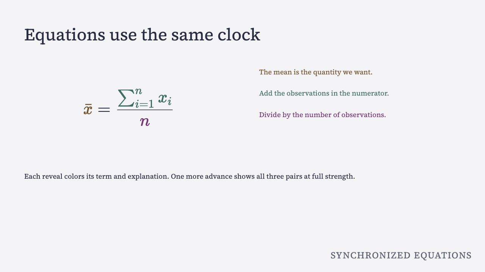
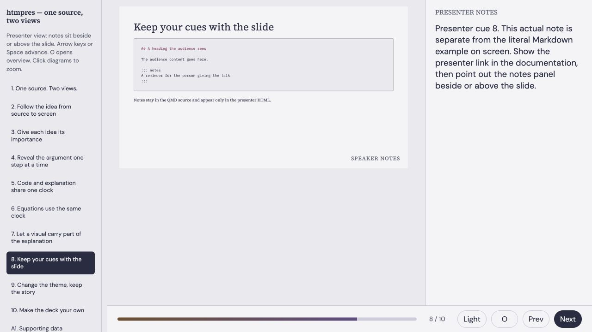

Write slides and speaker notes in one Markdown file. htmpres builds a browser
presentation with a separate presenter view.

```{=html}
<div class="home-actions">
  <a class="btn btn-primary" href="quickstart.html">Start a deck</a>
  <a class="btn btn-outline-primary" href="example.html">Learn from the Markdown</a>
  <a class="btn btn-outline-primary" href="compare.html">Compare all 38 themes</a>
</div>
```

## Reveal an equation in steps {#home-example}

[](example.qmd?slide=6)

The mean, total and count appear with their explanations as you advance. The
last step shows all three colored pairs together. [Try the equation steps and
read their Markdown](example.qmd?slide=6). The [syntax reference](syntax-reference.md)
collects the marks used to build them.

htmpres uses Quarto Markdown (QMD) to build a custom HTML slide deck with an
outline, progressive reveals and zoomable media. Choose a theme without editing
a stylesheet.

## Write, preview and present

```{=html}
<div class="home-grid">
  <article><span class="eyebrow">01 · Write</span><h2>Write your slides</h2><p>Write slides with level-two headings, use fenced blocks for layouts, and keep speaking cues in notes.</p></article>
  <article><span class="eyebrow">02 · Preview</span><h2>Preview while you write</h2><p>Run the live preview. Save your Markdown, styles or assets to rebuild the deck and reload the audience and presenter pages.</p></article>
  <article><span class="eyebrow">03 · Present</span><h2>Present with notes</h2><p>Share the audience page. Open the presenter page for the same slides with notes beside them.</p></article>
</div>
```

[](_generated/decks/nocturne/light/presenter.html#/8)

Audience HTML contains the slides. Presenter HTML adds your cues and navigation.
[Open the presenter view](_generated/decks/nocturne/light/presenter.html#/8), or
[create your first deck](quickstart.qmd). Both views come from the same Markdown
file. Share the audience output when notes should stay private.

## Compare themes

The comparison page holds the content constant while you change theme and mode.
It starts with **Nocturne** and **Simplex Reading**, then lets you explore
Bootstrap, Bootswatch, Elegant, Reading, Tufte and the original htmpres seeds.

[Open the theme comparison](compare.qmd)

## Match charts to your blog or slides

[Plotfoundry for Python, R and JavaScript](plotting-packages.md) coordinates chart
fonts, backgrounds and scientific palettes with the nine Elegant, Reading and
Tufte themes. Use qualitative colors for categories, sequential scales for
ordered values, and diverging scales around a meaningful midpoint.

Choose the same theme and mode as your blog or deck, then select reading or
presentation sizes. [Compare the visible chart examples](plotting-packages.md)
or [browse all 72 configurations](plotting-gallery.qmd). The packages also work
independently of htmpres. Installation uses pinned, unreleased reference source.

## Authoring guides {#find-your-next-step}

- [Start a deck](quickstart.qmd): make a first talk with a bundled theme, live preview and speaker cues.
- [Learn from the Markdown](example.qmd) to step through examples and copy their actual source.
- [Complete syntax reference](syntax-reference.md): every deck setting, class and attribute, with examples.
- [Semantic authoring](semantic-authoring.md): importance, reveals, code, equations and appendix links.
- [Authoring CLI](authoring-cli.md): create, inspect, edit and preview decks.
- [Class reference](quarto-class-map.md): the supported layout and interaction vocabulary.
- [Customization reference](build-a-deck-from-markdown.md): optional theme, layout and runtime overrides.
- [Install the extension](quarto-extension.md): set up htmpres in a presentation project.

[Pictures and slide patterns](patterns.qmd) shows backgrounds, full-slide images,
left/right layouts and attributions with their editable source.

This documentation site is built with **SmallDocs and Nocturne**. The slide decks
are built with **Quarto and the htmpres custom HTML renderer**. Quarto runs the
build script, and Pandoc converts Markdown fragments. htmpres writes the HTML
and browser controls.
