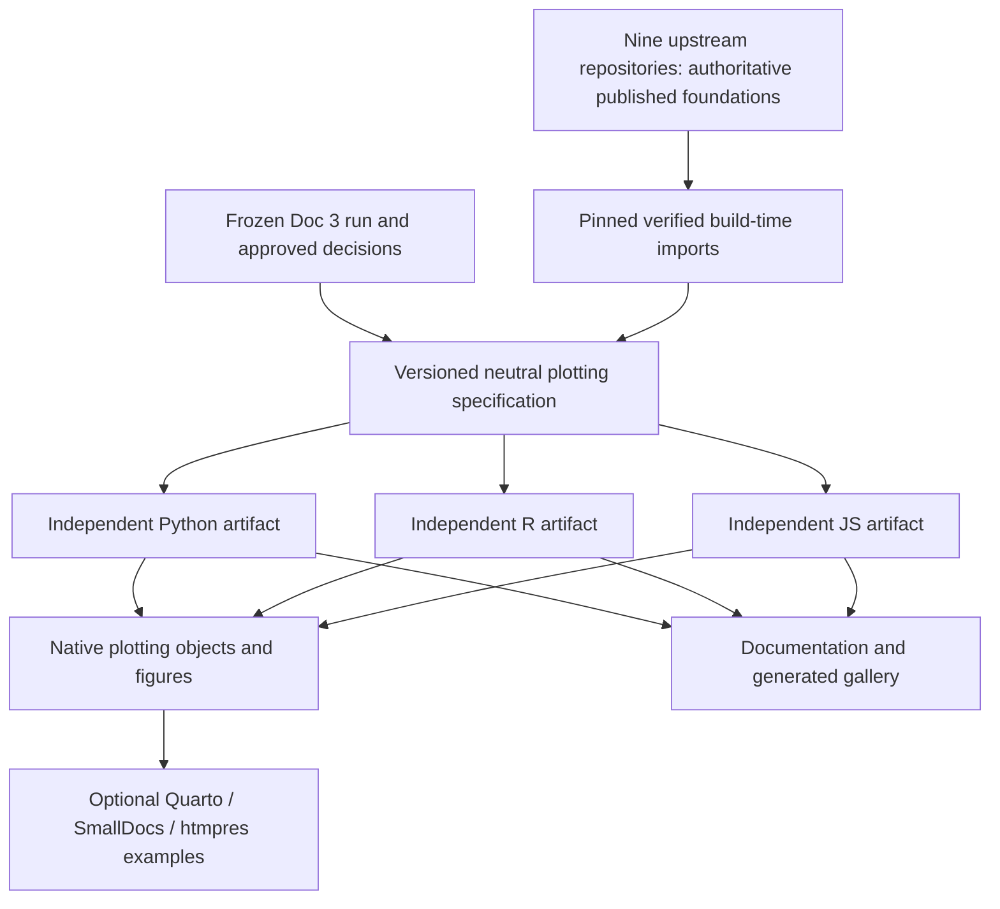

# Standalone plotting ecosystem: next-phase plan

**Status: identity scaffolds (piece 1) and the standalone approved scientific contract (piece 2) are implemented; the Python reference (piece 3) and R reference (piece 4) are implemented; the Python/R website documentation (piece 4a) is published at `0ae4354c`; the JavaScript reference (piece 5) is independently reviewed at commit `e2a0dc0`, with PR26 awaiting merge. Piece 5a has implemented practical Python/R tutorials and is in independent review; the rewrite is not yet published. Other adapters and integrations are not implemented.** This document plans phase 6, tracked by parent task `vxltssko`. Delivery is organized in iteration `wkssvzoo`; the planning leaf is `rlpsynzs` and identity-scaffold leaf is `ruzntmky`. The agreed Doc 3 recommendations are the scientific baseline. This plan does not begin implementation or publish anything. After each independently reviewed piece, the parent presents the result and the user selects the next piece; only genuinely unresolved or changed decisions return for design review.

The repository will be a monorepo containing independent plotting pieces. They must work with plain Python, R and JavaScript, and in Quarto or SmallDocs, **without installing, importing, running or naming htmpres as a package dependency**. The htmpres website hosts their documentation. Hosting and repository location do not create a runtime dependency.

## Navigation

- [Boundaries and layout](#boundaries-and-layout)
- [Shared scientific contract](#shared-scientific-contract)
- [Native conversion and support tiers](#native-conversion-and-support-tiers)
- [Small delivery pieces and review gates](#small-delivery-pieces-and-review-gates)
- [Distribution and release rules](#distribution-and-release-rules)
- [Verification and documentation matrix](#verification-and-documentation-matrix)
- [Execution and decisions still required](#execution-and-decisions-still-required)

## Boundaries and layout

Piece 1 selected **Plotfoundry** as the neutral umbrella and `plotfoundry` as the Python distribution/import, R package and npm identity. The dated [registry observations](../../packages/name-availability.json) show observed absence, not reservation, ownership or trademark clearance. Minimal independent identity scaffolds exist; nothing is published. Directory labels below remain structural labels; the scientific schema/data artifact and Python/R references are implemented; other adapters/integrations remain unimplemented. No neutral plotting package imports `_extensions/htmpres`, relies on its catalog loader, or requires its CLI. The existing private root npm project and `_extensions/htmpres` path remain intact.

```text
packages/
  spec/                  # approved plotting schema, data, provenance and notices
  python/                # independent pyproject, src layout, optional adapters
  r/                     # independent DESCRIPTION, R/, inst/, tests/
  javascript/            # independent public package.json, ESM exports, assets
integrations/            # optional; examples/helpers, not core dependencies
  quarto/
  smalldocs/
  htmpres/
fixtures/plotting/       # shared small public datasets and expected contracts
examples/plotting/       # runnable native Python/R/JS sources and project recipes
docs/                    # existing website plus incremental plotting guides/gallery
research/theme-audit/    # frozen evidence; not a package runtime resource tree
_extensions/htmpres/     # existing independent slide consumer, unchanged identity
package.json             # existing private local wrappers, not the JS package
```

Avoid prematurely splitting every Python adapter into a separate wheel. One independently installable Python package can provide optional extras/modules for Matplotlib, Altair, Plotly and compatibility adapters; R and JS have their own native packages. Heavy renderer/export dependencies stay optional and are imported only by their adapters. Package installation must not require a different language toolchain merely to read a palette or use one native backend.



Arrows mean build/consumption dependencies. No arrow returns from a document renderer or website to a plotting package. Native objects and exported images also work in scripts, notebooks and applications outside these integrations.

The nine upstream repositories remain authoritative for foundation colors, roles and source typography. Import their published `foundations.json` at explicit merged commits, validate schema/references, preserve exact bytes and record hashes. Never infer authoritative values from rendered CSS. Publish approved plotting decisions as a separate shared artifact with explicit links to those manifests and evidence. Do not turn the research scripts into a runtime dependency or silently edit upstream contracts to suit a renderer.

Keep the [frozen research run](../../research/theme-audit/runs/foundations-2026-11-09/decision-registry.json), its samples, font-resolution records, provenance and evidence unchanged. Promotion copies approved data into `packages/spec` through a reproducible reviewed import. Later decision changes produce a new specification version and evidence reference. The foundation schema and plotting schema have distinct compatibility/version responsibilities.

## Shared scientific contract

The following is the agreed Doc 3 baseline, not an assertion that packaging or universal accessibility has been validated. The [design-language rationale](../../research/theme-audit/01-design-language.md), [presentation-color rationale](../../research/theme-audit/02-presentation-color.md) and [scientific palette report](../../research/theme-audit/03-scientific-palettes.md) remain the design sources.

### Roles and typography

Separate theme furniture from data encoding. Paper/panel, primary ink, secondary metadata, axes and meaningful boundaries have explicit jobs. Brand, UI states and data categories are not interchangeable. Chart UI can deliberately use the approved resolved sans face even when the surrounding document has serif prose. Do not substitute a slide's display face or 48px title for an ordinary plot heading.

| Plot role | Reading CSS px | Presentation CSS px |
| --- | ---: | ---: |
| Ticks, axis/category labels, legends | 16 | 24 |
| Plot heading | 30 | 36 |
| Metadata | 14 | 24 |
| Deliberate body annotation | Per-theme reading body: 20 serif / 18 otherwise | 30 |

Reading body annotations retain the per-theme numeric body override: 20px for the serif reading profiles and 18px otherwise; the registry's generic 18px is not a universal override. Defaults derive from numeric contract roles, not duplicated adapter constants. Preserve explicit user overrides. Each adapter documents the translation into native units: Python/R text commonly uses points, browser charts use CSS pixels, and R geometry may use millimeters. A marker size parameter may represent area rather than diameter; native conversion must respect that distinction.

For point-based text and an explicitly placed figure:

`points = desired_css_px × 72 × figure_width_inches / placed_width_css_px`

The frozen reference uses an 8-inch figure placed at 640px reading or 1152px presentation. These are reference placements, not hidden global requirements. Accept explicit dimensions; DPI affects raster resolution, not the intended placed typography. Keep the declared canvas and margins; tight cropping must be an explicit option because it changes the placement relationship.

### Categorical treatment

The recommended default is `colorblind-subset-3`; `colorblind-subset-5` is an explicit conditional alternative. The latter's lower simulated separation and density/occlusion risks remain documented. Each variant has its own capacity and stable slots; three is not a global limit on the explicitly requested five-category variant. No automatic cycling, sorting, palette expansion or recoloring between light/dark modes or figures.

The approved palette is not a supported bare cycle. For the tested line/scatter treatment, preserve:

- 2.5 CSS px colored foreground over a 5.5px theme-ink under-stroke;
- 7px markers with 1.5px theme-ink edges;
- stable marker shapes and dashes, and explicit category labels at endpoints;
- caller-supplied category domains and category-to-slot identity.

Translate shape names and numeric dash arrays through each native adapter, rather than treating Matplotlib marker strings as a universal schema. Validate unique category IDs and per-variant capacity. Theme-only APIs may expose colors for explicit advanced use, but documentation must not present a color list or automatic property cycle as the compliant rendering helper.

Helpers initially cover named, tested plot families: categorical line/scatter, continuous heatmap/scatter and explicit missing-value examples. Bars, filled areas, maps, three-dimensional plots, rasterized aggregation and arbitrary third-party marks need their own treatment and acceptance before being called compliant. Layering must preserve data transforms, ordering, gaps and clipping; duplicated layers must not duplicate legends, hover targets or selections. Direct-label overlap is detected/documented rather than promised solved universally.

### Continuous maps, normalization and missing values

Use the approved sampled `cividis` sequential map and `BrBG` diverging map by default; expose only registry-approved alternatives as public supported options. Diagnostic pools and negative controls remain evidence, not accidental product defaults. Consume explicit sRGB sample positions and interpretation; do not rely on a library's same-named map being byte-identical. The frozen LUT contract uses gamma-encoded sRGB floats, uniform positions and ListedColormap semantics, with no automatic reversal. Diverging maps contain 257 samples produced by componentwise interpolation of the source 256 in encoded sRGB, preserving a shared exact middle sample. Promote those exact approved arrays and define identical discrete lookup/bin-edge rules in every adapter; do not silently interpolate them again through R `colorRamp`, a browser color-space interpolator or a same-named native scheme. Verify endpoints, center and bin boundaries numerically, while avoiding claims of identical rasterization.

Sequential scales require explicit limits. Diverging scales require `vmin < center < vmax` and a documented piecewise mapping sending the meaningful center to 0.5, including asymmetric limits. No automatic dark-mode reversal or automatic symmetry expansion. A renderer's midpoint parameter is not accepted as equivalent without numerical tests. In particular, Plotly's midpoint can be ignored with explicit bounds; adapters must implement the contract with suitable stops or normalized values and honest colorbar labels.

Consume explicit clipping and under/over policies. The current registry clips to endpoint colors. Missing values use the declared fill/ink roles plus a cross/hatch cue, distinct in treatment from a meaningful center. A missing observation in a line normally remains a gap; do not impute zero or invent a missing position merely to color it. Render explicit missing cells/points/legend cues only where the data semantics support them. Hatching or cross overlays require native mark helpers; a colormap alone cannot implement that cue everywhere.

### Fonts and provenance

Bundle licensed resolved faces and all notices. Register/use exact font files and real available weights. Do not silently resolve a host-installed same-family font, synthesize a missing weight, or confuse font family metadata with proof of the rendered file. Matplotlib can bind `FontProperties` to files; R and browsers can use unique registered family aliases backed by bundled files. Inspect text created by guides/colorbars/legends as well as main labels. A renderer unable to guarantee an exact file must declare its limitation rather than report an unverified hash as the actual face.

Preserve the approved chart-font decisions, including explicit portable fallbacks for platform-dependent stacks. Distinguish a declared approved fallback from an unexpected missing-font fallback; expose resolution reports and a strict failure mode. ET Book WOFF-to-sfnt conversion is reproducible build work: preserve names/metrics/notices and record original/output hashes, converter version/settings and resolved face. FontTools is not required at installed runtime merely to use a packaged converted face. Export manifests record the actual files/weights and any outlining/embedding policy; SVG text does not automatically carry its font file.

## Native conversion and support tiers

At **build time**, validate the shared specification, source revisions, hashes, notices and all referenced assets; bundle the necessary immutable resources into each native artifact. Generate browser-ready ESM with explicit file exports and a tested dependency closure. Do not expose a Node-only module as the browser entry or rely on a CDN to rewrite imports in an offline build.

At **runtime**, each adapter reads its installed resources and returns native objects. There is no research checkout, htmpres installation, raw GitHub fetch or central service requirement. Theme-only functions return furniture/configuration; scale functions return explicit mappings/maps/norms; compliant helpers construct supported marks. Global registration or defaults are explicit, with scoped restoration where native APIs permit it. Backends and global application settings are not changed on import.

| Support tier | Native surfaces and scope |
| --- | --- |
| Core, delivered in pieces | Matplotlib/Seaborn and pandas plotting; ggplot2 plus base R helpers; Observable Plot; Vega-Lite/Altair; Plotly.js/Python with separately tested R wrappers |
| Early compatibility | plotnine native theme/scales and tested layered helpers, reusing Python resources but verifying its own precedence/grammar |
| Limited native export | Full Vega config/scales and small native-spec fixtures, separate from Vega-Lite; no universal Vega chart rewriter |
| Later integration | HoloViews/hvPlot explicitly through Bokeh, then direct Bokeh if needed; backend/interaction tests required |
| Demand-led | ECharts and Chart.js full adapters; no implicit parity promise |
| Utilities | D3 and custom renderers consume tokens, samples, mappings and normalization utilities; no universal chart wrapper |

Altair is a Python authoring interface for Vega-Lite. Observable Plot is a distinct JavaScript grammar, not a Vega theme target. Quarto/OJS is an integration environment, not another plotting grammar; its pinned runtime versions and offline imports require explicit testing. Matplotlib contexts do not automatically satisfy all Seaborn/pandas or plotnine mark behavior. Plotly's JSON template is reusable across languages, but wrapper/embedded Plotly.js versions and export behavior are checked separately, especially R.

## Small delivery pieces and review gates

**Stop after every piece unless the user has selected a sequence.** The user has authorized piece 5 followed by piece 5a; no later adapter is authorized. A distinct Sol 6.1 agent conducts substantive independent review of the writer's artifacts, tests and docs. The parent integrates that review and presents the result; the user selects the next piece. No automatic advancement follows a passing test, completed task or merged PR. Docs grow with each piece; piece 11a consolidates them rather than postponing them.

### Delivery task and dependency map

Parent `vxltssko`, iteration `wkssvzoo`, planning leaf `rlpsynzs`. The iteration contains the planning gate plus 20 delivery leaves in 21 phases. The table records current native `blocked-by` prerequisites from the parent's final task snapshot; row order is the selected presentation order. “After” is an execution/review dependency, **not runtime package coupling**. The current graph hard-blocks piece 9 on all adapter leaves listed in its row and consequently blocks downstream release work on them. A smaller release subset is possible only through an explicit user-selected re-scoping and parent dependency review/update before execution; the current graph does not already permit skipping prerequisites. Retain genuine contract dependencies when updating the selected execution order. After that explicit update, a reviewed subset need not wait for adapters excluded from its scope.

| Piece | Gest task | Output | Selected after |
| --- | --- | --- | --- |
| 1 | `ruzntmky` | Boundaries and identities | Planning leaf `rlpsynzs` / user selection |
| 2 | `zyxwokzz` | Shared contract and fixtures | 1 |
| 3 | `nmtpqkkx` | Python reference | 2 |
| 4 | `tsmttwvv` | R reference | 2, 3 |
| 4a | `mlzqvvmv` | Python/R website docs and galleries | 3, 4 |
| 5 | `zzqspzmp` | JS / Observable Plot | 2, 3, 4, 4a |
| 5a | `punnvmwq` | Task-led Python/R tutorial improvement | 5 |
| 6a | `xztkkvxk` | Vega-Lite | 2, 5, 5a |
| 6b | `xyrzryyt` | Altair | 3, 6a |
| 6c | `mxpztosn` | Limited full Vega exporter | 6a, 6b |
| 7a | `rzuvmpkx` | Plotly.js | 2, 5 |
| 7b | `woxltmpl` | Python Plotly | 3, 7a |
| 7c | `owpuzwzn` | R Plotly | 4, 7a, 7b |
| 8 | `rnuwzxyq` | plotnine compatibility | 3, 4 |
| 9 | `qvvxknuw` | Independent document examples | 5, 6b, 7b, 7c, 8, 6c |
| 10a | `slnwyzln` | Release pipelines / CDN / offline artifacts | 9 |
| 10b | `ksnzqslt` | Upstream / slide release catalog | 10a |
| 11a | `llvzuuww` | Website and galleries | 10b |
| 11b | `xqowlnms` | Clean native / container rehearsal | 11a |
| 12 | `wlvvnxll` | Explicit publication / public install verification | 11b + explicit publication authorization |


### 1. Boundaries, identities and minimal package structure — `ruzntmky`

**Prerequisites:** user-approved plan and explicit authorization for this piece. **Outputs:** verify registry/package-name availability, select neutral names, define public identifiers, module/export boundaries, package licenses and version policy; create only the minimal independent package/spec scaffolding and build commands. Keep root npm private and the existing extension untouched. Record runtime/build/optional dependencies and the no-htmpres boundary.

**Review gate:** tiny native install/import smoke examples work outside the checkout without htmpres; dependency audits show no forbidden path/import or language-toolchain coupling. Scaffold names and future registry ownership are reviewed without creating accounts or publishing. **Docs/examples:** architecture/install skeleton and plain Python/R/JS hello-world paths, clearly marked unreleased.

### 2. Promote the shared plotting contract and fixtures — `zyxwokzz`

**Prerequisites:** reviewed piece 1 and user selection of this piece; promote the agreed Doc 3 baseline. **Outputs:** versioned schema/data artifact, exact pinned nine-manifest imports, approved registry/maps/fonts/notices, portable cue definitions, fixture datasets, expected values and provenance. Preserve the frozen run. Add deterministic import/build validation; no runtime research generator.

**Review gate:** schema/ref/coverage/hash/license checks; approved-only palette exposure; capacity, font and unit contracts; mutation tests prove downstream jobs derive from data. Define golden normalization values and placement calculations. **Docs/examples:** design Docs 1/2/3 rationale, map-selection and categorical guidance, machine-readable contract reference and evidence links.

### 3. Python reference: Matplotlib, Seaborn and pandas — `nmtpqkkx`

**Prerequisites:** piece 2. **Outputs:** independent wheel/sdist, data loader, scoped rc/context, category-domain mapping, sampled maps/norms, supported under-stroke/edged-marker helpers, exact-font styling and export report. Add ordinary Matplotlib, Seaborn and pandas examples without a document engine.

**Review gate:** install built wheel and wheel rebuilt from sdist in clean environments outside the repo; nested/exception context restoration, no import side effects, exact fonts despite conflicting host families, missing values, placement and PNG/SVG/PDF acceptance. Exercise all 36 configurations on both paper and panel backgrounds (72 cases) for the advertised adapter surfaces. **Docs/examples:** install/API/tutorial/font/export/offline pages and generated reference gallery; explain which Seaborn/pandas artists require the helper.

### 4. R reference: ggplot2 and base R helpers — `tsmttwvv`

**Prerequisites:** shared contract and reference expectations from piece 3. **Outputs:** independent R source package; native theme/manual scales/continuous scales, supported layered geoms, exact-font/device setup and base R named palette/scales/scoped furniture helpers. Explicit categories rather than implicit session-wide palette mutation.

**Review gate:** installed archive in a clean R library; numerical normalization and size parity, native theme/scale precedence, 36 configurations on both paper and panel backgrounds (72 cases), fonts/notices and chosen raster/vector device exports. Test global state restoration where helpers change it. Local R/Quarto are available; package use itself requires neither Quarto nor Python. **Docs/examples:** ggplot2 and base R quickstarts, unit differences, font devices and downloadable native source.

### 4a. Publish Python/R website guides and galleries — `mlzqvvmv`

Implementation checkpoint: standalone overview/Python/R guides and all 72 configurations across 216 interface views, with reviewed static assets, closed publication validation and browser verification. Published and deployment-verified at `0ae4354c`. No registry publication is implied.

**Prerequisites:** reviewed R reference and the existing user authorization to publish Python/R documentation immediately afterward. **Outputs:** publish installation, native API, font/device/export/offline guides and reproducible galleries for the completed Python/R references on the htmpres website. Reuse installed examples and verified specimens; clearly distinguish unreleased source artifacts from registry availability. No new adapter implementation.

**Review/acceptance gate:** distinct Sol writer/reviewer, strict website build/link/asset allowlist checks, actual browser review and deployed-page verification after integration. This user-authorized immediate documentation slice precedes JavaScript; piece 11a remains later full-ecosystem consolidation. No automatic advancement.

### 5. Browser JavaScript reference: Observable Plot — `zzqspzmp`

**Prerequisites:** shared contract and approved package names; no R/Python runtime dependency. **Outputs:** browser-ready ESM, options/scales/domain functions and supported layered Plot mark helpers; local font assets and plain HTML example. Keep the compiled dependency closure usable offline; optional bundler consumption also works.

**Review gate:** import the packed npm artifact in a clean plain browser project; no Node globals, remote imports or htmpres; 36 configurations on both paper and panel backgrounds (72 cases), exact font loading, hover/legend/label/layer behavior and documented static browser export. Verify network-off use after setup. **Docs/examples:** plain HTML/ESM and Observable examples, explicit domains, font loading and browser/static differences.

### 5a. Improve Python/R task-led tutorials — `punnvmwq`

**Prerequisite:** reviewed JavaScript piece 5. This user-authorized slice follows JS before another adapter. A distinct Sol writer will teach meaningful native tasks with runnable code/output pairs, native integrations, missing/limit choices and export instructions. A distinct Sol reviewer checks copied examples, reader flow and desktop/mobile results. Follow the nossaifd guide, hard and verbose checks, then manual revision. Do not change scientific policy or native runtime APIs without a separate finding.

### 6a. Vega-Lite native adapter — `xztkkvxk`

**Prerequisites:** shared fixtures and JS/native conversion contracts; selected execution predecessor in the map. **Outputs:** Vega-Lite config/scales/layer helpers. Keep top-level config/composition rules valid and handle facets deliberately. No Altair wrapper or full-Vega grammar work is hidden inside this piece.

**Review gate:** 36 configurations, each on paper and panel surfaces (72 cases); schema/compiled-spec validation, categorical layer interaction, centered scales, missing cues, exact-font limitations and interactive/static export checks. **Docs/examples:** direct Vega-Lite JSON/JS recipes, local assets, offline HTML and converter requirements. Distinct Sol review, parent presentation and user next-piece selection follow.

### 6b. Altair Python adapter — `xyrzryyt`

**Prerequisites:** reviewed Vega-Lite native contract and the independent Python package boundary. **Outputs:** optional Altair module translating the same shared data into native config/scales/layered charts, without a runtime dependency on the JS package or htmpres. The common specification is bundled independently.

**Review gate:** clean installed Python artifact, 36 configurations on both paper and panel backgrounds (72 cases), native schema/compiled-spec parity, facets/interaction, actual fonts and supported static/offline HTML export. **Docs/examples:** plain Altair Python tutorial, downloads and version compatibility with Vega-Lite/converter. Stop after distinct Sol review; user selection is required before 6c.

### 6c. Limited full Vega exporter — `mxpztosn`

**Prerequisites:** shared contract and native fixtures, separately selected after the preceding review; no assumption of Vega-Lite grammar compatibility. **Outputs:** limited full-Vega config/scales exporter with native grammar fixtures. This is an independent authorized delivery unit, not a universal Vega chart rewriter.

**Review gate:** its own Vega schema, scale values and promised configuration coverage, including paper/panel cases; native fonts/export/interaction acceptance for the advertised fixtures. If advertised as a full adapter, apply all 36 configurations on two surfaces (72 cases); otherwise state the exact limited coverage. **Docs/examples:** native Vega specification and exporter example with explicit scope, installation and renderer/export prerequisites. Stop after distinct Sol review and parent presentation.

### 7a. Plotly.js native adapter — `rzuvmpkx`

**Prerequisites:** shared fixtures and normalization expectations; user selection after the selected predecessor. **Outputs:** native template, explicit scales/domain mappings and supported paired-trace helpers.

**Review gate:** installed JS artifact and 36 configurations on paper/panel backgrounds (72 cases); asymmetric center parity with explicit bounds; no duplicated hover/legend/selection behavior; exact-font handling, interactive HTML and supported browser/static exports. **Docs/examples:** plain JS source, browser ESM/offline recipes and trace/export limitations. Stop for distinct Sol review and user selection.

### 7b. Python Plotly wrapper — `woxltmpl`

**Prerequisites:** reviewed Plotly native contract and independent Python package. **Outputs:** optional Python wrapper using the same bundled native data; no runtime JS-package or htmpres installation dependency.

**Review gate:** clean Python install, native JSON/value parity and 36 configurations on paper/panel backgrounds (72 cases); wrapper/Plotly.js compatibility, exact fonts and interactions. Static export checks browser/Kaleido dependencies; disclose WebGL raster content in nominal vector outputs. **Docs/examples:** Python interactive/static/offline recipes and downloads. Stop for distinct Sol review and user selection.

### 7c. R Plotly wrapper — `owpuzwzn`

**Prerequisites:** reviewed native contract and independent R package. **Outputs:** separately version-tested R wrapper, without assuming `ggplotly()` preserves the required treatment or relying on Python at runtime.

**Review gate:** clean R install, native JSON/value parity and 36 configurations on paper/panel backgrounds (72 cases); exact fonts, legends/hover/selection and supported interactive/static export path. Record wrapper/Plotly.js versions and R documentation/support limitations. **Docs/examples:** native R code and precise export prerequisites; `ggplotly()` is a separately tested convenience if included. Stop for distinct Sol review and user selection.

### 8. Early compatibility: plotnine — `rnuwzxyq`

**Prerequisites:** shared contract and working Python reference. **Outputs:** optional native theme/scales and supported layered plotnine helpers, reusing package assets. No assumption that rc defaults alone style the grammar correctly.

**Review gate:** installed compatibility extra, explicit limits and 36 configurations on both paper and panel backgrounds (72 cases) for advertised surfaces; precedence, fonts, categories, exports and user overrides tested. **Docs/examples:** plotnine quickstart and precise differences from Matplotlib/ggplot2. HoloViews/hvPlot, direct Bokeh and demand-led JS adapters remain later tasks, not hidden work in this piece.

### 9. Independent document integration examples — `qvvxknuw`

**Prerequisites:** relevant native adapters passed; each integration can be reviewed separately. **Outputs:** standalone Quarto and SmallDocs examples for the native tools, plus htmpres integration examples as an optional consumer. A plain Quarto/SmallDocs user installs only the selected plotting package and document theme. Do not route those examples through htmpres helpers or distribute a full Bootstrap CSS file into Quarto.

**Review gate:** fresh consumer projects, pinned local/package assets, correct placement/modes/fonts and no htmpres dependency in ordinary Quarto/SmallDocs examples. Verify newly built installed artifacts, not a dirty tree's last committed installation. Preserve independent nine-theme extension installs and stock/legacy slide behavior. **Docs/examples:** copyable projects, native code, resulting HTML/images and per-environment install instructions; describe light/dark selection and export placement explicitly.

### 10a. Release pipelines, CDN and offline artifacts — `slnwyzln`

**Prerequisites:** piece 9 and the chosen release scope passed all current graph prerequisites. A smaller adapter subset requires the explicit re-scoping/dependency update described above before reaching this piece; it is not an implicit bypass. **Outputs:** artifact-build and dry-run publication pipelines for versioned Python wheel/sdist, R source archive, npm tarball/browser bundle, shared specification/offline archives, checksums/notices and release manifests. Define CDN paths and compatibility metadata without pretending unpublished URLs exist.

**Review gate:** pipeline dry runs, artifact contents/hash/provenance checks and basic outside-checkout installs; browser ESM and offline dependency closure verified. No registry upload, account creation or website deployment. **Docs/examples:** candidate install/download instructions, checksums and release operator guide. Credential ownership is an eventual publication decision, not requested now. Stop for distinct Sol review and user selection.

### 10b. Upstream and slide-extension release catalog — `ksnzqslt`

**Prerequisites:** reviewed artifact/version policy and pinned upstream imports. **Outputs:** catalog aligning nine upstream theme revisions, published manifest hashes, plotting-spec/package versions and the htmpres slide extension. Preserve each repository's authority, tag/install path and independent versioning; no central runtime dependency or forced synchronized nine-repository release.

**Review gate:** catalog matches actual reviewed source/artifact bytes; Quarto/SmallDocs and htmpres tagged-extension installation paths remain correct; generated files/notices and compatibility boundaries are complete. Actual publication belongs to piece 12. **Docs/examples:** consumer compatibility/install matrix and source-to-artifact provenance, with no private sources in downloads. Stop for distinct Sol review and user selection.

### 11a. Unified website and generated galleries — `llvzuuww`

**Prerequisites:** selected adapter documentation already exists and release-candidate artifacts/catalog passed the preceding review. **Outputs:** consolidated website navigation, per-adapter generated galleries, code/download links, compatibility/migration notes and release checklist. Include all nine families, modes, profiles and paper/panel cases for full adapters; state limited-adapter coverage. Link Docs 1/2/3 rationale and evidence without publishing private inputs.

**Review gate:** existing website build/crawl plus adapter-gallery assertions, browser review, download/asset/license and placement checks; only allowlisted public sources/resources. No public deployment in this piece. **Docs/examples:** consolidated public guides and downloadable native example bundles. Distinct Sol review is integrated and presented by the parent before user selection of the next piece.

### 11b. Clean native and optional container release rehearsal — `xqowlnms`

**Prerequisites:** reviewed candidate package subset, release catalog and website/example sources. **Outputs:** reproducible end-to-end release rehearsal from built artifacts in clean Python/R/JS consumers and optional pinned containers; test report tying all artifact hashes and renderer versions to results.

**Review gate:** wheel plus wheel-from-sdist, R archive and npm tarball installs outside the checkout; native independent runs, conflicting host-font tests, supported exports and gallery examples. Disable network after dependency setup and test the complete browser/runtime asset closure. Container success does not replace supported-platform checks. This piece neither builds unreviewed features nor publishes. **Docs/examples:** rerunnable native/container commands, expected outputs, offline instructions and resolved limitations. Stop for distinct Sol review, parent presentation and user selection.

### 12. Explicit publication and public-install verification — `wlvvnxll`

**Prerequisites:** chosen release subset passed rehearsal, distinct Sol review cleared findings, and the user explicitly authorized publication. Confirm required credentials/ownership and exact versions/destinations at this gate; do not request them during planning.

**Outputs:** approved release/tag and registry/CDN artifacts, website deployment and public release record for the selected scope. Publication is not implied by artifact building, a merged PR, a green gallery or completion of another task. **Review gate:** a separate Sol reviewer verifies actual public installs/download hashes/notices, exact CDN paths, fonts, standalone/offline behavior and live documentation against the approved artifact ledger; parent integrates and reports the evidence. Record any publication blocker rather than claiming release completion. **Docs/examples:** versioned public install recipes, release notes, compatibility/migration table and verified downloadable native examples. No automatic follow-on adapter or phase begins.

## Distribution and release rules

| Surface | Proposed channel | Offline/reproducibility rule |
| --- | --- | --- |
| Python | PyPI wheel and sdist; release downloads | Resources bundled; optional renderer extras; exact versions and wheel-from-sdist test |
| R | Tagged release source archives, then r-universe; CRAN later if justified | Preserve downloadable versions/checksums; r-universe snapshots or source commit for reproducibility |
| JavaScript | Public npm package and exact-version jsDelivr convenience | Packed browser-ready ESM plus local complete dependency/assets bundle |
| Shared specification | Versioned package/release artifact, bundled by consumers | Same approved data hash visible in all native reports; no runtime fetch |
| Nine document themes | Existing independent per-repo Quarto/SmallDocs installs and tagged archives | Published compiled extensions, manifests/fonts/notices; independent rebuild/test |
| htmpres | Existing tagged Quarto/Deno utility extension and starter paths | Keep `_extensions/htmpres`, optional Node wrappers and local math/theme assets |

Native package identities are selected as Plotfoundry/`plotfoundry`; prerelease scaffold versions are recorded in each package. Registry accounts, final release versions and public artifact URLs are not assigned. Each language package versions independently; manifests record compatible schema/data versions and adapter/native renderer versions. A new renderer release need not force all nine upstream repositories to release. Reject unsupported schema majors; record explicit migration policies for category identities, palette samples, fonts, native object shapes and export geometry.

Use registry installs for native users, CDN URLs for optional browser convenience, and release archives for downloads. Raw GitHub URLs are source/development references, not the primary production runtime. Never use mutable `main`, `latest` or version-range CDN links in reproducible examples. Exact CDN versions may be permanently cached: publish a new version rather than replacing files. Browser asset paths must remain valid when vendored locally; no hidden CDN font, JS, MathJax, map or data dependency in an offline claim.

Keep private source snapshots, raw books, private datasets and ignored source presentations out of packages, release bundles, Docker contexts and public website resources. Publish only allowlisted small fixtures, licensed assets and approved derived evidence. The htmpres website currently publishes only `docs/_site`; extend its page/resource allowlist deliberately, not by uploading the repository.

## Verification and documentation matrix

A **full adapter** covers nine families × two modes × two profiles = **36 configurations**, each exercised on both paper and panel surfaces: **72 reference cases**. Every piece gate referring to 36 configurations includes those two surfaces; neither may be omitted or collapsed because colors happen to match. This is data/structural coverage, not a demand for hand-written prose or manual screenshots for every cell. Generate deterministic specimens and expected values. Missing values, explicit domains, category counts 1/3/conditional-5, asymmetric diverging limits, fonts and placement are scenario dimensions beyond those 36 configurations.

Separate gates:

1. **Contract/value parity:** samples, category slots, normalization values, unit conversion, role coverage, source hashes and fonts/notices.
2. **Native behavior:** precedence/user overrides, context state, data ordering/gaps, layers, legends, hover, selection, facets and supported mark limits.
3. **Rendered acceptance:** actual typography/faces, geometry, labels, cue visibility, overlap and responsive/placed behavior. Compare screenshots within an adapter; do not promise pixel-identical antialiasing across renderers.
4. **Exports:** PNG/SVG/PDF/interactive HTML as supported, fixed canvas, embedding/outlined-font policy, transparency and missing cues. A file extension alone does not establish vector or font portability.
5. **Installation/offline:** wheel/sdist, R archive, npm tarball, outside-checkout examples, conflicting host fonts, fresh libraries/caches and network disabled after dependency setup. Test browser ESM separately from Node imports.
6. **Documentation:** public page/resource allowlist, complete local crawl, downloads, code provenance, generated galleries, no presenter-note/private-source leakage and versioned install commands.

The website should expose design rationale and palette choice guidance, then native install/API recipes, fonts, normalization/missing values, export, offline, compatibility and migration. Attach runnable and downloadable code to each example. A selectable gallery generates combinations from shared fixtures; it must show adapter/version, theme/mode/profile, placement and known limitations. Documentation lives on the htmpres website but must state prominently that plotting packages are standalone.

Docker is optional infrastructure for reproducible checks, not a required user runtime. Pin image/toolchain versions, include only public sources/assets, and distinguish dependency setup from the offline execution phase. Local R and Quarto are already available. Browser exporters and system font/device differences still need explicit supported-platform checks; a Linux image does not certify every platform or a physical projector.

## Execution and decisions still required

Every phase is implemented by a Sol 6.1 agent and independently reviewed by a different Sol 6.1 agent. The writer and reviewer are distinct. The parent only orchestrates, gives course corrections, integrates and communicates with the user; it does not implement or substitute its own review for the independent Sol review. This plan itself is Sol-authored and independently Sol-reviewed. Assign workers by package or integration layer, not by theme. Work one piece at a time, with no automatic phase advancement; the parent integrates the distinct Sol review and presents the result; the user selects each next piece. Sequential work with one active writer is the default. If later independent pieces run concurrently, use separate physical worktrees, explicit file ownership and parent integration gates. The parent owns Gest decomposition, branch/commit/PR/publication decisions and records review/acceptance before each next piece.

Pieces 1–3 have selected neutral names, promoted the approved standalone scientific contract and implemented the Python reference; other native adapters, integrations and release-scope selection remain later gates. The agreed Doc 3 recommendations are the baseline; only genuinely unresolved or changed decisions return for user review. Before publication: confirm registry ownership/credentials, release versions, signing/attestation choices if adopted, support versions and public artifact destinations. These are future decisions, not permission requests in this planning checkpoint.

**Tag classification:** phase 6 remains under the existing plotting-package workstream; the parent records existing vocabulary and any new tags when creating leaves. **Dependency impact:** this plan changes no callable code. Implementation tasks must inspect dependers for the shared schema, adapter APIs, asset staging, native exports, integration examples and website allowlists; coupled surfaces must be covered before completion.

## Primary implementation references

These document native capabilities; support is established by the tests above, not by copying a configuration object alone.

- [Matplotlib contexts](https://matplotlib.org/stable/api/matplotlib_configuration_api.html), [font files/registration](https://matplotlib.org/stable/api/font_manager_api.html), [Seaborn theme behavior](https://seaborn.pydata.org/generated/seaborn.set_theme.html).
- [ggplot2 themes](https://ggplot2.tidyverse.org/reference/theme.html), [manual scales](https://ggplot2.tidyverse.org/reference/scale_manual.html), [R font registration](https://systemfonts.r-lib.org/reference/register_font.html).
- [Observable Plot marks](https://observablehq.github.io/plot/features/marks), [Vega-Lite config](https://vega.github.io/vega-lite/docs/config.html), [layer composition](https://vega.github.io/vega-lite/docs/layer.html), [Altair exports](https://altair-viz.github.io/user_guide/saving_charts.html).
- [Plotly templates](https://plotly.com/python/templates/), [explicit bounds/midpoint behavior](https://plotly.com/javascript/reference/scatter/), [static export requirements](https://plotly.com/python/static-image-export/).
- [Quarto extension distribution](https://quarto.org/docs/extensions/distributing.html), [OJS runtime libraries](https://quarto.org/docs/interactive/ojs/libraries.html), [Python artifacts](https://packaging.python.org/en/latest/discussions/package-formats/), [r-universe setup](https://docs.r-universe.dev/publish/set-up.html), [r-universe reproducibility](https://docs.r-universe.dev/install/reproducibility.html), [jsDelivr versioning/caching](https://github.com/jsdelivr/jsdelivr#usage).
