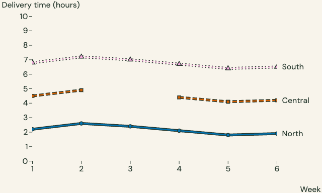
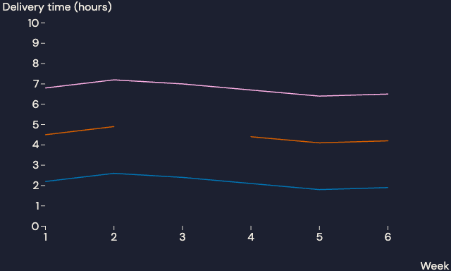
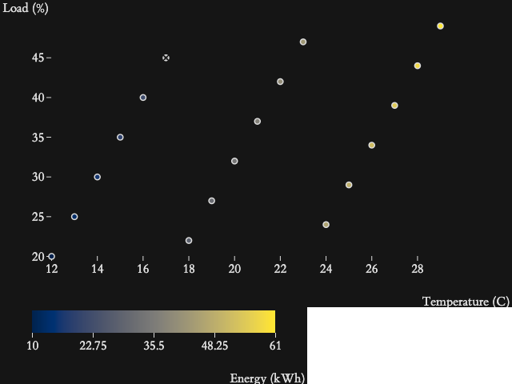
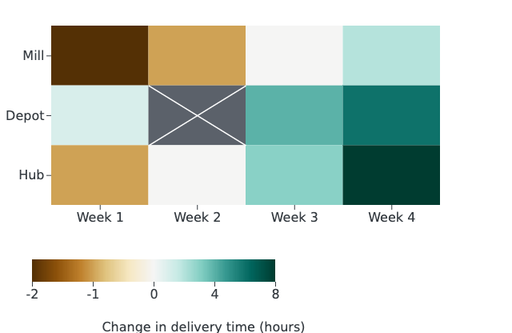

Use Plotfoundry to match an Observable Plot chart to the blog or slides where you will
publish it. Choose from the same nine themes, with bundled fonts and contrasting mark
edges. Qualitative colors identify categories, sequential colors show magnitude, and
diverging colors show values around a meaningful center. The scientific maps keep their
exact sampled colors.

## See the same route data in Folio and Nocturne

The reviewed browser exports below show the same delivery measurements in two themes.
Folio uses the treated line helper. Nocturne uses native Plot lines, so the comparison
also shows what a theme alone supplies.

```{=html}
<div style="display:grid;grid-template-columns:repeat(auto-fit,minmax(min(100%,18rem),1fr));gap:1.25rem">
<figure style="margin:0">
<a href="assets/javascript/deliveries.png"></a>
<figcaption>Folio · light · reading · paper. Treated categorical lines retain shapes, dashes, ink edges and labels.</figcaption>
</figure>
<figure style="margin:0">
<a href="assets/javascript/native.png"></a>
<figcaption>Nocturne · dark · reading · paper. Theme-only native lines retain the category colors, with no helper cues.</figcaption>
</figure>
</div>
```

The background, ink and fonts match each theme. Choose mark treatment separately
from the theme. Use the helper in either theme when categories need its shapes,
dashes, ink edges and direct labels as well as color. [Sequential](#explore-energy-use) and
[diverging](#find-signed-changes) examples below complete the three palette roles.

## Select the configuration used by your document

After installation, choose the same family, mode, profile and surface as your
blog or deck. Replace the `config` assignment in each complete module below
with your choice. Keep its `loadSpec` call and local imports:

```js
// A Folio reading page: intended width 640 CSS pixels.
const config = theme(spec, "folio", {
  mode: "light", profile: "reading", surface: "paper"
});
```
 For a Nocturne slide panel, use this configuration instead:

```js
// A Nocturne slide panel: intended width 1152 CSS pixels.
const config = theme(spec, "nocturne", {
  mode: "dark", profile: "presentation", surface: "panel"
});
```

The [nine family identifiers](plotting-packages.md#match-the-setting-keep-the-scientific-meaning)
work with both modes, both profiles and both surfaces. The [theme gallery](plotting-gallery.qmd)
shows the same qualitative, sequential and diverging specimen across the themes
using reviewed Python and R exports. The JavaScript reference uses the same
scientific contract. The static gallery images are not JavaScript output.

A dark theme changes the chart background, fonts, labels, axes and ink edges. It does
not recolor cividis or BrBG to the theme's brand accents or reverse their meaning. Keep
category domains, numeric limits and the diverging center the same when charts compare
the same measurements.

## Choose a palette role

| Data meaning | Complete JavaScript example | Palette and treatment |
| --- | --- | --- |
| Unordered categories | [Delivery routes](#compare-routes) | Three qualitative slots with shapes, dashes, ink edges and direct labels |
| One ordered quantity | [Energy use](#explore-energy-use) | Sequential cividis with explicit limits and a crossed missing point |
| Change around a center | [Delivery-time change](#find-signed-changes) | Diverging BrBG with an explicit zero center and crossed missing cells |
| Existing native chart | [Native Plot lines](#adapt-native-plot) | Matching furniture and fonts; native marks retain their own treatment |

A chart's furniture includes its axes, labels, grids and legends. The native route
applies matching furniture and fonts. The helpers also add mark treatment.

All examples use invented local observations. Each complete module matches its installed
source example. The package is an unreleased reference, with no npm or CDN publication
implied. It runs in a browser or Quarto Observable JavaScript (OJS), independently of
htmpres, Python and R at runtime.

## Install and run

Install from the reviewed repository revision. The commands below create a checkout and
print its revision and package version:

```sh
git clone --no-checkout https://github.com/rahuldave/htmpres.git plotfoundry-source
cd plotfoundry-source
git checkout 0787d97961c938aece8e6d58639ec1ed3ea79f87
git rev-parse HEAD
cd packages/javascript
node --input-type=module -e 'import fs from "node:fs"; const p=JSON.parse(fs.readFileSync("package.json")); if(p.version!=="0.1.0-dev.1") throw Error("Use the source revision for this guide"); console.log(p.version)'
```

The checkout selects the reviewed Git revision for version `0.1.0-dev.1`.
Record the printed revision with your work, and stop if the version differs.
The package has no npm release. Build its local archive with:

```sh
npm pack --ignore-scripts
```
 The archive includes the browser bundle, so you do not need a build step. The
repository's private root npm package is not installed. Keep the recorded source
revision with your work. In a new project outside that checkout, run:

```sh
npm init -y
npm install --offline --ignore-scripts /absolute/path/plotfoundry-0.1.0-dev.1.tgz
```

Copy the installed package's `examples/standalone/` files into your new project
root. Each example has an HTML file and a JavaScript module. Serve the new
project over HTTP, then open `deliveries.html`. For example, a development server
may use `python3 -m http.server 8000`. Python is only one server choice.

To write a page yourself, save the module below as `deliveries.js` and use
this HTML file in the same project root:

```html
<!doctype html><meta charset="utf-8"><title>Delivery times</title>
<style>#chart{overflow:auto}svg{max-width:none}</style>
<div id="chart"></div><p id="downloads"></p>
<script type="module" src="./deliveries.js"></script>
```

For package-aware build tools, imports such as `plotfoundry` and
`plotfoundry/observable` select the same modules. Plain browsers use the local
paths in these examples. After setup, the examples load libraries from local
paths without fetching external libraries.

## Compare routes


Start with three named routes and delivery time in hours. Set the category domain, the
ordered list that fixes each route's slot. A route keeps its slot even when it is absent
after filtering. Missing observations leave gaps, with no connecting segment or zero
replacement.

```js
import {loadSpec, theme} from "./node_modules/plotfoundry/src/index.js";
import {line, plot, loadFonts, stylePlot, watchPlot, exportSvg, exportPng}
  from "./node_modules/plotfoundry/src/observable.js";
const spec = await loadSpec();
const config = theme(spec, "folio", {mode: "light", profile: "reading"});
const fonts = await loadFonts(config);
const deliveries = ["North", "Central", "South"].flatMap((route, i) =>
  [1,2,3,4,5,6].map((week, j) => ({route, week,
    hours: route === "Central" && week === 3 ? null :
      [2.2,2.6,2.4,2.1,1.8,1.9][j] + i * 2.3})));
const chart = plot(config, {
  height: 384, x: {label: "Week"},
  y: {label: "Delivery time (hours)", domain: [0,10]},
  marks: line(config, deliveries, {
    x: "week", y: "hours", category: "route",
    domain: ["North", "Central", "South"]
  })
});
stylePlot(config, chart);
document.querySelector("#chart").append(chart);
const observer = watchPlot(config, chart);
function download(blob, name) {
  const url = URL.createObjectURL(blob);
  const link = document.createElement("a");
  link.href = url; link.download = name; link.textContent = "Download " + name;
  document.querySelector("#downloads").append(link, " ");
  // Revoke the URL when your app removes the link.
}
download((await exportSvg(config, chart)).blob, "deliveries.svg");
download((await exportPng(config, chart, {pixelRatio:2})).blob, "deliveries.png");
// When removing the chart: observer.dispose(); fonts.dispose();
```

North improves after week four. Central is slower than North and has no
observation in week three. South stays slower throughout this invented example.
Replace `deliveries` with your rows and change the axis labels to your units.
The download links save the chart without requiring a file API of your own.

The default has three slots. To use five, select the explicit
`variant: "colorblind-subset-5"` option. Five is conditional because the frozen
simulations showed lower separation, and extra marks can obscure each other.
Keep its shapes, dashes, ink edges and direct labels, then inspect your chart.
A variant change can change slot colors. The package never expands a variant
automatically.

## Explore energy use

The next chart asks whether energy use rises with temperature and load. Position shows
temperature and load. Color shows a third measurement in kWh. The sequential cividis
scale has fixed limits, so another chart can use the same color meaning.



```js
import {loadSpec, theme, colorScale}
  from "./node_modules/plotfoundry/src/index.js";
import {plot, scatterValues, legend, loadFonts, stylePlot}
  from "./node_modules/plotfoundry/src/observable.js";
const spec = await loadSpec();
const config = theme(spec, "tufte", {mode:"dark", profile:"reading"});
const fonts = await loadFonts(config);
const sensors = Array.from({length:18}, (_,i) => ({
  temperature:12+i, load:20+(i%6)*5+Math.floor(i/6)*2,
  energy:i===5 ? null : 10+i*3
}));
const scale = colorScale(config, {vmin:10, vmax:61});
const chart = plot(config, {
  height:384,
  x:{label:"Temperature (C)"}, y:{label:"Load (%)"},
  marks:scatterValues(config, sensors, {
    x:"temperature", y:"load", value:"energy", scale
  })
});
stylePlot(config, chart);
document.querySelector("#chart").append(chart,
  legend(config, {scale, label:"Energy (kWh)"}));
// Dispose fonts when removing every chart that uses this session.
```

Energy rises with temperature in these invented observations, while load varies
within that trend. The muted crossed point has a location but no energy value.
Change the `sensors` rows and choose limits for your comparison question.
Keep those limits when you filter the rows.

Values below 10 or above 61 use endpoint colors. Null, undefined and NaN remain missing.
Infinity, booleans and string numeric coercion are rejected. The legend uses the exact
discrete bins, not interpolation between samples. The legend rounds tick labels for
readability. The lookup values do not change.

## Find signed changes

Use a diverging map when a meaningful center separates two kinds of change. Here zero
means no change in delivery time. Faster deliveries reach -2 hours, while slower
deliveries reach +8 hours. The two arms keep those different limits.



```js
import {loadSpec, theme, colorScale}
  from "./node_modules/plotfoundry/src/index.js";
import {plot, heatmap, legend, loadFonts, stylePlot}
  from "./node_modules/plotfoundry/src/observable.js";
const spec = await loadSpec();
const config = theme(spec, "litera-reading", {mode:"light", profile:"reading"});
const fonts = await loadFonts(config);
const values = [-2,-1,0,2, 1,null,4,6, -1,0,3,8];
const cells = values.map((change,i) => ({
  week:i%4, plant:Math.floor(i/4),
  x1:i%4, x2:i%4+1, y1:Math.floor(i/4), y2:Math.floor(i/4)+1,
  change
}));
const scale = colorScale(config, {kind:"diverging", vmin:-2, center:0, vmax:8});
const chart = plot(config, {
  height:320,
  x:{domain:[0,4], ticks:[.5,1.5,2.5,3.5],
     tickFormat:v=>"Week "+Math.floor(v+1), label:null},
  y:{domain:[0,3], reverse:true, ticks:[.5,1.5,2.5],
     tickFormat:v=>["Mill","Depot","Hub"][Math.floor(v)], label:null},
  marks:heatmap(config, cells, {value:"change", scale})
});
stylePlot(config, chart);
document.querySelector("#chart").append(chart,
  legend(config, {scale, label:"Change in delivery time (hours)"}));
```

The Hub has the largest slowdown in week four. The Depot's week-two cell is
missing, while the pale uncrossed cells mean zero change. A symmetric range would allocate negative colors to values absent from this example.
Replace `values` and the plant names while keeping an explicit center and limits.

Cells need finite ordered bounds. The helper keeps the source rows unchanged.
Missing cells use a muted fill and a contrasting cross, so missing and zero
remain distinct. `legend` uses the same asymmetric inverse for every tick.

## Adapt native Plot

You can keep a native Plot chart and apply only its furniture and fonts.
The next module uses native `Plot.line`, with `options` supplying the selected
background, text and axis settings. Native options still control the axes and
mark data.


```js
import {loadSpec, theme, categories}
  from "./node_modules/plotfoundry/src/index.js";
import {Plot, options, loadFonts, stylePlot}
  from "./node_modules/plotfoundry/src/observable.js";
const spec = await loadSpec();
const config = theme(spec, "nocturne", {mode:"dark", profile:"reading"});
const fonts = await loadFonts(config);
const domain = ["North","Central","South"];
const data = domain.flatMap((route,i) => [1,2,3,4,5,6].map((week,j) =>
  ({route,week,hours:route==="Central"&&week===3?null:
    [2.2,2.6,2.4,2.1,1.8,1.9][j]+i*2.3})));
const chart = Plot.plot(options(config, {
  height:384,
  x:{label:"Week"}, y:{label:"Delivery time (hours)",domain:[0,10]},
  color:{domain,range:categories(config,domain,domain).map(slot=>slot.color)},
  marks:[Plot.line(data,{x:"week",y:"hours",stroke:"route"})]
}));
stylePlot(config, chart);
document.querySelector("#chart").append(chart);
// Theme-only native marks: no helper ink edges, shapes, dashes or direct labels.
```

The native lines keep Plot's thin default strokes. Applying a theme alone does
not add shapes, dashes, ink edges or direct labels. To add those cues, replace
the `marks` entry with `line(config, data, {x:"week", y:"hours",
category:"route", domain})` from the first example. Keep your native axis options.

`createPlotAdapter(Plot, {version:"0.6.19"})` accepts an explicitly supplied
module with the tested API shape. The bundled exact version is the default.
A supplied version is caller-declared provenance, not package verification.
Untested versions are rejected.

## Export for your blog or slides

Keep the selected configuration through font loading, chart construction,
styling and export. To adapt the delivery module to a Nocturne slide panel,
replace its `config` assignment with the presentation configuration above and
rebuild the chart. Replace its fixed `height: 384` with `height: config.width * 0.6`
to give the presentation text room. Inspect the final layout at its intended width.

Presentation width is 1152 CSS pixels, with 24-pixel labels and 36-pixel headings.
Reading width is 640, with 16-pixel labels and 30-pixel headings. The first module's
`exportSvg` and `exportPng` calls save the currently selected configuration.
Its PNG uses `pixelRatio:2` for more raster pixels without doubling
the declared placement size.

After downloading the files, embed the reading chart in Quarto Markdown:

```markdown
{width=640px}
```

Use `.png` instead of `.svg` when needed. A blog template can use HTML:

```html

```

Place a presentation export at `width=1152px` in Quarto Markdown, or `width="1152"`
in HTML. Name the file for its selected theme and mode when keeping several
exports. PNG and SVG keep their exported appearance when a page's light or dark
toggle changes. If the document offers both modes, export both
cases and let the document choose its matching image.

Body annotations use 20 pixels for serif reading families and 18 otherwise.
Presentation body annotations use 30. Metadata uses 14 pixels in reading mode.
Use `data-pf-role` to distinguish heading, label, metadata and body_annotation.
`stylePlot(..., {resize:true})` applies their sizes. By default, it preserves
authored sizes and binds the real font face and weight.

`theme(..., {width})` declares another placement width and scales SVG lengths
together. A later CSS resize scales the text with the rest of the picture.
Use the declared width to judge readability, rather than a thumbnail.
The full browser example offers all 72 case selections.

## Use Quarto

Copy `node_modules/plotfoundry/examples/quarto.qmd` into your project root,
then run `quarto render quarto.qmd`. No Python or R engine is used. The OJS cells
import the locally installed package and its pinned Plot, rather than the
implicit Plot version that Quarto supplies.

The imports use `document.baseURI` because OJS evaluates modules from its own
runtime directory. The file includes the same delivery data and a complete
chart cell. Font loading is an explicit dependency, and OJS invalidation
disposes that font session. Serve the rendered directory over HTTP.
Keep its `node_modules/plotfoundry` resource tree when moving the document.

The installed Quarto example is tested with external requests blocked.
`embed-resources` cannot collect resources loaded dynamically by JavaScript.
A local resource directory is part of this offline document, not a remote CDN.

## Fonts and export limits

`loadFonts` registers hash-named faces in the selected Document after an explicit
call. Await it before rendering. Each session has `dispose()`. Concurrent sessions share faces until the last
owner disposes them. Unknown caller registrations
using reserved names are rejected. The package never substitutes a host font
with the same family name.

`stylePlot` binds exact UI or heading files and real weights, then checks visible
glyphs. `watchPlot` applies role sizes and faces to inserted hover text.
Dispose the observer when removing the chart. The native Plot zero-width
separator is layout formatting, not a visible glyph.

The first example creates SVG and PNG download links. Each export clones a single SVG
canvas and leaves the caller's chart unchanged. HTML headings, captions and separate
legends around the chart are outside that canvas. Save those SVGs separately or compose
them in your document.

SVG text becomes paths from the exact bundled files. The result needs no font network
request, but has no selectable text or live hover. PNG rasterizes the same outlined SVG
at an explicit pixel ratio. Its report gives actual canvas dimensions. Resolution does
not change placed typography. The package has no PDF exporter.

Plain Latin text, punctuation and approved glyphs are supported. Math, complex shaping,
missing glyphs, italic or vertical text and external SVG images, filters or HTML are
rejected. Supported text runs keep native offsets, anchors and tspan positions. The
exporter is a tested Plot path, not a universal SVG converter. Dense labels still need
author review.

Helpers accept row objects with numeric Cartesian coordinates and linear paths. They
preserve input order, missing intervals, facet fields and native clipping. Projections
and alternative curves are rejected. Arbitrary filled areas, maps, third-party marks and
automatic label-overlap repair are outside this adapter. Do not infer compliance from a
native theme-only chart.

## Package resources and offline use

The archive includes every spec file, font and dependency notice.
The core import does not fetch, touch the DOM or register fonts. `loadSpec`
checks every immutable resource before parsing. An installed browser consumer
needs no Node runtime. In Node, import `loadSpec` from `plotfoundry/node` to
check that resources are regular files and the resource set is complete.

The current verification uses Node 25.1.0, Chrome 157, Quarto 1.8.26, Playwright 1.65.0
and Pillow 13.0.0 on macOS. Plot 0.6.19 is the tested renderer. The installed-browser
evidence records renderer and Quarto versions. Compatible engine ranges are not a claim
that every version or platform was tested. There is no registry account, package
publication or live CDN promise.

Maintainers run `npm test` and `node tools/check-package.mjs` from this package.
`npm ci --ignore-scripts` installs locked build tools.
Installed consumers do not need these build tools.
`node tools/build-vendor.mjs` rebuilds both browser bundles and notices.
Normal validation does not regenerate files to hide drift. The source lock,
original foundations, ET Book conversion recipe and notices stay included.

The scientific spec remains 0.1.0. JavaScript has its own package version.

API behavior follows [Plot marks](https://observablehq.github.io/plot/features/marks),
[Plot lines](https://observablehq.github.io/plot/marks/line),
[Plot legends](https://observablehq.github.io/plot/features/legends) and
[Quarto OJS libraries](https://quarto.org/docs/interactive/ojs/libraries.html).
The task-led explanation follows the nossaifd guide, including Rosalind Reid's
problem-to-result and explained-figure guidance and Shreya Shankar's plain-writing
guidance. No source prose from those guides is reproduced.


## Download and explore

[Open the local browser example](_generated/javascript/examples/browser.html)
with all 72 case selections. The figure's colors are independent of this site's
page theme. The example can scroll at its intended width on a narrow screen.

Download the complete modules, save each in your installed project root, and use the
HTML wrapper shown above:

- [Delivery times](_generated/javascript/examples/standalone/deliveries.js).
- [Energy use](_generated/javascript/examples/standalone/energy.js).
- [Signed changes](_generated/javascript/examples/standalone/changes.js).
- [Native Plot adaptation](_generated/javascript/examples/standalone/native.js).
- [Quarto OJS source](_generated/javascript/examples/quarto.qmd.txt).
- [Runtime and dependency notices](_generated/javascript/vendor/provenance.json).

The package `resources/data/notices` directory retains the font and upstream
notices. Browser dependencies have their own `vendor/notices` files. Preserve
both directories when distributing a copy. Source comes from the
[JavaScript package directory](https://github.com/rahuldave/htmpres/tree/main/packages/javascript).
There is no npm registry release to install.

Maintainer browser checks need an installed Chrome executable. The default path
is macOS-specific. To select another path, pass `--browser-executable` to the
browser runner. The locked verification recipe provisions Playwright/Pillow
only as developer tools.
