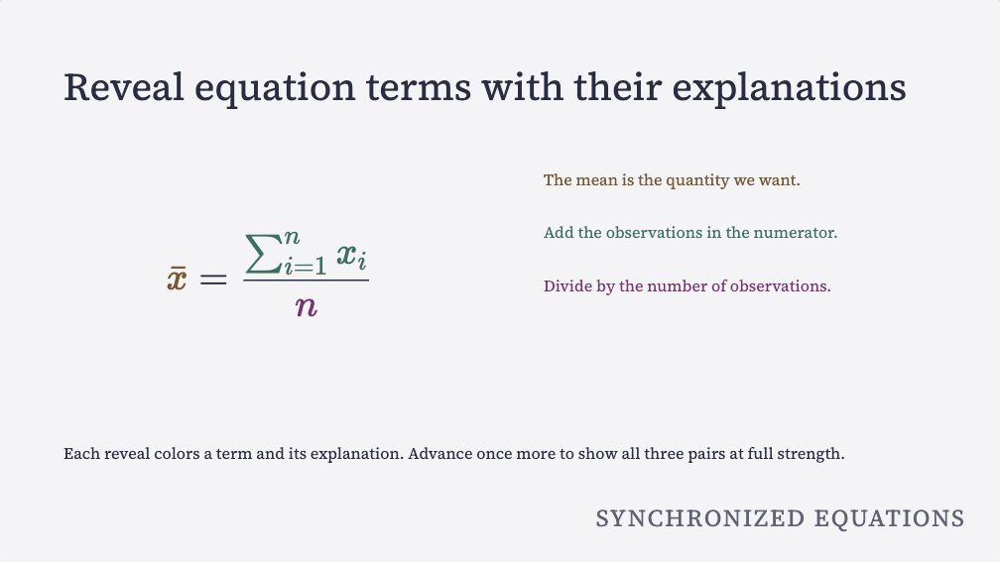

# Layout and class reference

Use the [complete syntax reference](syntax-reference.md) to look up every
author-facing setting, class and attribute. Use this page to combine layouts
and media. Links beside each section open the rendered patterns.

The editable source is a Quarto Markdown (QMD) file. The renderer uses
Quarto/Pandoc to convert Markdown fragments, then writes the slide HTML with
navigation, overview, zoom, presenter notes and small interactions.

See [the visual syntax gallery](syntax-examples.qmd) for transparent images, image
opacity, half backgrounds, filters, playback and working panel/filter controls.
Each preview has the authored Markdown below it. Download the stylesheet when
an example uses custom classes.

## Slide syntax

[See a title slide](example.qmd?slide=1) or an [untitled statement](patterns.qmd?slide=1), with the actual heading source.

Start a slide with top-level `---` or a level-2 heading. A separator immediately
before a heading makes one slide. Use an empty heading to set attributes on an
untitled slide. The renderer copies heading classes and data attributes to
the generated `<section class="slide">`.

```markdown
## Platform Story {.hero-title data-section="Opening" data-title="Platform Story"}
```

Common slide classes:

- `.hero-title`: title-slide treatment.
- `.section-divider`: centered chapter slide.
- `.diagram-slide`: a marker from legacy imports. It does not generate a diagram layout.
- `.title-hidden`: keeps a navigation title while visually hiding the slide heading.
- `.autoscale`: enables text fitting for one slide.
- `.no-autoscale`: opts one slide out of deck-level text fitting.
- `.no-background`: opts one slide out of a global deck background.

## Semantic importance, math and titles

See [importance and footnotes](example.qmd?slide=3), [typeset equations](example.qmd?slide=6) and [title emphasis](_generated/semantic/index.html#story).

Use `[The claim.]{.statement}`, `[The point.]{.key}` and `[A qualification.]{.aside}`, or fenced
`::: {.key}` / `::: {.aside}` blocks. The theme maps importance to weight,
size and ink (text color). Use semantic roles without inline styles or font choices. Optional
matched-color overrides are the explicit exception; see the examples below.
`.key` and the other semantic roles work in all paired themes, in both modes.

<details>
<summary>Importance variables for theme authors</summary>

The theme assigns importance level 3 to `.key`, level 1 to `.aside`, and
level 4 to `.statement`. `.credit`/`.source` use level 0, and ordinary body text
uses level 2. Themes expose levels 0 to 4 as CSS variables
`--htmpres-importance-N-scale`, `-weight` and `-ink` so theme authors can change
how each level looks.
</details>

Titles accept inline Markdown, for example `## Why *structure* matters {#structure}`.
Math uses `$x^2$` / `$$...$$` and local KaTeX assets. Name a term with
`\htmlClass{term-a}{x}`; only this KaTeX HTML extension is trusted. Keep the
rendered `assets/htmpres-math/` folder with the HTML for offline viewing.
Standard footnotes are unique across slides, titles and presenter cues;
write `[^1]` and `[^1]: Source.` normally.

See [Semantic slides](semantic-authoring.md) for complete, copyable examples
and the [audience demo](_generated/semantic/index.html).

## Statement, picture credit, quote source and counter

Open the rendered [statement](patterns.qmd?slide=1), [picture credit](patterns.qmd?slide=3), [quotation](patterns.qmd?slide=2) or [counter example](patterns.qmd?slide=10). Each page shows the source under the slide.

Jonathan Schwabish's *Better Presentations* (2017) motivates these hooks.
They cover dominant claims (pp. 70 to 72), spare statement/header slides (pp. 139 to 140), picture
credits and endnotes (pp. 128 to 129). His examples also cover quotations with highlighted passages and
sources (pp. 72 to 73), and omitting audience slide numbers (pp. 69 to 70).

| Hook | Meaning |
|---|---|
| `.statement` span or block | Dominant claim; importance level 4. A solo block on an untitled slide is centered and supports text fit. |
| `.credit` span or block | Picture attribution; level-0 type in a reserved lower-right lane with opaque theme backing. Multiple credits stack. |
| `.quote` on a slide heading | Quotation treatment for an ordinary Markdown blockquote. |
| `.source` span or block | Level-0 source line kept with the quotation. `.key` works inside the quote. |
| `deck.counter: presenter` in initial YAML | Hide the counter in audience output and retain it in presenter output, including the appendix. |

Level 0 is for attribution through the named roles. It has no generic class
for small text. This complete deck
demonstrates all hooks
(replace `assets/photo.jpg` with your own picture):

```markdown
---
pagetitle: Semantic hooks
deck:
  theme: nocturne
  text-fit: true
  counter: presenter
---

## {#claim data-title="The claim"}

::: {.statement}
Structure makes the argument memorable.
:::

## A picture {#picture}

::: {.ds-full .ds-media .ds-fill .ds-no-pad}

:::

[Photo: Creator, [source record](#sources).]{.credit}

## One idea {.quote}

> An effective slide gives the audience [one idea to remember.]{.key}
>
> [Example quotation written for this demonstration.]{.source}

## Source record {#sources data-kind="appendix"}

The complete picture attribution belongs here.

[Back to the picture](#picture).
```

`counter: true` (the default) shows both counters; `false` hides both;
`presenter` hides only the audience counter. Empty/unknown values are
`deck-counter` lint errors. Render again after changing the setting.

A block credit/source uses `::: {.credit}` / `::: {.source}`, text, then `:::`.
Picture credits move to their lane; source lines stay with the quote. Keep
lengthy attribution in endnotes so the picture credit remains short and readable.
See the [complete guide](semantic-authoring.md#picture-credits) and
[runnable example](_generated/authoring-hooks/index.html).

## Matched final view

[Try the code overview](example.qmd?slide=5) or [equation overview](example.qmd?slide=6). Each has three teaching steps and one summary step.

[](example.qmd?slide=6)

`## A result {data-step-summary="match"}` adds one automatic final step after
all text, code and equation reveals. Named source parts and their explanations
share colors from each group's first reveal. Earlier groups keep their colors
as the slide advances. The final step clears the last teaching highlight and
dimming. Previous restores the final teaching highlight. If you omit the
attribute, the slide keeps its normal behavior.

| Author syntax | Meaning |
|---|---|
| `[The mean.]{data-match="mean"}` | Name an explaining span; also works on a fenced block. |
| `data-line-matches="1:observations\|2:total\|3:mean"` on a code fence | Match code line numbers to the explanations. Ranges and comma selections are supported. |
| `\htmlClass{mean}{\bar{x}}` inside an `.equation-steps` block | Match that equation term to `data-match="mean"`. |
| `data-match-color="#245c88" data-match-color-dark="#91c9f0"` beside `data-match` | Override a pair's colors directly on one span. |
| `data-match-colors="mean=#245c88\|total=#765013"` on the slide heading | Define a slide palette without editing CSS. Add `data-match-colors-dark` for dark-mode values. |
| `--htmpres-match-mean: #245c88;` in CSS | Set a semantic color across slides. |

Names begin with a lowercase letter and contain lowercase letters, digits or
hyphens (`enclosing` is reserved for KaTeX). They are independent of step indices. The [complete syntax and color guide](semantic-authoring.md#finish-with-matched-colors)
includes copyable code/equation slides, direct inline-math attributes, defaults,
override precedence and contrast limits. Omit the color attributes to use
the theme's colors.

## Presenter notes

[See the notes example](patterns.qmd?slide=10) and choose **Presenter with notes**.

Write speaker notes in a fenced div:

```markdown
::: notes
Use this as the presenter cue.
:::
```

The renderer removes notes from audience slide content and writes them to
the presenter notes panel in `presenter.html`.

## Layout blocks

[See two columns with code and text](example.qmd?slide=5), or [a grid of pictures](patterns.qmd?slide=9).

Use fenced divs for structure and the theme's defaults for appearance. For
custom colors or sizes, edit the theme stylesheet and keep semantic roles in
the QMD:

```markdown
:::: {.three-col}
::: {.card .metric-card}
**Question**

What changed?
:::
::: {.card}
**Evidence**

Compare the two groups.
:::
::: {.callout}
**Conclusion**

The outcome improved.
:::
::::
```

A class gets its behavior or appearance from one of these places:

- Renderer/runtime classes have behavior in `_extensions/htmpres/htmpres.ts`
  or the runtime assets.
- Bundled themes include starter CSS classes; no extra stylesheet is needed.
- Deck-local classes need CSS definitions in that deck or its theme.

Common starter CSS layout classes include:

- `.lead`: a short introductory paragraph.
- `.two-col`, `.three-col`, `.card`, `.metric-card`, `.callout`
- `.diagram-frame`, `.code-card`, `.checklist`, `.focus-panel`, `.theme-sample`
- `.pill-row`, `.pill`, `.control-chip`, `.action-button`

If a class such as `.why-line` appears in a deck but is not listed here, look
in that deck's `source.css` or theme stylesheet. It is a deck-local hook unless
the reusable class map documents it.

## Themes

[Compare the same slide in two themes](compare.qmd). The page shows both declarations.

For Bootstrap, Bootswatch, Elegant, Reading, and Tufte adapters and their
light/dark/auto selection, see [Presentation themes](themes.md).
The example below overrides the fixed-look `mono-grid` theme in a local stylesheet.

Set `deck.theme` in front matter to select a CSS variable set:

```yaml
deck:
  css: source.css
  theme: mono-grid
  overflow: fit-scroll
```

The renderer copies the theme to `<html data-theme="mono-grid">` and overflow
to `<html data-overflow="fit-scroll">`. In deck CSS, keep structural layout
rules separate from the theme's palette and typography:

```css
:root,
html[data-theme="sage"] {
  --font-body: Inter, ui-sans-serif, system-ui, sans-serif;
  --font-display: var(--font-body);
  --htmpres-text-fit-min: 0.64;
  --ds-theme-filter: saturate(1.03) contrast(1.04) brightness(1.01);
  --ds-sharpen-filter: url("#htmpres-sharpen");
}

html[data-theme="mono-grid"] {
  --font-body: "Helvetica Neue", Arial, ui-sans-serif, system-ui, sans-serif;
  --font-display: ui-monospace, "SFMono-Regular", Consolas, monospace;
  --ds-theme-filter: saturate(0.78) contrast(1.18) brightness(1.04) hue-rotate(-8deg);
  --ds-sharpen-filter: url("#htmpres-sharpen");
}
```

Theme variables currently cover deck colors, typography, code token colors,
panel colors, media frame colors, filter preset values, `.ds-theme-filter`,
and text-fit typography tokens.

## Global backgrounds and text fit

[See a background](patterns.qmd?slide=6) and a [fitted statement](patterns.qmd?slide=1).

Set global background and text-fit behavior in front matter:

```yaml
deck:
  background-image: assets/background.svg
  background-fit: fill
  background-filter: theme sharpen
  background-opacity: 0.08
  text-fit: true
  text-fit-min: 0.64
  overflow: fit-scroll
```

The renderer inserts `.ds-global-background` inside each slide. Per-slide
overrides use `data-background-image`, `data-background-fit`,
`data-background-filter`, `data-background-position`,
`data-background-opacity`, and `data-background-class`. Use
`data-background-image="none"` or `.no-background` to opt out.

Text fitting uses `deck.text-fit`, `.autoscale`, `.no-autoscale`,
`data-text-fit`, and `data-text-fit-min`. The runtime measures the active
slide and sets `--htmpres-text-fit-scale`. The theme defines which typography
tokens scale.

`deck.overflow` can be `hidden`, `scroll`, `fit`, or
`fit-scroll`. The `fit` modes also trigger text fitting. With `fit-scroll`,
only slides that still overflow scroll. Scrollable slides show a
small bottom cue while more content is below the visible slide area.

## Media containers {#deckset-inspired-containers}

See [full-slide media](patterns.qmd?slide=4), [picture left](patterns.qmd?slide=7), [picture right](patterns.qmd?slide=8) and [picture grid](patterns.qmd?slide=9).

Use fenced containers to place pictures and text, then add attributes to
control cropping, filters and playback:

- Place the container with `.ds-full`, `.ds-left`, `.ds-right`, `.ds-split`, `.ds-pane`, `.ds-media`, `.ds-grid` and `.ds-inline`. The renderer supplies `.ds-global-background` for the [background settings](#global-backgrounds-and-text-fit).
- Set media behavior with `.ds-fit`, `.ds-fill`, `.ds-rounded`, `.zoomable`, and filter classes.
- `.ds-layer` raises text or controls above full-slide media, with a transparent background.
- `.ds-panel` adds a theme-colored panel to a text block. On a slide heading, it adds panels to the title and each top-level text block.
- `.ds-no-pad`, `.ds-no-border`, `.ds-frame`, `.ds-center`, `.ds-top`, and `.ds-bottom` tune the container box.

### Pictures that fit, with accessible descriptions

The [picture patterns](patterns.qmd?slide=3) show captions and credits. Select the full-slide, overlay and background patterns to compare the layouts.

Jonathan Schwabish, *Better Presentations* (2017), pp. 118 to 124, recommends
that a strong picture fill the slide. Adam Wathan and Steve Schoger explain
why text over a picture needs a background with consistent contrast. See
*Refactoring UI*, "Text needs consistent contrast," pp. 202 to 204. The patterns
use semantic roles, and the theme supplies ink, backgrounds and typography.

Every meaningful picture needs a description between `![` and `]`. The
`lint`, `render` and `verify` commands fail with an `image-description` error
when a description is empty or missing. The check covers pictures in presenter notes,
reference images and raw HTML. Diagnostics name the slide and point to the
line where it starts. See [source validation](authoring-cli.md#lint-semantic-source).

<details>
<summary>Picture diagnostic fields for automated checks</summary>

For example, slide 3 titled "A titled picture, empty description"
produces this exact message:

```text
Slide 3 (A titled picture, empty description): describe this picture, or mark a purely decorative picture with {.decorative}.
```

`lint --json` uses schema version 1 and includes `severity: "error"`,
`code: "image-description"`, `slide`, `slideId`, `line` and `column`; it exits
with status 1. Both verifiers also reject exported images with no `alt`
attribute. They check the notes stored in presenter output too. All rendered
images have an `alt` attribute. Code examples and comments are not pictures.

</details>

For a purely decorative picture that adds no information, explicitly write an
empty description with `.decorative` on the **image**:

```markdown
## A decorative texture

{.decorative .ds-fit}
```

The decorative image renders `alt=""` and lint accepts it. Raw HTML may use
``.

Do not mark an informative picture decorative to remove a caption. Use the described
`.ds-full` form below to hide the visible caption and keep the description.
Use `data-background-image` for a decorative full-slide background. Printing
retains these HTML attributes. htmpres does not provide a separate tagged-PDF export.

For a titled slide containing one picture and an optional credit, write:

```markdown
## One queue before one database {data-section="The bottleneck"}

{.ds-fit}

[Picture: Creator, source and license.]{.credit}
```

The description becomes both the image's screen-reader `alt` text and its
visible caption. The picture fits below the title without cropping. It grows
until one edge reaches the available space, after the layout reserves room
for the caption, credit, section label and theme gaps. The image can grow
beyond its original size. SVGs with only a viewBox also scale this way.

Captions sit under the center of centered pictures. Wide, tall and 16:9
images use the same syntax. `.ds-fit` is optional for this one-picture layout.
You can also wrap the image in `::: {.ds-media}`. A linked image keeps its
native Markdown caption behavior. To fill the available picture box by
cropping, use `.ds-fill`.

For a full-slide picture, keep its description and omit the visible heading:

```markdown
## {data-title="A queue before one database" data-section="The bottleneck"}

::: {.ds-full .ds-media .ds-no-pad}
{.ds-fill}
:::

[Picture: Creator, source and license.]{.credit}
```

Inside `.ds-full`, the description stays in `alt`. The generated caption is
hidden visually and from screen readers, while the image keeps its accessible
name. `data-title` supplies a navigation label without a visible title. If you
need to show the complete picture, use `.ds-fit` instead of `.ds-fill`.

For text over the picture, add a semantic layer:

```markdown
## {data-title="Every search repeats the work" data-section="The bottleneck"}

::: {.ds-full .ds-media .ds-no-pad .ds-readable}
{.ds-fill}
:::

::: {.ds-layer}
[Every search reads the same rows.]{.key}
:::

[Picture: Creator, source and license.]{.credit}
```

`.ds-layer` places text above the picture and leaves its background transparent.
The theme sets the text's colors and emphasis. `.ds-readable` adds a gradient
to the picture and also works on a contained `.ds-media` picture. A gradient
can help, but check the text against your picture in each theme mode you use.

For a solid panel, add `.ds-panel` to the text block:

```markdown
::: {.ds-layer .ds-panel}
[Every search reads the same rows.]{.key}
:::
```

The theme supplies the panel's background and text colors. Nested emphasis keeps its
size and weight and uses the panel's ink. The surrounding picture stays visible.
Compare the [text without a panel](syntax-examples.qmd?slide=35) and the
[panel over the same picture](syntax-examples.qmd?slide=36), with their Markdown.

A decorative background can carry a visible title and body text directly:

```markdown
## Every search repeats the work {data-background-image="assets/photo.svg" data-section="The bottleneck"}

[Read the data once, then reuse the result.]{.key}

[Picture: Creator, source and license.]{.credit}
```

The title and body appear over the picture without panels. To put a panel
behind one passage, place it inside a `::: {.ds-panel}` block. To give the title
and each top-level text block a panel, put `.ds-panel` on the slide heading.
A top-level block sits directly inside the slide, outside a card or column.
The slide class covers paragraphs, lists, blockquotes, `.ds-layer`, and fenced
`.key`, `.aside` or `.statement` blocks. Give other containers their own
`.ds-panel` class.

```markdown
## Every search repeats the work {.ds-panel data-background-image="assets/photo.svg"}

[Read the data once, then reuse the result.]{.key}
```

Compare the [text without panels](syntax-examples.qmd?slide=6) and
[panels on the title and body](syntax-examples.qmd?slide=37).
Background layers are decorative (`aria-hidden`). When the picture needs an
accessible description, use the described `.ds-full` image pattern above.

In the picture layouts above, `data-section` keeps a readable section label on its own
opaque background supplied by the theme. The credit lane remains separate. A left/right picture
beside a list also starts below the title and leaves space for its caption and
credit. Automatic sizing covers a single picture, with an optional title, or one
picture plus one explanation in left/right panes. Credits are allowed in either
layout. Extra body blocks or pictures use the container layout that you author.

For optional theme customization, panels use `--htmpres-media-text-bg` and
`--htmpres-media-text-ink`.
Themes can also override
`--htmpres-media-label-bg` and `--htmpres-media-label-ink` for section labels.
By default, panels and labels use theme background and text colors, with a target
text/background contrast of 4.8:1. See the
[credit contrast policy](semantic-authoring.md#picture-credits).
Authors can use these layouts without CSS, colors or sizes. Every informative
image needs a description; decorative images need an explicit `.decorative` mark.

Half-slide media:

```markdown
::: {.ds-left .ds-media .ds-no-pad}
{.ds-fill .zoomable}
:::

::: {.ds-right .ds-pane}
### Text, buttons, or lists go here
:::
```

Split flow layout:

```markdown
:::: {.ds-split}
::: {.ds-pane .ds-frame}
### Text pane
:::

::: {.ds-pane .ds-media .ds-frame}
{.ds-fit .zoomable}
:::
::::
```

## Media classes

See the [text overlay](patterns.qmd?slide=5), [filter comparisons](syntax-examples.qmd?slide=8),
[opacity](syntax-examples.qmd?slide=4), [video](syntax-examples.qmd?slide=18) and
[audio](syntax-examples.qmd?slide=19). Each preview has its source, with assets
available to download from the syntax gallery.

Use layout classes on containers and fit/filter classes on the media. Wrapper
effects such as vignette and readability overlays belong on the nearest
container, because they use pseudo-elements around the media.

- `.ds-fit`: contain the whole asset.
- `.ds-fill`: cover the box and crop if needed.
- `.ds-bn` / `.ds-bw`: black and white.
- Filter presets include `.ds-vivid`, `.ds-noir`, `.ds-chrome` and `.ds-fade`.
- `.ds-filter`: custom filter variables such as `--ds-grayscale`, `--ds-sepia`, `--ds-saturation`, `--ds-contrast`, `--ds-brightness`, `--ds-exposure`, `--ds-hue`, `--ds-blur`, and `--ds-opacity`.
- `.ds-theme-filter`: apply the active theme's `--ds-theme-filter` value.
- `.ds-sharpen`: apply the browser SVG sharpen filter and compose it with preset or custom CSS filters.
- `.ds-original`: remove filters from a media item.
- `.ds-alpha`: opacity through `--ds-opacity`.
- `.ds-zoom`: visual zoom through `--ds-scale`.
- `.ds-vignette`: edge vignette through `--ds-vignette`, `--ds-vignette-size`, and optionally `--ds-vignette-color`. Add `.ds-vignette-light` on the same container for a light vignette.
- `.ds-readable`: readability gradient through `--ds-readable-angle`, `--ds-readable-start`, and `--ds-readable-end`.

Three images in a grid (use `.ds-inline` for a wrapping row):

```markdown
:::: {.ds-grid}
::: {.ds-media}
{.ds-fill .ds-bn}
:::

::: {.ds-media}
{.ds-fill .ds-theme-filter}
:::

::: {.ds-media .ds-vignette}
{.ds-fill .ds-filter .ds-sharpen}
:::
::::
```

The filter presets use CSS and SVG effects in the browser.

Set custom media filter, gap, height and grid variables in the theme
stylesheet. The QMD examples use the theme defaults.

Media playback directive classes:

- `.ds-controls`: show native playback controls.
- `.ds-autoplay`: request playback when the slide becomes active; browser autoplay policy still applies.
- `.ds-loop`: repeat playback.
- `.ds-muted`: mute playback.
- `.ds-hide`: hide the player visually and from screen readers.
- `.ds-autoadvance`: advance the deck when this active slide's media ends.
- `.ds-keep-time`: retain the playback position when leaving the slide; other media reset.

For video, audio, and embeds, raw HTML is the most predictable authoring form:

```html
<video class="ds-fill ds-controls ds-autoplay ds-muted ds-loop" src="assets/demo.mp4"></video>
<audio class="ds-controls" src="assets/narration.mp3"></audio>
<iframe class="ds-fill" src="https://www.youtube.com/embed/VIDEO_ID" allowfullscreen></iframe>
```

## Images and zoom

[Open the contained image](patterns.qmd?slide=3) and click it to zoom.

Normal images use Pandoc image attributes:

```markdown
{.ds-fit .zoomable}
```

Clicking a `.zoomable` image opens the custom deck zoom modal. Press `Esc` or
click outside the image to close it.

## Code blocks

[Try code highlights with an explanation](example.qmd?slide=5). The preview and Markdown use the same step mapping.

Use fenced-code attributes for syntax highlighting, line numbers, static line
highlights, and step-through code transitions:

````markdown
```{.python .numberLines data-steps="none|2|3|4|all"}
def render_slide(slide):
    html = markdown_to_html(slide["body"])
    if slide.get("notes"):
        write_presenter_notes(slide["notes"])
    return f"<section>{html}</section>"
```
````

Supported code attributes:

- Language class, such as `.python`, `.js`, `.html`, or `.yaml`, enables Pandoc syntax highlighting.
- `.numberLines` enables Pandoc line-number anchors.
- `data-highlight="2,4-5"` applies persistent line highlights.
- `data-steps="none|2|3-4|all"` adds per-slide code steps before moving to the next slide.
- `data-highlight-steps` is accepted as a more explicit alias for `data-steps`.
- `data-step-indices="1|3|7"` maps code snapshots to shared text/equation frames.

## Transitions and fragments

[Try dimmed fragments](example.qmd?slide=4) and [synchronized equation terms](example.qmd?slide=6).

Use `.incremental` around a list to reveal each list item one step at a time:

```markdown
::: {.incremental data-fragment-effect="rise"}
- First point
- Second point
- Third point
:::
```

Use `.fragment` on any fenced div or raw HTML block that should reveal as a
unit:

```markdown
::: {.card .fragment data-fragment-index="2" data-fragment-effect="highlight"}
**Reveal me later**
:::
```

Supported fragment classes and data values:

- `.fragment`: a revealable block.
- `.incremental`: reveal direct list items in source order.
- `data-fragment-index="2"`: reveal multiple fragments on the same step.
- `data-fragment-effect`: choose one of `rise`, `left`, `right`, `scale`, `blur`, `highlight`, `dim` or `none`, for example `data-fragment-effect="rise"`.

Auto-numbered fragments advance past explicit indexes. Repeat an explicit
`data-fragment-index` only when multiple fragments should reveal together.

Supported slide transition classes:

- `.transition-fade`
- `.transition-slide`
- `.transition-zoom`
- `.transition-none`

You can also put `data-transition="slide"` on a slide heading. Choose one
value: `fade`, `slide`, `zoom` or `none`.

Mixed slides use one ordered step graph. Match text
`data-fragment-index="1"` with code `data-step-indices="1|3|7"` to change both
columns together. Before its first mapped frame, code or math is visible
without a step highlight. It then holds its latest snapshot until its next mapped frame. Sparse indices consume no empty
keypresses. Earlier ordinary fragments stay visible; `dim` is opt-in.

For equations, wrap classed math in
`::: {.equation-steps data-equation-steps="term-a|term-b|term-a,term-b" data-step-indices="1|3|7"}`.
Use `\htmlClass{term-a}{x}` and `\htmlClass{term-b}{y}` in the equation.
Only referenced named terms dim; unrelated operators keep their appearance.

Stepped display math defaults to twice the fitted body size; theme CSS can
set `--htmpres-equation-scale`. Inline math and notes retain their normal size.
Mappings require one decimal positive safe integer per snapshot, strictly
increasing within a block. Invalid mappings warn and fall back to source order.

Unmapped mixed events run in source order. Unmapped code-only slides show
their first snapshot before the first advance. Multiple code blocks advance
through their corresponding snapshots together.

`data-fragment-index="0"` remains a baseline reveal. Spans with
`.fragment` and list items inherit `data-fragment-effect="dim"` from their
incremental container, including inside columns. Future text stays hidden;
earlier text dims. Advancing only code or equations leaves the latest text
point emphasized.

The following do not consume navigation steps:

- Persistent `data-highlight` line highlights.
- Slide transitions.
- Media playback directives such as `.ds-autoplay`.

## Interactivity

The complete panel-button pattern below can be copied into a slide. The [syntax reference](syntax-reference.md#interactions) also gives a working item-filter pattern.

The packaged interaction helper supports a generic data-driven button pattern:

```markdown
::: {.pill-row}
<button class="pill active" data-target="#examplePanel" data-title="Audience view" data-text="The audience sees the slides.">Audience</button>
<button class="pill" data-target="#examplePanel" data-title="Presenter view" data-text="The presenter sees slides and speaking cues.">Presenter</button>
:::

::: {#examplePanel .focus-panel}
### Audience view

The audience sees the slides.
:::
```

The interaction helper looks for targets within the current `.slide` first,
then in the document if necessary.

## Slide IDs, appendix and breaks

[Enter the appendix from the final main slide](example.qmd?slide=10) and follow its return link.

`## Extra {#appendix-data data-kind="appendix"}` starts a trailing appendix.
All later slides belong to it. Normal counters, Next, End and media
advancement stop at the final main slide; appendix counters are separate.
Use `[The data](#appendix-data)` and `[Back](#main-result)` to navigate to
explicit slide IDs with live hash/history support. Same-slide footnote links
retain the reveal frame. Fallback IDs are collision-safe `slide-N`; duplicate
explicit slide IDs are rejected.

A slide starts at top-level `---` or `##`. A separator followed by a heading
(with only blank lines between) makes one slide. Empty headings carry attributes
without a visible title. Code, comments, initial YAML and fenced divs protect
boundaries; rules inside notes stay in the notes. Run
`quarto run _extensions/htmpres/htmpres.ts lint slides.qmd --json` for versioned
JSON diagnostics and a nonzero exit on errors. Rendering and verification
apply the same scanner.

## Workflow

```sh
just tutorial
just verify
```

In a project where the extension was installed with `quarto add`, use:

```sh
quarto run _extensions/htmpres/htmpres.ts render decks/my-deck/index.qmd
quarto run _extensions/htmpres/htmpres.ts verify
```
