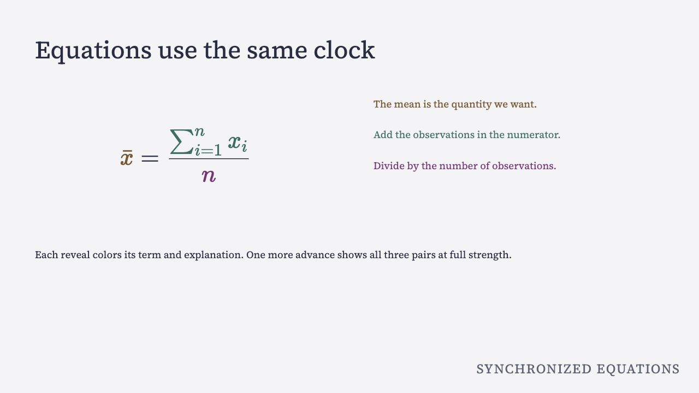

# Semantic slides

Write your argument in Quarto Markdown (QMD), and use the theme's fonts and
colors. The complete [example source](_generated/source/semantic.qmd.txt) contains
no inline styles or color values. Open the [audience deck](_generated/semantic/index.html)
or [presenter deck](_generated/semantic/presenter.html) to see the result. Both
use the custom HTML renderer, with Quarto's Pandoc parser for Markdown.

Use the [complete syntax reference](syntax-reference.md) to look up settings,
classes and attributes. The links beside each section open its rendered
pattern directly.

To check and render your own `slides.qmd`, run:

```sh
quarto run _extensions/htmpres/htmpres.ts lint slides.qmd --json
quarto run _extensions/htmpres/htmpres.ts render slides.qmd
quarto run _extensions/htmpres/htmpres.ts verify slides.qmd
```

## Importance

[See `.key` and `.aside` on a slide](example.qmd?slide=3). Switch modes to compare their emphasis.

Use `.statement` for the dominant claim, `.key` for a key point and `.aside` for a minor qualification.
Apply these roles to bracketed spans or fenced blocks:

```markdown
## The result

[The intervention helped.]{.key}

::: {.aside}
The estimate is less certain for smaller groups.
:::
```

All 35 paired themes map these roles in both modes, and the three legacy seeds
have defaults. Themes use CSS variables, called tokens, for levels 0 to 4.
Each level has
`--htmpres-importance-N-scale`, `-weight` and `-ink`. Normal text is level 2;
`.aside` uses 1, `.key` uses 3 and `.statement` uses 4. Purpose-specific
`.credit` and `.source` labels use level 0.

There are no numbered author classes.
Level 0 is reserved for attribution through `.credit` and `.source`.
There is no generic class for shrinking the argument. Theme
authors may change tokens in CSS without changing slide source. Role sizing
also works inside fitted cards and callouts.

### A statement slide

[See a statement slide](patterns.qmd?slide=1), with its copyable source below the preview.

Jonathan Schwabish, *Better Presentations* (2017), pp. 70 to 72, recommends that
the most important point be dominant. Pages 139 to 140 show spare section/header slides.
Use a statement block on an untitled slide for that purpose:

```markdown
## {#main-claim .autoscale data-title="The main claim"}

::: {.statement}
Structure makes the argument memorable.
:::
```

The solo block is centered. You can also use `[The claim.]{.statement}` or a
fenced statement block within a normal slide. Themes supply level-4 size,
emphasis weight and ink. Text fitting scales the block and its paragraphs
together. Prefer one short claim. If long copy reaches the theme's minimum
fit size, you may still need to split it.

With `overflow: fit-scroll`, readers can scroll through all excess copy,
including in the smaller presenter preview. Vertical centering applies only
when the copy fits.

## Picture credits

[See a picture credit](patterns.qmd?slide=3). Follow its source-record link and return to the picture.

Jonathan Schwabish, *Better Presentations* (2017), pp. 128 to 129, recommends a
short picture credit at the lower right. Put lengthy source records on an
endnote/appendix slide. Use a bracketed span or fenced `.credit` block for the
short credit:

```markdown
## A picture {#picture}

::: {.ds-full .ds-media .ds-fill .ds-no-pad}

:::

[Photo: Creator, [source record](#image-source).]{.credit}

## Image source {#image-source data-kind="appendix"}

Creator, work title, date, original URL and applicable license.

[Back to the picture](#picture).
```

A block alternative is `::: {.credit}` followed by the credit text and a closing
`:::`. The renderer collects all picture credits in source order into one
lower-right lane. It also collects credits from inside media blocks. The theme
puts opaque paper behind the credit text so it stays readable over bright or
dark images.
Attribution ink targets 4.8:1 contrast against that paper. If a stock palette's
normal or muted ink is too faint, the theme adapter shifts that ink toward black
or white; already-readable ink keeps its semantic token alias.

On a paper tone where neither black nor white can reach 4.8:1, the adapter
uses whichever gives the strongest contrast. That contrast remains above the
4.5:1 minimum for normal text.

The layout reserves space for the lane and puts
the section label above it. Credits do not shrink with body text fitting.
Keep the short credit concise, with long source records in the linked
appendix. Use credits for attribution. They do not define a general layout
for captions or overlays.

### Pictures that fit, with accessible descriptions

See the rendered [contained picture](patterns.qmd?slide=3), [full-slide picture](patterns.qmd?slide=4), [text overlay](patterns.qmd?slide=5), [background](patterns.qmd?slide=6), [picture left](patterns.qmd?slide=7) and [picture right](patterns.qmd?slide=8). Each preview includes its actual Markdown.

Jonathan Schwabish, *Better Presentations* (2017), pp. 118 to 124, recommends
that a strong picture fill the slide. Adam Wathan and Steve Schoger explain
why text over a picture needs a background with consistent contrast. See
*Refactoring UI*, "Text needs consistent contrast," pp. 202 to 204. The patterns
use semantic roles, and the theme supplies ink, backgrounds and typography.

Every meaningful picture needs a description between `![` and `]`. The
`lint`, `render` and `verify` commands fail with an `image-description` error
when a description is empty or missing. The check covers pictures in presenter notes,
reference images and raw HTML. Diagnostics name the slide and point to the
line where it starts. For example, slide 3 titled "A titled picture, empty description"
produces this exact message:

```text
Slide 3 (A titled picture, empty description): describe this picture, or mark a purely decorative picture with {.decorative}.
```

`lint --json` retains schema version 1 and includes `severity: "error"`,
`code: "image-description"`, `slide`, `slideId`, `line` and `column`; it exits
with status 1. Both verifiers also reject exported images with no `alt`
attribute. They check the notes stored in presenter output too. All rendered
images have an `alt` attribute. Code examples and comments are not pictures.

For a purely decorative picture that adds no information, explicitly write an
empty description with `.decorative` on the **image**:

```markdown
## A decorative texture

{.decorative .ds-fit}
```

The decorative image renders `alt=""` and lint accepts it. Raw HTML may use
``.

Do not mark an informative picture decorative to remove a caption. Use the described
`.ds-full` form below to hide the visible caption and keep the description.
Use `data-background-image` for a decorative full-slide background. Printing
retains these HTML attributes. htmpres does not provide a separate tagged-PDF export.

For a titled slide containing one picture and an optional credit, write:

```markdown
## One queue before one database {data-section="The bottleneck"}

{.ds-fit}

[Picture: Creator, source and license.]{.credit}
```

The description becomes both the image's screen-reader `alt` text and its
visible caption. The picture fits below the title without cropping. It grows
until one edge reaches the available space, after the layout reserves room
for the caption, credit, section label and theme gaps. The image can grow
beyond its original size. SVGs with only a viewBox also scale this way.

Captions sit under the center of centered pictures. Wide, tall and 16:9
images use the same syntax. `.ds-fit` is optional for this one-picture layout.
You can also wrap the image in `::: {.ds-media}`. A linked image keeps its
native Markdown caption behavior. To fill the available picture box by
cropping, use `.ds-fill`.

For a full-slide picture, keep its description and omit the visible heading:

```markdown
## {data-title="A queue before one database" data-section="The bottleneck"}

::: {.ds-full .ds-media .ds-no-pad}
{.ds-fill}
:::

[Picture: Creator, source and license.]{.credit}
```

Inside `.ds-full`, the description stays in `alt`. The generated caption is
hidden visually and from screen readers, while the image keeps its accessible
name. `data-title` supplies a navigation label without a visible title. If you
need to show the complete picture, use `.ds-fit` instead of `.ds-fill`.

For text over the picture, add a semantic layer:

```markdown
## {data-title="Every search repeats the work" data-section="The bottleneck"}

::: {.ds-full .ds-media .ds-no-pad .ds-readable}
{.ds-fill}
:::

::: {.ds-layer}
[Every search reads the same rows.]{.key}
:::

[Picture: Creator, source and license.]{.credit}
```

`.ds-readable` adds a gradient and keeps the full-slide geometry. It also
works on a contained `.ds-media` picture. `.ds-layer` gives text an opaque
panel whose colors come from the theme. A nested `.key` uses the panel's ink
and keeps its semantic emphasis. The panel keeps text readable on dark, bright
and mixed pictures. A transparent gradient alone cannot guarantee that contrast.

A decorative background can carry a visible title and body text directly:

```markdown
## Every search repeats the work {data-background-image="assets/photo.svg" data-section="The bottleneck"}

[Read the data once, then reuse the result.]{.key}

[Picture: Creator, source and license.]{.credit}
```

The title and body receive the same theme-controlled panels. Background layers
are decorative (`aria-hidden`). When the picture itself needs an accessible
description, use the described `.ds-full` image pattern above.

In all four examples, `data-section` keeps a readable section label on its own
opaque theme ground. The credit lane remains separate. A left/right picture
beside a list also starts below the title and leaves space for its caption and
credit. Automatic fitting applies to the one-picture or two-pane structures.
Complex multi-picture compositions keep the container layout that you author.

Themes can override `--htmpres-media-text-bg`, `--htmpres-media-text-ink`,
`--htmpres-media-label-bg` and `--htmpres-media-label-ink`. Defaults use theme
paper and ink that targets 4.8:1 contrast under the attribution policy.
Authors can use these patterns without CSS, colors or sizes.

## Quotations and their source

[See the quotation, highlighted words and source](patterns.qmd?slide=2).

Jonathan Schwabish, *Better Presentations* (2017), pp. 72 to 73, illustrates a
quotation with its important passage emphasized and its source attached. Use
ordinary Markdown quotation syntax, the slide class `.quote`, and `.source`:

```markdown
## One idea {.quote #quotation}

> An effective slide gives the audience [one idea to remember.]{.key}
>
> [Example quotation written for this demonstration.]{.source}
```

The quotation was written for this example. Its words are not from Schwabish.
`.key` keeps its usual emphasis inside the quotation. A fenced `.source` block
uses the same attribution role.

The theme sets the quotation's spacing and
size, and the smaller source line. Source text stays with the quote. The
renderer moves only `.credit` to the picture-credit lane.

## Audience counter

[Open the counter example](patterns.qmd?slide=10), then use **Open full deck** in audience and presenter views to compare their counters.

Jonathan Schwabish, *Better Presentations* (2017), pp. 69 to 70, recommends omitting
slide numbers from a spoken talk. Put this setting in the **initial deck front
matter** to retain the counter for the speaker:

```markdown
---
pagetitle: A spoken talk
deck:
  theme: nocturne
  counter: presenter
---

## The result {#result}

[The argument leads here.]{.key}

[Supporting data](#backup).

## Supporting data {#backup data-kind="appendix"}

The detailed evidence.

[Back to the result](#result).
```

| `deck.counter` | Audience `index.html` | `presenter.html` |
|---|---|---|
| omitted or `true` | Shown | Shown |
| `false` | Hidden | Hidden |
| `presenter` | Hidden | Shown |

The setting applies throughout the main talk and appendix. Hidden counters
still track navigation, but take no layout space and are absent from the
accessibility tree. Main slides count to the last slide before the appendix,
where End stops. Appendix slides have their own count.

Unknown or empty values produce a `deck-counter` source error in
`lint --json`. Render and verify reject those values too. After changing the
policy, rerender both outputs. Verify detects stale policy or visibility.

Run `just authoring-hooks` for a complete local example. Inspect the
[audience deck](_generated/authoring-hooks/index.html),
[presenter deck](_generated/authoring-hooks/presenter.html) and
[editable source](_generated/source/authoring-hooks.qmd.txt).


## Math and named terms

[See typeset math](example.qmd?slide=6). Its preview shows the equation and the source that names each term.

Use dollar delimiters. Give a term a semantic class with `\htmlClass`:

```markdown
## A sum

Inline $x^2$ also works.

$$
\htmlClass{term-a}{x} + \htmlClass{term-b}{y} = z
$$
```

KaTeX 0.19.1, its CSS and fonts are bundled locally. Keep the generated
`assets/htmpres-math/` folder beside the HTML when sharing a deck offline.
Math is typeset in presenter notes too. Accessible MathML accompanies the
visual equation. Only KaTeX's `\htmlClass` extension is trusted; URL, inline
style and HTML-ID extensions are disabled. Use descriptive class names, not
colors, and define any custom term styling in the theme.

Display math inside `.equation-steps` uses twice the surrounding fitted body
text size by default. Themes can set the unitless CSS
variable `--htmpres-equation-scale` to change that ratio. No size attribute is
needed in QMD. Ordinary inline math and presenter-note math keep their normal
text sizing; authored math CSS can still override the default.

## Shared text, code and equation steps

Try the rendered [code steps](example.qmd?slide=5) and [equation steps](example.qmd?slide=6). Use **Next step**, **Previous step** and **Restart steps** on the page.

[](example.qmd?slide=6)

A frame is the set of changes shown together on one advance.
`data-fragment-index` gives text a shared frame number. Map code snapshots,
the line selections highlighted at each step, to those numbers with
`data-step-indices`. The complete slide below changes code and reveals its
explanation together:

````markdown
## Compute a mean

:::: {.two-col}
::: {}
```{.python .numberLines data-steps="1|2|3" data-step-indices="1|3|7"}
values = [2, 4, 6]
total = sum(values)
mean = total / len(values)
```
:::
::: {}
[Collect the observations.]{.fragment data-fragment-index="1"}

[Add them.]{.fragment data-fragment-index="3"}

[Divide by the count.]{.fragment data-fragment-index="7"}
:::
::::
````

There are three keypresses, despite the gaps in the numbers. Earlier ordinary
text remains fully visible. Code highlights its current selection and dims the
other lines; `data-highlight` can add persistent highlighted lines.

An equation uses the same mapping. Each `|` separates snapshots; a comma selects
several named terms in one snapshot:

```markdown
## Connect the terms

:::: {.two-col}
::: {.equation-steps data-equation-steps="term-a|term-b|term-a,term-b" data-step-indices="1|3|7"}
$$
\htmlClass{term-a}{x} + \htmlClass{term-b}{y} = z
$$
:::
::: {}
[Start with x.]{.fragment data-fragment-index="1"}

[Then y.]{.fragment data-fragment-index="3"}

[Combine both.]{.fragment data-fragment-index="7"}
:::
::::
```

Only named terms referenced by `data-equation-steps` participate in dimming.
Other operators remain unchanged. List every selected class in a snapshot
when several terms should be emphasized. Mapped code and equation blocks
begin inactive and hold their latest snapshot until the next mapped frame.
Backward navigation restores the corresponding state of each block.

Mapping entries must be decimal digits, positive safe integers, strictly
increasing within that code/equation block, with one entry per snapshot.
Invalid mappings warn in the browser, set
`data-step-error="invalid-step-indices"`, and fall back to implicit order.

Without mappings, mixed slides schedule text, code and equation events in
source order. On unmapped code-only slides, the first snapshot is visible
before any advance. Multiple unmapped code blocks share their corresponding
snapshots. Explicit fragment index `0` is also visible before an advance.
Use explicit shared numbers when two columns should advance together.

## Finish with matched colors

[See the matched overview](example.qmd?slide=6). Advance four times; the fourth frame restores all colored pairs to full strength.

Add `data-step-summary="match"` to the slide. Starting with the first teaching
step, each named group gains its color when its explanation appears.
Code line numbers or equation terms share the explanation's color. Earlier
revealed groups retain their colors; future explanations stay hidden.
Teaching highlights and dimming still identify the current source part.

After the last teaching step, **one more advance** shows the complete overview.
The highlight and dimming clear, and all revealed explanations remain readable.
Previous restores the last teaching frame and its colors; further backward
steps remove colors from groups no longer revealed. Restart restores the initial
slide.

Choose this behavior in the QMD before rendering. If you omit the attribute,
the slide keeps its final highlight. The renderer adds the summary to the
ordered sequence of teaching steps. You do not need to number a summary step
when you add a reveal or change sparse indices. A valid slide with the
attribute and no reveals has one summary step.

### Code: name the relationship

This complete slide has three teaching steps and a fourth summary step:

````markdown
## Compute the mean {#mean-code data-step-summary="match"}

:::: {.two-col}
::: {}
```{.python .numberLines data-steps="1|2|3" data-step-indices="1|3|7" data-line-matches="1:observations|2:total|3:mean"}
observations = [2, 4, 6]
total = sum(observations)
mean = total / len(observations)
```
:::
::: {}
[Collect the observations.]{.fragment data-fragment-index="1" data-match="observations"}

[Add their values.]{.fragment data-fragment-index="3" data-match="total"}

[Divide by their count.]{.fragment data-fragment-index="7" data-match="mean"}
:::
::::
````

`data-match="mean"` is a semantic relationship, not a color. Names start with
a lowercase letter, followed by lowercase letters, digits or hyphens. Reuse
the same name for related spans or blocks. A name is local to its slide.
`enclosing` is reserved because KaTeX uses it internally.

`data-line-matches` maps source line positions to those names. Separate entries
with `|`; use `2-4:total` for a range or `1,3:observations` for separate lines.
Selections must be positive, in bounds and non-overlapping. Every mapped name
needs a `data-match` explanation.

The mappings are independent of
`data-steps`. Repeated or cumulative highlights do not change a group's color.
Matched slides display line numbers throughout teaching and the summary, including code without
`.numberLines`; only mapped numbers receive a matching color. Code syntax
colors remain intact.

### Equation: reuse the name on the term

For a term inside a larger equation, use the same name in `\htmlClass` and
`data-match`:

```markdown
## Explain the equation {#mean-equation data-step-summary="match"}

:::: {.two-col}
::: {.equation-steps data-equation-steps="mean|total|count" data-step-indices="1|3|7"}
$$
\htmlClass{mean}{\bar{x}} = \frac{\htmlClass{total}{\sum_{i=1}^{n} x_i}}{\htmlClass{count}{n}}
$$
:::
::: {}
[The mean is the quantity we want.]{.fragment data-fragment-index="1" data-match="mean"}

[Add the observations in the numerator.]{.fragment data-fragment-index="3" data-match="total"}

[Divide by the number of observations.]{.fragment data-fragment-index="7" data-match="count"}
:::
::::
```

`mean` gets its color on the first reveal, `total` on the second and `count` on
the third. Each has its own matching explanation. On the third reveal, only
the denominator is emphasized; the earlier terms remain colored but dimmed.
The fourth advance removes that dimming so all three pairs are visible at
full strength. The overview is an extra frame on the same slide.

If the last teaching snapshot already selects every term, the overview will
have little visible change. To demonstrate the overview, keep the last
snapshot focused on its own term. Different groups must not overlap on the
same source term or code line.
The theme supplies colors unless you override them below. Try both complete
patterns in the [interactive example](example.qmd?slide=6).

### Set a color directly on a span or term

Add `data-match-color` to a span with `data-match`. This sets the color for the
**whole named pair**, including its code numbers or classed equation terms:

```markdown
[The mean is the quantity we want.]{.key .fragment data-fragment-index="1" data-match="mean" data-match-color="#245c88" data-match-color-dark="#91c9f0"}
```

For an individual inline math term, Pandoc's bracket-and-brace syntax works:

```markdown
## A named term {data-step-summary="match"}

[$\bar{x}$]{data-match="mean" data-match-color="#245c88" data-match-color-dark="#91c9f0"}

[The mean of the observations.]{data-match="mean"}
```

Those colors apply from the named group's reveal through the final summary.
An enclosing fragment determines when a nested matched span first appears. A repeated name
keeps one color, but later occurrences stay hidden until their own reveal.
Static labels with teaching frames join the first frame; a slide without
teaching reveals waits for its single summary advance.

Explicit index-0
fragments are visible and colored at the baseline. Back/Restart restores these
visibility and color states. For a term **inside** a larger
display equation, keep `\htmlClass{mean}{...}` and set the shared color on its
explanation or slide palette.
Pandoc `{...}` attributes do not go inside TeX. Do not add KaTeX HTML styles.

`data-match-color` supplies the default for both modes;
`data-match-color-dark` optionally replaces it in dark mode. Hex values, CSS
color names, `rgb(...)`, `hsl(...)`, `oklch(...)` and `var(--token)` are
supported. Conflicting inline colors for one name on the same slide are an
error. Set the color on one occurrence, or repeat the identical choice.

### Set a palette on one slide

You do not have to edit CSS. Put the palette in the slide heading's metadata:

```markdown
## Compute the mean {data-step-summary="match" data-match-colors="mean=#245c88|total=#765013" data-match-colors-dark="mean=#91c9f0|total=#edc37d"}
```

Then use `data-match="mean"` / `data-match="total"` and the code or equation
mappings above. Separate `name=color` entries with `|`. Omitted names use the
theme palette.

Inline color attributes override the slide palette for that
name. Put per-slide metadata in the heading's `{...}`. Do not add another YAML
block. A top-level `---` can separate slides, but the settings belong on a
heading. For an untitled slide, use an empty `## {...}` heading.

### Set semantic colors in the deck stylesheet

For a deck-wide choice in `source.css`, set named variables:

```css
.slide {
  --htmpres-match-mean: #245c88;
  --htmpres-match-total: #765013;
}

html[data-color-mode="dark"] .slide {
  --htmpres-match-mean: #91c9f0;
  --htmpres-match-total: #edc37d;
}
```

You can use a color directly, such as `rebeccapurple`, or a theme token such as
`var(--teal)`. Semantic names remain the QMD contract. Specific slide/inline
declarations override these ordinary deck-wide rules. Theme authors may also
replace generated numbered slots `--htmpres-match-1`, `--htmpres-match-2` and
later slots. Prefer named variables when a concept should retain its color
across slides.

### Theme palettes and contrast {#how-the-theme-chooses-readable-colors}

The renderer generates as many slots as the largest matching slide needs.
Slots follow the first `data-match` explanations in source order. Highlight
indices do not determine slot order. Hues start at the theme accent and spread by
the golden angle; saturation follows that accent within a moderate range.
Adding another name keeps earlier slot colors stable. Lightness is selected
separately for light and dark backgrounds.

The generated palette targets **4.8:1** text/background contrast, above the
[WCAG minimum of 4.5:1 for normal text](https://www.w3.org/WAI/WCAG22/Understanding/contrast-minimum.html).
Tests independently check 12 slots across every bundled mode and the legacy
seeds. Ordinary themes are checked against paper and panel. Code numbers have
opaque paper backplates, so their exact color can match text even on dark
code panels. A medium-tone theme such as Quartz dark instead gets an opaque,
theme-related backing behind the matched text and terms; its palette is
checked against that actual backing.

The checks measure contrast against the background. They do not guarantee that every pair of hues
is distinguishable with every form of color vision. Keep descriptive wording
and line numbers; do not make color the sole explanation. With many groups,
consider splitting the slide. Direct colors and CSS overrides are preserved
exactly and are **not** contrast-adjusted.

Check both modes after overriding,
especially on custom backgrounds or images. A custom theme can supply the
same named variables and the `--htmpres-summary-surface` /
`--htmpres-summary-number-bg` background tokens. Bundled themes and the three
legacy seeds have generated palettes; a custom theme without named colors or
ordinal slots falls back to its ordinary foreground color.

## Layering without reading ahead

[Try dimmed spans and list items](example.qmd?slide=4). Future points stay hidden while earlier points dim.

The `dim` effect hides future points, shows the current point normally, and
dims past points. It is inherited by fragment spans and list items inside
columns:

```markdown
## Build the argument

:::: {.two-col}
::: {.incremental data-fragment-effect="dim"}
[The question.]{.fragment}

[The answer.]{.fragment}
:::
::: {.incremental data-fragment-effect="dim"}
- The evidence.
- The implication.
:::
::::
```

Explicit fragment effects override a container effect. Ordinary fragments do
not dim. A dimmed text lane keeps its latest text point current while only
code or equations advance. No mode previews future text in grey.

## Appendix navigation

[Follow the supporting-data link](example.qmd?slide=10), then return from the appendix. The source panel follows the navigation.

Give slides explicit IDs for stable links. The first `data-kind="appendix"`
starts a trailing appendix, including every later slide:

```markdown
## Main result {#main-result}

[The data](#appendix-data)

## Supporting data {#appendix-data data-kind="appendix"}

The detailed evidence belongs here.

[Back to the result](#main-result)
```

The main counter, Next, End and media autoadvance stop at the main-talk
boundary. The last main slide's steps remain available before Next stops. Use
links or the slide list to enter the appendix. It has a separate
`Appendix N / M` counter.

Return links and browser Back return to the main slide. Same-slide footnote
links preserve the reveal frame. Numeric `#/N` URLs remain supported.
Slides without an explicit ID receive a collision-safe `slide-N` ID. Duplicate
explicit slide IDs are an error.

## Footnotes

[Follow a footnote and its return arrow](example.qmd?slide=3).

Use standard Pandoc footnotes, and reuse labels on different slides:

```markdown
## First estimate

The first result.[^1]

[^1]: First source.

## Second estimate

The second result.[^1]

[^1]: Second source.
```

Footnote IDs, references and backlinks are unique per slide and presenter cue.
Code IDs and body-heading IDs are also namespaced. Authored slide IDs and links
to other slides are preserved. Literal code samples are not rewritten.

## Emphasis in titles

[See italic emphasis in a title](_generated/semantic/index.html#story).

Titles accept inline Markdown; navigation uses their plain text:

```markdown
## Why *structure* and **order** matter {#structure}

[Story before styling.]{.key}
```

## Slide boundaries and lint

[Open the untitled statement](patterns.qmd?slide=1) to see an empty heading with a navigation title. The complete boundary file below is also runnable.

Start a slide with a standalone `---` or a level-two heading (`## Title`).
Both are accepted at the top level, with zero to three leading spaces and
optional trailing spaces or tabs. Four-space/tab-indented code is exempt.
Only exactly three hyphens count.

`----`, `***`, and `___` are not slide
boundaries. A `---` followed by `##` with only blank lines between makes
**one slide**. Content before the first boundary forms an untitled opening slide.
Leading HTML comments do not create slides. Decks can also use only headings
for slide boundaries.

An untitled slide has no displayed heading. Navigation, overview, and presenter
navigation use `Slide N`, where N is its one-based position in the whole file.
Use `data-title="Backup data"` to choose a navigation label without adding a
visible title. The CLI's JSON slide list keeps `title: ""` and exposes the
fallback or override in `dataTitle`; its text list shows that label. Main slides show `1 / N`, while a trailing appendix has its own
`Appendix 1 / N` counter.

Use an **empty heading** for settings on an untitled slide:

```markdown
---

## {#appendix-data data-kind="appendix" data-title="Backup data"}

The data, without a displayed title.
```

The separator and heading form one slide. The empty heading can also start it without a preceding
`---`. IDs, classes and other slide attributes use the same heading syntax as
titled slides; do not put attributes on the separator itself.

In the initial YAML front matter, the opening `---` and closing
`---` (or `...`) are metadata delimiters. Put an opening slide separator **after**
the front matter. Without front matter, leave an initial blank line before an
opening separator so a later `---` cannot be mistaken for the YAML closer.
Backtick/tilde fences, indented code, raw code blocks, HTML comments, and fenced
`:::` divs protect their contents from slide splitting. Both `---` and `##`
inside a div stay on the current slide. Balance nested divs before the next
slide boundary.

Speaker notes (`::: notes` or `::: {.notes}`) belong to their current slide.
A `---` inside notes or another fenced div is a normal Markdown rule, not a
slide boundary or a lint error. Leave blank lines around an intended rule to
avoid Markdown's Setext-heading interpretation. Nested divs inside notes stay
with those notes. Quarto 1.8.26's Reveal output was checked for rule containment
and empty attributed headings. htmpres intentionally keeps `##` inside a div
local too, avoiding Quarto's nested slide sections inside notes/divs.

The complete file makes **three slides**. The first uses `---` alone, the
second uses `##` alone, and the third uses `---` plus `##` together:

```markdown
---
pagetitle: Three slides
deck:
  theme: nocturne
---

---

Opening without a title.

::: notes
First slide cue.
:::

## Second slide

Second slide body.

---

## Third slide

Third slide body.
```

A runnable variation at `decks/slide-breaks/index.qmd` uses an empty attributed
heading for the third slide, demonstrating appendix settings and notes on all
three slides. Run `just slide-breaks` and open its `index.html` or
`presenter.html`.

The linter rejects **empty slides**. Examples include two consecutive separators, a trailing
separator, or an empty heading with no body. A heading with a title and no body
is a valid title-only slide. A leading separator adds no preceding empty slide.
An error points to the boundary that started the empty slide. Rendering and
`verify` use the same rule and fail on those diagnostics.

The CLI accepts multiple paths and returns versioned JSON. It exits with
status 0 on success or status 1 on errors:

```json
{"version":1,"ok":false,"diagnostics":[{"file":"slides.qmd","line":12,"column":1,"code":"empty-slide","severity":"error","message":"..."}]}
```

Successful output is
`{"version":1,"ok":true,"diagnostics":[]}`. `source-read` reports an unreadable source file, and `usage` reports invalid
command arguments. The checker in another repository can call
`quarto run _extensions/htmpres/htmpres.ts lint slides.qmd --json`; no Node
runtime is required. In this repository use `just lint slides.qmd`.

Pass source paths to `verify slides.qmd`; without paths, `verify` discovers
`decks/**/index.qmd`. Explicit paths support arbitrary names and fail if rendered
HTML is missing. `slide list/show/insert/replace`, both rendering engines,
verification and showcase labels all share the same slide boundaries.

The boundary convention follows [Quarto presentations](https://quarto.org/docs/presentations/index.html).
Quarto also recommends [empty headings for slide attributes](https://github.com/orgs/quarto-dev/discussions/603).
The renderer supports this `---`/`##` subset. It is not a full Pandoc or
Deckset importer (for example, level-one section slides and Setext slide
headings are not implemented).

## Unsupported syntax

Deckset shorthand such as `[.column]` and `^` notes is not parsed. Use fenced
layout blocks and `::: notes` instead. The CLI has no `credits` or `conclusion`
slide template; write those slides with the normal heading and semantic roles.
