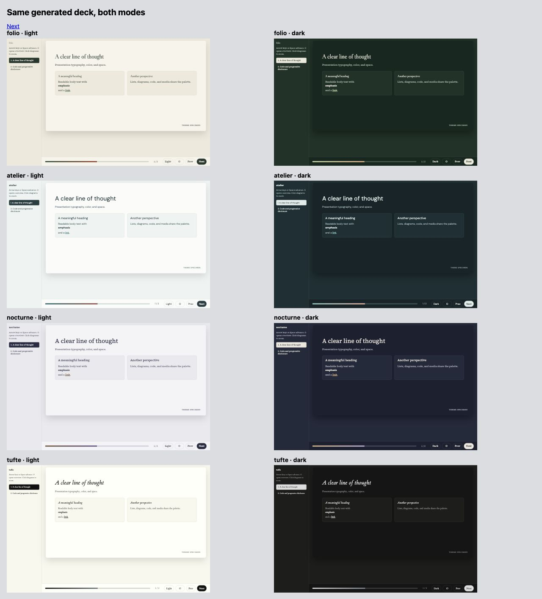
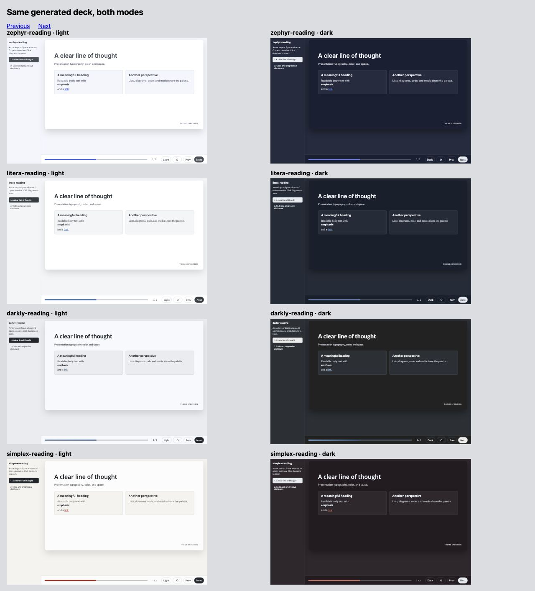

# 1. Which themes have a coherent design language?

**Decision draft · 9 November 2026 · no production theme changes**

**Rollout approved:** the nine-theme foundation recommendations below are now
accepted for implementation. Follow the [phased implementation plan](implementation-plan.md)
for upstream SmallDocs/Quarto work, then htmpres, then revised plotting experiments.
The measurements in this report remain the pre-implementation baseline.

Folio, Atelier and Nocturne have coherent light/dark identities in the current
htmpres adapter. Atelier fits its shared presentation shell particularly well;
Folio and Nocturne offer distinct editorial voices. Tufte is a valuable restrained
alternative, but the surrounding card-and-shadow slide UI does not yet express
its philosophy. All five Reading themes deserve equal attention. The
[actionable specification at the bottom](#proposed-changes-to-our-nine-themes-a-shared-foundation-two-reading-conditions)
defines proposed changes for all nine owned themes, separately for blogs and
slides, with swatches, typography and spacing ladders. Stock Bootswatch is
reference material only.

This is the first of three linked decisions. [Part 2](02-presentation-color.md)
tests these judgments against Schwabish's visual presentation guidance.
[Part 3](03-scientific-palettes.md) tests scientific color systems for all nine
priority themes. These are recommendations for selection, not an approved redesign.

## What is actually being reviewed

The current catalog contains **35 paired themes / 70 modes**, not 32: Bootstrap,
25 Bootswatch themes, Folio, Atelier, Nocturne, five Reading refinements, and
Tufte. The three older unpaired seeds, Sage, Mono Grid and Blank, are outside
this paired-theme audit. Thus the CLI's 38 names and this report's 35 pairs
describe different scopes. Archived original/refined designs in Elegant are
also not extra htmpres themes.

The unit of assessment is the **current htmpres rendering**, not an upstream
Bootswatch demo. Its adapter imports palette roles and font stacks, then applies
the same navigation, slide surface, cards, spacing and code system. It does not
import most source component styling, reading widths, margins, buttons or
responsive typography. This explains why many stock themes look similar here,
and why an excellent source documentation theme can still have slide problems.

The four custom/Tufte pairs have designed complementary palettes. Light-native
stock themes use Bootstrap dark variables. Dark-native stock themes and Reading
refinements use htmpres complementary adaptations. Do not count those derived
modes as upstream-designed or inherit the upstream review's scores for them.

## Evidence and review method

The rubric comes from the earlier Elegant review of *Refactoring UI*, checked
against the original 252-page PDF for this pass. The authors did not evaluate
these themes. Its six lenses are:

| Lens | What earns confidence | Source locations in the previously reviewed 252-page edition |
|---|---|---|
| Hierarchy | Size, weight, tone and spacing establish clear priorities without making secondary information unreadable | pp. 36–47, 54–59 |
| Spacing and grouping | Related content is close; section gaps and inner padding have consistent jobs | pp. 66–74, 96–99 |
| Color roles | Text, surfaces, accents and states have distinct readable roles | pp. 42–44, 142–168 |
| Layout and scale | Width and responsive changes fit the content and viewing task | pp. 76–81, 92–95, 114–116 |
| Surfaces and restraint | Edges, shadows and fills explain groups without competing with them | pp. 190–192, 224–241 |
| Personality | Typography, palette and component shape describe the same character | pp. 20–26, 108–112 |

We used the existing [Elegant UI guide](https://rahuldave.com/elegant-themes/ui-design-guide.html)
and [design assessment](https://rahuldave.com/elegant-themes/visual-design-report.html),
including their source-code rubric and disclosed self-review limits. We also
read the original PDF at pp. 20–22, 36–44, 66–74, 76–81, 96–99, 102–107,
114–116, 142–160 and 162–168, and visually checked the illustrations at
pp. 73, 105, 147, 154 and 164. Remaining page
pointers in the rubric come from the earlier Elegant review. The original is
kept in the ignored sibling `nossaifd-talks/books` folder; no book pages are
redistributed here. The present classifications are our own judgments, and no
numerical aesthetic leaderboard is implied. Source fingerprints are recorded in
[source-manifest.json](results/source-manifest.json).

Fresh evidence comprises the checked-in catalog, its shared adapter, a complete
35-theme renderer smoke run, solid-color measurements for all 70 modes, and nine
browser contact sheets of the same actual rendered slide in all 70 modes.
Atelier was also inspected full size, switched from light to dark, and advanced
to its code slide. Contact sheets establish composition and relative character;
they are not a small-text legibility or interaction audit of every theme.
No physical projector, phone or reader study was used.

The [raw role table](results/theme-roles.csv) reports unrounded calculations.
The numeric screen uses 4.5:1 for normal text on paper/panel/code and 3:1 for
large text only where applicable. These thresholds come from
[WCAG](https://www.w3.org/WAI/WCAG22/Understanding/contrast-minimum.html), not
Refactoring UI. A ratio is evidence about one color pair, not a whole-theme
accessibility certificate. Borders and decorative surfaces are not normal text.

## What the original book adds to this review

Refactoring UI's pp. 142–151 describe a vocabulary of neutral shades, primary
shades and additional semantic colors, anchored to actual uses such as text,
buttons and tinted backgrounds. Page 147 explicitly recognizes that graph
categories can need more accent colors. A five-swatch mood board is therefore
not a sufficient theme specification, and our five aliases collapsing to one
or two colors is a substantive limitation.

The same book recommends keeping those choices finite rather than inventing
another shade for every component. A useful revision would define separate
accent ink, accent fill, focus, context and state roles, then test each on its
allowed surfaces. The dark-text/pale-fill example on p. 164 is particularly
relevant: making every accent darker or brighter cannot solve every role at
once without changing visual emphasis.

Pages 152–157 also show why equal HSL lightness does not mean equal perceived
brightness. Their practical hue/shade adjustments help UI design; they do not
establish that a generated scientific color scale has equal perceptual steps.
Part 3 measures that separately. Pages 166–168 reinforce the need for cues
besides color; chart labels, line styles and symbols belong in the design
contract, not merely in accessibility footnotes.

## Shared problems that theme selection cannot solve

1. **The UI adapts color more than design language.** Every theme gets a rounded,
   shadowed slide and similar cards. This supports consistency for Atelier, but
   makes Tufte less booklike and weakens the distinctive shape systems of stock
   themes. Audit the selected theme's structural variant before editing its hues.
2. **Body copy is often treated as secondary.** The specimen's `.card p` uses
   muted ink. That is a meaningful reading role, not optional decoration. Weak
   muted colors therefore affect ordinary explanations, not just footnotes.
3. **The accent vocabulary overstates its distinctions.** `teal` and `indigo`
   become the same accent; `amber`, `rose` and `violet` become the same secondary.
   Four Reading pairs also set accent equal to secondary. Those aliases cannot
   stand for five categories or five semantic states. Use semantic role names
   and a separate chart cycle in a future change.
4. **Role validation is surface-specific.** Several derived accents were made
   readable against paper but fail the same screen on panels. The light/dark
   pair must be validated as a matrix of roles and surfaces.
5. **Syntax colors are shared across families.** Code keeps its function, but
   its blue/purple/green/yellow/pink grammar can feel imported into Folio or
   Nocturne. A selected family should get a deliberate code and figure policy;
   coloring every token with a brand hue would destroy useful distinctions.
6. **Reading scale is not presentation scale.** In the full-size 1280×720
   Atelier specimen, the title was 37.6px, card headings 18.88px, card text
   16px and code 14.4px. That is evidence about this fixture/layout, not every
   slide. It nevertheless requires a dedicated projected-presentation profile.
7. **Font names are not proof of font delivery.** Custom and Reading families
   bundle local fonts; stock families may fall back if their named typeface is
   absent. Judge the delivered font, and verify fallbacks before attributing
   fine typographic character to a stock font name.

## Detailed review of the nine priority themes

| Theme | Light mode | Dark mode | Design judgment and next decision |
|---|---|---|---|
| **Folio** | Warm paper, green text/accent and restrained rust form a convincing literary family. Display and body serifs have clear roles. | Green-black paper and pale sage retain that family instead of becoming generic charcoal. | **Retain both.** Strong source identity survives adaptation. Reduce the common slide shadow for a more editorial expression; test display-serif readability at projection distance. |
| **Atelier** | Cool near-white, teal-grey text and DM Sans give a clear technical/studio voice. Quiet panels support grouping. | Blue-green near-black and pale teal preserve the same relationships. | **Practical comparison base.** Retain both. Give primary content a stronger role than the current muted card text; tune a presentation scale and chart typography together. |
| **Nocturne** | Pearl-grey with brown and purple is coherent, though less immediately recognizable than its dark counterpart. | Ink-blue, warm brass and literary serif create a distinctive evening palette. | **Retain both; lead with dark as its identity.** Use brass selectively. Review chart/title emphasis together so warm highlights do not compete. |
| **Tufte** | Cream paper and near-black serif are highly restrained; italic headings preserve character. | Neutral near-black/grey is a convincing reading companion. | **Retain as a different philosophy.** The shared shadowed frame and cards work against the identity. Its accent equals ink, so distinguish links by underline and figure emphasis by an explicit optional color. |
| **Zephyr Reading** | Inter, controlled blue and quiet grey-blue panels make a strong modern UI. | The blue-tinted adaptation is coherent in hue; accent-on-panel is only **3.97:1**. | **Retain native light; repair dark before recommendation.** It offers a distinct neutral sans alternative to Atelier, not merely a lesser custom theme. |
| **Simplex Reading** | Open Sans, warm neutrals and deep red form an economical, coherent identity. | Warm dark surfaces preserve character; red-on-panel is **4.13:1**. | **Equal-priority candidate.** Retain light and repair dark. Reserve red branding from negative-data semantics, or use a different chart highlight. |
| **Pulse Reading** | Deep purple, soft lavender panels and system sans are restrained and legible. | Its complementary accent reaches **4.53:1** on paper but **3.90:1** on panel. | **Equal-priority candidate.** Retain light and repair dark. Purple offers a useful identity outside the many blue/teal options. |
| **Litera Reading** | Serif body plus clear sans headings is a useful reading/presentation hybrid. Blue links are much stronger than stock Litera. | Ink-blue adaptation has strong main text, but accent-on-panel is **3.93:1**. | **Retain light; repair dark.** Confirm that prose, lists, captions and chart text maintain intentional font roles rather than inconsistent local overrides. |
| **Darkly Reading** | The complementary blue-grey light palette is restrained and has usable primary text. | Charcoal, Lato and pale blue links form a practical dark UI. The secondary is dark blue: only **1.86:1** on panel. | **Retain dark with a secondary-role repair; retain light as conditional companion.** A dark secondary fill can be useful with suitable text, but it must not be reused as a readable text/line accent. |

The four custom/Tufte identities remain candidates because they provide different
visual purposes, not because they are ours. The same principle keeps Simplex
and Pulse Reading in the detailed experiments. Their native palettes are
arguably cleaner than some more celebrated stock alternatives.

## Complete catalog critique

The judgments below concern the current adaptation. A theme whose source relies
on gradients, unusual borders or special component styling may lose much of
that personality when only its colors and fonts are imported. Every row includes
both modes; the nine priority rows above supply their fuller interpretation.
Stock-theme repair language describes limitations for comparison and adoption;
it is not a proposal to edit the original Bootswatch themes. Only our nine owned
variants enter the change specification below.

| Theme | Light-mode critique | Dark-mode critique | Decision for this workstream |
|---|---|---|---|
| Bootstrap | Clear neutral baseline; blue accent is marginal on paper and 4.27 on panel. | Conventional charcoal; readable main accent, less dependable secondary text. | Keep as baseline, not a distinctive finalist. |
| Cerulean | Pleasant blue identity undermined by accent 2.77 on paper and muted panel text 4.01. | Generic Bootstrap structure with a much more readable light blue. | Defer; native light needs substantive contrast work. |
| Cosmo | Calm thin/sans direction, but blue links are 3.97 on paper. | More readable accent, but source typography/shape distinction is diminished. | Defer in favor of Atelier/Zephyr Reading. |
| Cyborg | Clean light adaptation, but blue panel links fall to 4.37. | Severe black surface gives strong contrast but harder outlines and less calm grouping. | Specialist high-contrast character; not a first refinement target. |
| Darkly | Restrained light adaptation; panel accent 4.13. | Strong main text with more conspicuous panel boundaries. | Prefer Darkly Reading for detailed work. |
| Flatly | Familiar clear layout; green link 2.41 on paper is a serious role mismatch. | Accent remains 4.45 on paper / 3.84 on panel. | Defer both until role repair. |
| Journal | Heading/body contrast offers character, but coral links are weak. | Stronger accent readability; heavy headings can dominate shared cards. | Conditional editorial alternative; Folio more coherent as a pair. |
| Litera | Useful serif/sans pairing, weak blue links (3.71 on paper). | Readable primary colors; upstream reading repairs are absent. | Prefer Litera Reading. |
| Lumen | Neutral working surface; link 3.82 on paper. | Clear colors but little distinctiveness survives the shared shell. | Defer. |
| Lux | Monochrome restraint works; muted panel text is 3.66. | Dark link 3.83 on paper / 3.18 on panel breaks the monochrome promise. | Defer; Tufte is the stronger restrained direction. |
| Materia | Generic but coherent sans; accent 3.12 on paper. | Stronger colors; material-specific component grammar is mostly absent. | Defer. |
| Minty | Pastel personality is visible, but body text is 3.54 and muted panel text 2.31. | Readable Bootstrap-derived dark mode loses much of the pastel identity. | Reject as a ready-to-use pair for this purpose. |
| Morph | Tinted surface and pale text collapse hierarchy: body 2.63. | Text improves, but differently tinted outer surface/panels feel less unified. | Reject until substantial redesign. |
| Pulse | Deep purple and quiet neutrals work in light. | Native stock dark variables are relatively readable; less distinct from other dark variants. | Retain as comparator to Pulse Reading, which is not automatically superior in dark. |
| Quartz | Neutral light adaptation loses the theatrical source character. | Violet ground is distinctive, but muted panel text is 2.93 and links 4.04. | Defer; background competes with the content. |
| Sandstone | Warm accent is only 2.03 on white; subdued palette erases emphasis. | More usable main accent; secondary panel text still 3.83. | Defer. |
| Simplex | Red with neutral text is coherent; sampled text roles largely robust. | Readable main accent; generic dark companion changes its character. | Strong stock comparator; refine Simplex Reading instead. |
| Sketchy | Playful handwriting survives; crisp stock cards create a mixed shape language. | Main accent 4.18 on paper, 3.80 on panel; handwriting still dominates. | Keep for deliberate informal use, not this scientific default. |
| Slate | Neutral light adaptation, panel links 4.26. | Strongly outlined panels; muted panel text 3.63 is too weak. | Defer. |
| Solar | Readable ordinary text in derived light; links weaken on panels. | Dark teal identity is strong but body 4.75 has little reserve; muted panel text 3.00. | Defer for projection; color atmosphere is not readability. |
| Spacelab | Grey body 4.48 and muted panel text 2.70 undermine the calm aesthetic. | More robust text; source distinction limited in shared shell. | Defer. |
| Superhero | Clear derived light with weak panel accents. | Navy/orange pairing is memorable; orange panel accent only 3.83. | Specialist alternative after repair. |
| United | Warm orange personality; links 3.65 on paper. | Readable dark accent, less distinctive overall pair. | Defer; Simplex Reading supplies a cleaner warm-accent candidate. |
| Vapor | Clear pastel-tinted adaptation without much neon personality. | Saturated cyan type and purple field retain character but make everything compete. | Reject as a default analytical/presentation UI; retain for intentional style. |
| Yeti | Quiet layout, but pale-weight heading and weak blue links need review. | More readable blue; lightness of heading weight remains a distance concern. | Defer. |
| Zephyr | Coherent blue/Inter UI; muted panel copy 4.01 is a defect. | Readable ordinary main colors, generic dark companion. | Prefer Zephyr Reading light; keep stock dark as a repair comparator. |
| Folio | Coherent warm editorial identity. | Coherent green-black companion. | Advance both. |
| Atelier | Coherent technical/studio identity. | Coherent teal-black companion. | Advance both; practical comparison base. |
| Nocturne | Coherent pearl/brown/purple identity. | Coherent ink/brass identity. | Advance both. |
| Tufte | Restrained serif; shared cards weaken the language. | Restrained neutral pair; same structural mismatch. | Advance as minimalist alternative. |
| Zephyr Reading | Strong modern blue/sans direction. | Panel-accent repair required. | Advance with explicit condition. |
| Simplex Reading | Strong economical warm/red direction. | Panel-accent repair required. | Advance with equal priority. |
| Pulse Reading | Strong purple/system-sans direction. | Panel-accent repair required. | Advance with equal priority. |
| Litera Reading | Clear prose hierarchy and stronger blue. | Panel-accent repair required. | Advance with equal priority. |
| Darkly Reading | Usable restrained complementary light. | Strong main accent; weak secondary role. | Advance with equal priority. |

More evidence: contact sheets [2](figures/contact-2.png),
[3](figures/contact-3.png), [4](figures/contact-4.png), [5](figures/contact-5.png),
[6](figures/contact-6.png), [7](figures/contact-7.png), [8](figures/contact-8.png).

## What should carry back to SmallDocs and Quarto

Carry back a **role contract**, not slide pixel sizes: readable ink on each
surface, accent text separate from accent fill, state semantics separate from
category colors, explicit body/heading/code font roles, and consistent light/dark
relationships. Audit the paired SmallDocs CSS and Quarto Sass together if those
roles change. The current 640px reading width and 1.45 leading are document
decisions; the proposal below revisits prose leading and defines a separate
projection profile with different size/space assignments.

Do not overwrite a source Reading theme with an htmpres-derived dark palette
merely because it exists here. First decide whether that source project should
publish a designed pair at all. Fixing htmpres adaptation defects can stay local
to the importer/adapter unless a native source defect is independently reproduced.

## Provisional selection for Part 2

Advance **all nine priority themes**. Within them, test Atelier as a practical
presentation comparison; Folio/Nocturne for distinct editorial voices; Tufte for a
minimal direction; and all five Reading alternatives with the repairs described
above. Retain Bootstrap and stock Pulse/Simplex/Zephyr as comparison controls.
No theme is selected for implementation yet.

## Proposed changes to our nine themes: a shared foundation, two reading conditions

**Working specification for joint review, added 9 November 2026.** This is the
actionable conclusion of Part 1. It supersedes any implication above that we
should redesign stock Bootswatch themes or select one winner before defining
the system. Our editable scope is **Folio, Atelier, Nocturne, Tufte and all five
Reading variants**. Stock Bootswatch remains comparison material. Changes to a
Reading variant belong to our named override/extension, not the upstream theme.
For Tufte, the proposal concerns our adaptation, not a fork of its upstream philosophy.

The aim is to give each family a complete vocabulary for text and interface
components, then map that vocabulary deliberately to **blogs/documents** and
**presentations**. Shared meaning does not require identical geometry. A Tufte
text group and an Atelier panel can express the same grouping role without
having the same border, background or shadow.

The earlier observations measure the current htmpres adaptation. The proposal
below also checks the owned Elegant sources: the custom themes' `theme.json`,
`common.css` and `design.css`, and the Reading variants' `theme.json` and
`reading.css`. That distinction matters: Reading sources already separate
`link`, `button`, `on-button` and semantic-state colors. We should preserve that
work, not recreate it under new names or “repair” a good button fill because it
failed when the slide adapter reused it as text.

### Compatibility with Part 2, before choosing values

I read Part 2 before deriving this proposal. Its core recommendations complement
this foundation: readable primary prose, surface-specific text roles, separate
accent ink/fill, deliberate emphasis, and different document/projection scales.
It does not require every theme to become a neutral sans-serif presentation.

| Part 2 recommendation | Part 1 foundation | Relationship / decision still to make |
|---|---|---|
| Ordinary explanations must remain readable | Paragraphs and list items use primary ink, including inside a card; supporting metadata alone uses secondary ink | Agreement. This changes role assignment before changing every shade. |
| Text accent must work on every intended surface | Separate accent text, accent fill and text-on-fill; publish tested combinations | Agreement. Carry the existing Reading source distinction through the adapter. |
| Reduce competing visual emphasis | Quiet default headings, one deliberate emphasis role, neutral secondary actions | Agreement. A large palette is available vocabulary, not a demand to use every hue on one screen. |
| Projection needs larger, stronger type | Same finite type vocabulary; separate blog and audience-slide subsets | Agreement on direction. Exact slide sizes below are proposed starting values, not a room-tested guarantee. |
| Sans often survives projection better | Preserve serif identities; propose stronger regular serif text and sans UI labels | Open choice for Folio, Nocturne, Litera and Tufte: test serif body versus a sans projection profile. Do not silently remove their identity. |
| Subtle panels may vanish in projection | Blog panels may use quiet fills; slides must also group through spacing, headings and alignment | Open choice: strengthen the boundary only when grouping needs it, or remove the box. Tufte starts with no box. |
| Use brass/rust/red sparingly | Retain family hues but stop automatically coloring all headings, controls and chart marks with them | Open choice about the amount of emphasis, especially Nocturne and Simplex. |
| Few typefaces simplify a slide | Preserve distinct display/prose/UI/code roles, using only the needed subset in each view | Folio's optional display face adds a fourth family on a code-heavy page. Compare keeping it only for covers versus simplifying to Source Serif + DM Sans + mono. |
| Figures require data-appropriate colors | UI swatches below are not a category cycle or scientific colormap | Agreement. Part 3 chooses data encodings after these interface roles are stable. |

We will use that table when reviewing Part 2 together. The unresolved rows are
choices to compare; this addition does not quietly decide all of them.

### Foundation A: colors are named by job, with explicit combinations

Keep the existing characteristic paper colors and hue families. Add the shades
and distinct roles needed to use them consistently. The finite swatches below
are **candidate UI shades**, derived from current anchors and checked after
rounding to actual hex values. They are not claimed to be perceptually uniform
scientific ramps. Named current anchors remain available when a useful existing
color does not fall on a newly generated shade step.

Use three layers: **swatch → semantic role → component use**. A component asks
for `accent-text` or `surface-panel`, not “blue-500”; the light/dark role mapping
chooses the swatch. A figure asks a different data-color API, not these UI roles.

| Role contract | Blog / general-theme use | Presentation use | What to stop doing |
|---|---|---|---|
| Paper, panel, code surface | Page, optional grouped region, code block respectively | Slide canvas, genuinely useful grouping, code area | Do not nest tinted cards merely to fill the page, or force all prose onto a panel. |
| Primary ink | Article prose, list items, meaningful table values, field labels, callout body | All audience explanations, data labels and essential captions | Do not make `.card p` secondary by default. |
| Secondary ink | Dates, bylines, supporting descriptions, nonessential UI metadata | Only supporting information, still large enough and visibly separated | Do not use reduced opacity as a substitute for a tested color. |
| Accent text | Links, selected labels, deliberate inline emphasis | One intended emphasis; links with a non-color cue | Do not reuse button fill as small text merely because both belong to the same hue family. |
| Accent fill + on-accent ink | Primary button, checked control, selected control when a fill is needed | Sparse diagram/emphasis fill or local controls | Do not assume on-fill ink is always white, or always the page color. Test the pair. |
| Secondary action / secondary text | Neutral alternative button; an optional second accent only for a defined job | Mostly neutral supporting labels; editorial secondary hue used deliberately | Do not give four Reading themes arbitrary extra hues merely to fill five legacy color aliases. |
| Decorative line | Dividers, table rules and gentle panel boundaries | Optional organizational rule | A decorative line is not automatically strong enough to identify a control. |
| Control boundary / focus | Input outline and visible keyboard focus against the actual adjacent surface | Interactive controls; presentation canvas content uses separate grouping decisions | Do not make every decorative line dark just to repair input boundaries. |
| Success / warning / danger / information | Explicit state background, state ink, border and word/icon | Only where those meanings exist in the material | Simplex brand red is not an error state; Nocturne purple is not “negative data.” |

The candidate screen uses **5:1 for normal UI text roles on their specified
paper/panel/code surfaces**, **4.5:1 for text on a filled button**, and **3:1
for the tested focus/control boundary**. The 5:1 target is our modest reserve
over the usual 4.5 normal-text screen; it is not a new WCAG rule or a guarantee
under projection. Decorative rules and large heatmap cells have other jobs.
The evidence table reports exactly which pairs were tested. Hover, disabled,
selected, pressed and error states must be mapped and checked as complete
components before production adoption; a base palette alone is not a complete
interaction audit.

For primary link/button hover, prefer another appropriate shade of the same
family, or an underline/boundary change. The custom blog sources currently map
primary hover to the secondary hue; changing a green primary action to rust
on hover should become a conscious design choice, not a generic default.
Do not make all secondary actions colorful. Preserve word/icon cues for states.

### Foundation B: a finite typography ladder and explicit font jobs

Refactoring UI's hand-selected size scale on p. 105 supplies the vocabulary:
**12, 14, 16, 18, 20, 24, 30, 36, 48, 60, 72**. Its spacing chapter, pp. 70–74,
and type chapter, pp. 102–107, favor a constrained set of useful decisions over
an arbitrary size for every selector. We freshly checked those passages and
the scale illustrations for this addition. The following assignments are ours.

For blogs, express these nominal CSS-pixel values in `rem` against a normal
16px browser reference (18px = 1.125rem, 20px = 1.25rem), while honoring user text
preferences. Set body size as a role; do not reset the root to 17px and then
silently reinterpret the whole ladder. For the current 1280×720 slide canvas,
these are design-coordinate pixels before the whole slide is scaled to fit.
They are neither physical projector pixels nor point sizes. A responsive
reading view of the slide deck needs the blog profile rather than tiny scaled
presentation text. Avoid nested `em` font-size multiplication; relative units
remain useful for line length and local optical details.

| Job | Blog/document profile | Audience-slide profile | Explicit exclusions |
|---|---|---|---|
| Small metadata | 14; 16 when important | 24 if the audience must read it | 12 reserved for exceptional nonessential UI badges; never article prose or required slide text. |
| Navigation, controls, form labels | 16, normal/medium weight | 14–16 only in presenter/editor controls outside the audience canvas | Don't project the reader's sidebar or shrink control labels to 10–12px to preserve a layout. |
| Body and list text | 18 for sans families; 20 for serif prose | 30 regular; 36 for a short key statement | No 16–20px audience paragraphs. Dense material must get a different layout, not automatic shrink-to-fit. |
| Lead / standfirst | 20 or 24 | 36 | It is a separate role, not a random local percentage. |
| Minor heading | 20 or 24 | 36 | Use weight/spacing as well as size; don't need an additional heading size for every component. |
| Section heading | 30 | 36 or 48 according to level | Keep the same level consistent within the artifact. |
| Page / slide title | 36; 48 for editorial display on wider screens | 48 | Long titles can wrap; do not automatically compress letter spacing until they fit. |
| Cover / display | 48, occasionally 60 on a landing page | 60 or 72 | 72 is not the default title of every slide or article. |
| Code | 16; inline code aligned optically with surrounding text | 24 minimum trial, 30 preferred | No inherited .78/.85rem code captions. Wrapping, excerpting or another view precedes shrinking. |
| Table / figure labels | 16–18, depending on importance | 24–30 at the placed size | A plot's internal 12pt setting says nothing about its final size after embedding. |

Use line heights as a small independent set: **1.1/1.2 for short display and
headings, 1.35 for slides, 1.5 for UI/code, 1.6 for long prose**. These are
starting role assignments; check actual font metrics and avoid fixed-height
containers that clip accents or descenders. Use regular 400 body text and a
real available 600/700 for hierarchy. Folio's display face is 400 only; Lato's
bundled emphasis is 700. Do not request an unavailable 600 and mistake synthetic
weight for a carefully designed typographic step.

| Theme | Prose / explanatory text | Headings and display | UI, labels and code |
|---|---|---|---|
| Folio | Source Serif 4, 20 blog / 30 slide | Libre Caslon Display only at large title/display sizes; Source Serif 4 for section headings | DM Sans UI/labels; IBM Plex Mono code. Sans slide-body alternate remains a Part 2 choice. |
| Atelier | DM Sans, 18 / 30 | DM Sans; use real 600 for smaller hierarchy and 400/600 for large titles | Same sans UI; IBM Plex Mono code. Relax very tight tracking at small sizes. |
| Nocturne | Source Serif 4, 20 / 30 | Source Serif 4, with warm color reserved for selected emphasis | DM Sans UI/labels; IBM Plex Mono code. Sans slide-body alternate remains open. |
| Tufte | ET Book, 20 / 30, existing serif fallback when unavailable | ET Book regular for projected headings; italic sectional headings remain an optional reading characteristic | Preserve restrained existing UI/mono fallbacks; do not claim DejaVu Serif in a plot is ET Book. |
| Zephyr Reading | Inter, 18 / 30 | Inter 600/700 where delivered | Inter UI; IBM Plex Mono code. |
| Simplex Reading | Open Sans, 18 / 30 | Open Sans 600/700 | Open Sans UI; IBM Plex Mono code. |
| Pulse Reading | System sans, 18 / 30 | Same system family; deliberate hierarchy | System UI; IBM Plex Mono code. Platform variation is explicit, not a font-loading failure. |
| Litera Reading | Georgia, 20 / 30 | System sans for section headings; serif prose remains distinctive | System sans UI/labels; IBM Plex Mono code. Compare sans slide-body only in Part 2. |
| Darkly Reading | Lato, 18 / 30 | Lato 700 emphasis; 400 ordinary text | Lato UI; IBM Plex Mono code. |

This replaces scattered size multipliers in our owned overrides. It does not
replace every serif with sans, force all headings into the accent color, or
make the original Bootswatch defaults conform to our scale.

### Foundation C: spacing, measure and surface treatment

Use one **spacing vocabulary** with different role assignments:
**0, 4, 8, 12, 16, 24, 32, 48, 64, 96, 128**. This is the useful lower subset of
the example on Refactoring UI p. 73, with zero added for deliberately unboxed
content. Gaps get farther apart as they grow; do not generate every multiple
of four. Border widths **1 and 2** and radii **0, 2, 4, 8** are separate scales,
not violations of the spacing vocabulary. Larger sizing values such as 640
belong to a container-width decision, not a 640px paragraph margin.

| Layout job | Blog/document mapping | 1280×720 presentation mapping |
|---|---|---|
| Page edge / safe area | 24 desktop gutter, 16 narrow screen; content centered within available width | 64 canvas inset; 48 may be tested as a deliberate compact profile, not an automatic fallback |
| Related inline items | 8; 4 for tight icon/label relation | 12 or 16 for meaningful adjacent items |
| Label → field / heading → its text | 8 for form labels; 12 or 16 after a heading | 16 within a group; 32 from main title to content |
| Paragraph separation | 16, without also stacking an equal top margin | 24 |
| New subsection | 32 above a minor heading, 48 above a major section | 32 between blocks; 48 between genuinely separate groups |
| Columns | 32 between related content columns; wider layout may use 48 | 48 default; do not buy another column by shrinking body text |
| Bounded panel / code padding | 24 panel; 16–24 code according to density | 32 panel; 24–32 code |
| Unboxed text grouping | 0 inner padding; groups separated by 32/48 | 0 inner padding; groups separated by 32/48, particularly Tufte |
| Major opening / closing space | 64; 96 only for a deliberately spacious landing section | 64 or 96 for cover compositions; 128 only where content permits |

The grouping rule is more important than the particular number: **space between
groups exceeds space within a group**. A 16px heading-to-text gap and 48px
between sections explains hierarchy without another box. Do not apply padding
and margins twice at nested container boundaries.

For blog prose, start with the existing **640px maximum** and check actual line
length, aiming around **55–70 characters**, within the book's 45–75 range
(pp. 114–116). A 60–65ch constraint is a useful approximation, not a character
counter; serif and sans metrics differ. Figures and tables may extend beyond
the prose measure. Keep the wider article layout available for navigation and
margin notes, but collapse those columns on narrow screens. Use the larger
sans/serif body size to improve reading without automatically widening the text.

For slides, use the content's geometry: two columns are appropriate only when
the proposed sizes and gaps fit. Keep title, body and figures aligned to a few
shared guides. A framed preview in the authoring application may help distinguish
the slide from the surrounding window; the **projected/exported canvas itself
gets no permanent drop shadow or ornamental rounded frame**.

Default component shape is intentionally different by family: Folio radius 2,
Atelier 0, Nocturne 4, Tufte 0, Zephyr Reading 8, Simplex Reading 2, Pulse Reading
4, Litera Reading 2 and Darkly Reading 4. These are proposed choices from the
radius vocabulary, not claims that every source currently has those values.
Use **no resting card shadow** in these starting profiles. A blog menu or dialog
may use one restrained elevation treatment to communicate overlap; an article
paragraph is not a floating object. Tufte begins without card fill, border,
radius or shadow; code and meaningful warnings can still have functional
boundaries. Atelier retains square ruled organization rather than inheriting
the rounded common slide shell.

### The swatches and ladders to use

The following generated specimens make the proposal inspectable. Each family
has neutral and accent shades, preserved anchors, and light/dark role choices.
The numeric results distinguish a changed text role from a retained fill.
The shared type and spacing boards show the vocabulary; the tables above
specify which steps belong in which medium. This is an available vocabulary,
not a mandate to use every step on every page.

The numbered families run from pale 50 to dark 950, with the current light-mode
hue anchor at 500. They are candidates for future component states, not a rule
that every primary button must use 500 in both modes. For this first profile,
use the explicit named anchors and tested role assignments shown on each board;
leave the other shade steps unused until a component needs them. This preserves
the designed dark-mode hues and paper temperature instead of replacing them
with mechanically chosen numbers.

These examples make the distinction between a role repair and a redesign
concrete. The ratios here are against the panel; the full evidence also checks
paper and code surfaces. A value just below our proposed 5:1 reserve is not
automatically a failure of the usual 4.5:1 text screen.

| Theme / mode | Proposed role change | Panel contrast, current → candidate |
|---|---|---|
| Folio light | Supporting ink `#5f6b62` → `#5a655d`; main ink and paper retained | 4.61 → 5.03 |
| Atelier light | Supporting ink `#526d70` → `#516b6e` | 4.95 → 5.09 |
| Nocturne light | Supporting ink `#626779` → `#5e6274` | 4.66 → 5.01 |
| Tufte light | Supporting ink `#6b6b69` → `#6a6a68`; this is only a small reserve adjustment | 4.998 → 5.07 |
| Zephyr Reading dark | Accent text `#6782ec` → `#8595f0`; keep fill separate | 3.97 → 5.02 |
| Simplex Reading dark | Accent text `#d16c62` → `#da8075`; keep fill separate | 4.13 → 5.01 |
| Pulse Reading dark | Accent text `#9379bb` → `#a58fc6`; keep fill separate | 3.90 → 5.04 |
| Litera Reading dark | Accent text `#6689bc` → `#819cc7`; keep fill separate | 3.93 → 5.03 |
| Darkly Reading dark | Secondary text `#375a7f` → `#90a0b6`; **retain `#375a7f` button fill with white ink** | 1.86 → 5.00 |
| Darkly Reading light | Accent text `#556d87` → `#50667f` | 4.52 → 5.00 |

The four light-native Reading themes also get neutral secondary text rather
than a duplicate brand accent. Their native link/button distinction remains.
The generated table contains **342 base role/surface checks across 18 modes**;
state ink/border pairs and Tufte's optional highlight fill/ink are checked
separately. None of these candidate hex values has been applied to production.

<!-- FOUNDATION_SPECIMENS -->

### Concrete changes by theme, at both levels

The common changes above apply to all nine. The table below specifies the
additional work that gives each one its individuality. “General” means our
blog/document extension and its SmallDocs/Quarto outputs. “Presentation” means
our htmpres adaptation. None of this requests edits to upstream Bootswatch.

| Theme | Keep / strengthen in the general theme | Change in presentations | Guardrail / reason |
|---|---|---|---|
| **Folio** | Keep warm paper, green/sage primary family, rust secondary and serif prose. Establish the 20px prose / 16px UI minimum roles; stop using tiny metadata and display serif for every heading. Use fine rules and radius 2, with no resting shadow. Strengthen secondary ink only where the new role screen requires it; keep paper anchors. | Remove the common slide shadow and reduce filled-card repetition. Use 30px Source Serif body, 48px large title, 36px section heading, 64px outer margin. Keep Libre Caslon for large cover/title use only; diagrams and dense labels use DM Sans. | Green and rust should have distinct jobs. Do not automatically change primary green interactions to rust on hover. Decide the serif/sans projection alternate in Part 2. |
| **Atelier** | Preserve the square studio grammar already present in its source: ruled groups, square code blocks and callouts. Keep DM Sans and teal with optional terracotta emphasis. Replace scattered small sizes and excessive negative tracking with the role ladder. Primary prose uses ink, not secondary ink. | Replace generic rounded cards with square panels only where they help, otherwise open columns. Use 30/36/48 text hierarchy, 32px internal panel padding and 48px column gaps. Keep labels aligned and quiet. | Atelier's fit with the existing shell is not proof it is the best design. Its own source is squarer than that shell; preserve that distinction. |
| **Nocturne** | Keep the ink-blue/pearl surfaces, Source Serif prose and brass/brown primary with purple secondary. Give DM Sans clear UI/metadata jobs. Use body ink for most headings; retain a short brass rule or selected emphasis instead of making every large heading brass. Radius 4; quiet code panels. | Keep the dark identity without forcing dark mode for every room. Remove ornamental frame/shadow, enlarge serif text, make brass scarce, and avoid adding a purple filled card merely because a secondary color exists. | Standard data-map highlights may compete with brass. Part 2 decides the emphasis budget and serif projection profile; Part 3 decides chart semantics. |
| **Tufte** | Keep cream/neutral paper and ET Book. Give paragraphs, quotes and sidenotes hierarchy through measure, type and space. Use borderless text groups and booklike table rules. Preserve ordinary link ink with an underline; optional color emphasis is a separate role. Improve marginal small-text roles where measured. | **Mute the cardiness:** card-like text groups become transparent, borderless, shadowless, square and internally unpadded; retain 32/48px group separation. Use regular large projected headings instead of making every small heading italic. Convert margin notes to an explicit side column or notes view when appropriate. | “Minimal” does not mean faint. Code blocks, focus indicators and warnings still need usable boundaries. Optional blue emphasis must not turn all links or charts into a new blue brand. |
| **Zephyr Reading** | Keep Inter and blue, native light paper/panel colors and existing separate link/button fields. Standardize 18px prose, 16px UI and 14px supporting metadata; use radius 8 for actual controls/cards, not every section. Publish dark mode as a deliberately designed companion if adopted. | Repair the current dark text-accent role on paper/panel/code while retaining a distinct fill. Use 30px Inter body and selected 600/700 hierarchy. Keep only useful panels; don't repeat blue fills around ordinary paragraphs. | The dark repair belongs first to the htmpres-derived companion. A new blog dark variant must be explicitly authored and checked; it is not an upstream Zephyr update. |
| **Simplex Reading** | Keep Open Sans, warm neutrals and economical red emphasis. Retain the source's link/button/on-button separation and explicit danger-state vocabulary. Use radius 2 and quiet ruled grouping. Publish coherent native/light and optional designed dark role mappings. | Repair dark accent text independently of its red fill. Use 30px regular sans body, clear 36/48 hierarchy and mostly neutral panels. Prefer weight or a rule before adding more red. | A red primary button is not a danger action. Error states need a word/icon and their own fill/ink pair; red is not automatically the negative arm of a chart. |
| **Pulse Reading** | Keep purple and the system-sans identity; document platform font variation. Standardize the type scale and radius 4; pale lavender is a supporting surface, not the default background of every paragraph. Keep secondary actions neutral. | Repair the dark purple text role that currently passes paper narrowly and fails panel. Preserve larger type, open groups and a clear single emphasis. | Do not invent a second decorative hue just because legacy aliases imply five colors. A purple UI ladder is not automatically an ordered scientific map. |
| **Litera Reading** | Keep Georgia prose and sans headings/UI as an intentional division. Use 20px article prose, 16px UI/labels and measured 14px metadata. Radius 2 and fine rules support the editorial character. Let figures extend beyond a constrained prose measure. | Repair dark accent text. Use 30px serif body with sans 36/48 headings and 24–30px figure labels; test the alternate sans-body projection profile later. | Do not flatten the useful serif/sans division by making every element inherit one generic family. Avoid retaining small document captions in slides. |
| **Darkly Reading** | Keep charcoal, Lato and the existing **pale-blue link / dark-blue button / white button text** distinction. The native source already does this correctly. Use 18px prose, 16px UI, actual bundled 700 for emphasis and radius 4. Treat the light companion as a separate designed adaptation. | Stop treating the imported dark-blue button fill as a readable secondary text/line accent. Preserve it as fill when its on-fill ink is valid; use the tested secondary text role for labels. Match 30/36/48 hierarchy and quiet panels. | Brightening the original button just to fix a slide text alias would damage the correct source distinction. Repair the mapping, then validate each intended surface. |

### What gets implemented where, after we choose

Create a single reviewed foundation record per owned family containing its
swatches, semantic light/dark mappings, font roles, type/space selections,
shape and elevation policy. **Keep one meaning; emit medium-specific mappings.**
Do not maintain unrelated hand-tuned hex values in three renderers.

| Owned surface | Proposed implementation responsibility | What is outside this change |
|---|---|---|
| Elegant custom theme source | Update the relevant `src/theme.json`, shared role rules and per-theme `design.css`; preserve declared font assets | No direct edits to generated distributions as the source of truth. |
| Owned Reading overrides | Extend existing `link/button/on-button/state` roles and replace scattered size/space values in `reading.css`; add a designed companion mode only deliberately | No edits to the original Bootswatch CSS or its upstream repository. |
| SmallDocs and Quarto outputs | Generate both from the owned source; map body, nav, TOC, links, forms, buttons, alerts, tables, captions and code to the same roles; verify both computed outputs | No assumption that identical variable names guarantee identical renderer output. |
| htmpres catalog/import adapter | Preserve role distinctions during import; add reading/presentation profiles and family-specific shape/grouping rules | No global restyling of all stock themes as collateral damage; scope overrides to the nine families. |
| Our Tufte adaptation | Put the unboxed grouping and optional highlight policy in our theme override layer; document source ownership when integrating with the blog package | No need to change upstream Tufte or pretend its general source lives in an Elegant custom-theme folder that does not exist. |
| Matplotlib / Seaborn, Part 3 | Map figure surface, primary/secondary text, font roles and placed-size targets to the chosen family/profile | UI swatch ladders do not become automatic category cycles, ordered maps or stateful chart meanings. |

Before adoption, render the same representative article, listing, code block,
form/button states, table, callout and figure in SmallDocs and Quarto, both
modes and a narrow viewport. In htmpres, render title/prose, two-column,
code/table and figure slides at actual audience size and exercise the mode
control. Compare effective font size and actual loaded family, every intended
text/surface pair, focus and interaction states, overflow and grouping. The
prototype swatches pass the documented color screen; this entire cross-renderer
component audit and a real room check are still required for production.

**The next joint decision is Part 2:** retain these shared foundations, then
choose among the explicitly marked projection tradeoffs. Parts 2 and 3 can
refine the medium-specific mappings without silently changing our nine families'
core identities. No production theme is changed by this specification.
