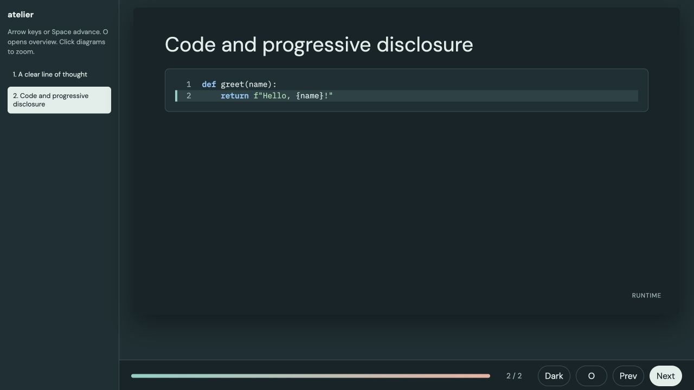

# 2. Do these palettes support visual presentation?

**Decision draft · 9 November 2026 · depends on [Part 1](01-design-language.md)**

The most dependable starting palettes remain Atelier, Folio and Nocturne, but
their visual presentation needs differ. Atelier is the best general technical
candidate; Folio's warm editorial character needs a projection typography pass;
Nocturne's brass should be reserved for the element that needs attention.
Tufte is an excellent neutral canvas if we add an explicit highlighting policy.
All five Reading themes remain live candidates: their simpler native palettes
are useful, while the mode/surface defects in Part 1 must be addressed before
calling them presentation-ready.

The next decision is about **visual roles and viewing conditions**, not finding
a single attractive set of hex codes. [Part 3](03-scientific-palettes.md) tests
the chart color systems required by those roles.

## Source scope: the look of slides, not their argument

This review uses Jonathan Schwabish's *Better Presentations* (Columbia
University Press, 2017), both the existing
[chapter summary](https://github.com/rahuldave/nossaifd-talks/blob/main/docs/schwabish-summary.md)
and the original PDF. We checked the visual passages on printed pp. 29–31,
35, 39–48, 51, 53–56 and 85–87; PDF page numbers are 15 higher. We also
inspected the rendered color/background and rainbow examples on pp. 41 and
45–47. The original is in the ignored sibling `nossaifd-talks/books` folder,
with its fingerprint in [source-manifest.json](results/source-manifest.json).
Other broad chapter pointers below come from the earlier summary; this is a
focused visual reading, not a claim to have reread the entire book.

| Visual criterion | Working application here | Printed book location |
|---|---|---|
| Unified, restricted color roles | A stable background, legible foreground, a deliberate highlight, and restrained supporting colors | Chapter 2, pp. 29–50 |
| Background appropriate to the room | Light/tinted light option for bright conditions; dark option evaluated in its intended dark setting | Chapter 2, pp. 29–50 |
| Value contrast and non-color cues | Inspect grayscale, text/surface contrasts, labels and mark shapes | Chapter 2, pp. 29–50 |
| Type visible from a distance | Check type size, stroke/weight, chart labels and numeric glyphs at presentation scale | Chapter 3, pp. 51–61 |
| Visual hierarchy without decorative noise | Avoid glow/3D text, aggressive backgrounds and competing emphasis | Chapter 4, pp. 65–82, visual portions only |
| Attention in charts | Selective highlight, quieter context, direct labels and restrained grid/axis treatment | Chapter 5, pp. 83–115 |

Excluded: narrative structure, hourglass planning, opening/closing language,
slide-count/content-density prescriptions, argument selection, rehearsal and
delivery. This document is about how the chosen material looks. It does not
rewrite the talk guide or import its content rules into themes.

The book's reported 28pt body / 45pt headline suggestions are useful prompts to
test distance, not CSS constants to paste into every responsive slide. Nor do
we turn its preference for sans on projected screens into a universal ban on
serif type. We can retain Folio/Nocturne/Tufte while validating their actual
stroke sizes and display conditions.

## Color roles before color counts

A UI accent is not automatically a chart palette. A presentation system needs
at least the following distinct specifications:

| Role | What should remain stable | What may vary |
|---|---|---|
| Text and page surfaces | Legible hierarchy on paper, panel and code surfaces | Mode-specific luminance and neutral tint |
| Single highlight | Consistent visual priority; meaning supplied by label or shape too | Theme-family hue |
| Context series | Visible without competing with highlight | Grey/tinted neutral adjusted to background |
| Unordered categories | Stable category-to-color assignment across figures and modes | A separately tested mode-specific cycle if necessary |
| Ordered magnitude | Monotonic perceptual lightness, honest normalization | Hue family only after validation |
| Divergence around a reference | Explicit meaningful center and reasonably balanced arms | Endpoint hue pair and mode-specific center treatment |
| Semantic state | Meaning of warning/error/success remains distinct from category identity | Readable fill/ink pair per mode |

Schwabish describes three or four colors plus neutrals as his typical working
palette on p. 31, not a hard ceiling for every dataset. Refactoring UI's larger
shade vocabulary serves a different purpose: a system may need many available
roles while a single view uses only a few emphatically. A continuous map can
contain many colors while conveying one coherent ordered scale.

The original's **rainbow sidebar on p. 47** warns that equal changes in data
can appear unequal and create misleading boundaries; its conclusion favors
discrete colors. Our comparison of viridis, cividis and continuous ColorBrewer
maps is an extension using current scientific plotting methods, not a claim
that Schwabish specifically endorsed those continuous maps. Part 3 distinguishes
lightness ordering from equal perceptual steps and keeps discrete classes as an
option when the data actually have meaningful classes.

Pages 45–48 also distinguish value contrast and color-vision risks. A pair being
complementary on a hue wheel does not establish readable luminance contrast.
Red and green of similar intensity are especially vulnerable; changing value
can help, but labels and shape remain necessary. The background discussion on
pp. 40–42 supports room-dependent light/dark choices, without licensing a
blanket claim that dark slides are always better.

## All-theme screening carried forward from Part 1

We keep the full 70-mode role table rather than extrapolating from the nine
priorities. The detailed per-theme judgments and contact sheets are in Part 1;
the classifications below translate them into presentation consequences.

| Finding | Affected catalog modes | Presentation consequence |
|---|---|---|
| Body ink below 4.5:1 on paper | Minty light (3.54), Morph light (2.63), Spacelab light (4.48) | Do not advance as general normal-text palettes without repair; projection adds uncertainty. |
| Muted text below 4.5:1 on panel | Cerulean light, Lux light, Materia light (4.498, which rounds to 4.50), Minty light, Morph light, Quartz dark, Slate dark, Solar dark, Spacelab light, Zephyr light | Ordinary card explanations can disappear before the large title does. |
| Weak native light accent text | Cerulean, Cosmo, Flatly, Journal, Litera, Lumen, Materia, Minty, Sandstone, Spacelab, United, Yeti | The color intended to attract attention is often weaker than body ink; don't use it for small labels. |
| Borderline/weak dark accent roles | Flatly, Lux, Sketchy; panel accents also Quartz, Solar and Superhero | A readable dark background does not guarantee a useful highlight. |
| Strong identity but competing emphasis | Vapor dark; Quartz dark | Saturation/background character can compete with data. These are intentional style options rather than general defaults. |
| Stronger priority foundations | Folio, Atelier, Nocturne; Tufte with explicit highlight policy; native Reading modes | Advance to controlled chart experiments, subject to the specific role limitations below. |

The first two rows use the exact normal-text screen; other rows are design
triage, not a complete WCAG conformance claim. Raw values, including all stock
dark companions and light adaptations, are in [theme-roles.csv](results/theme-roles.csv).

## Detailed presentation critique: nine equal-priority candidates

| Theme | What helps | What impedes visual presentation | Provisional action |
|---|---|---|---|
| **Folio** | Warm light canvas avoids stark white; green-black dark has strong paper/ink separation. Rust can be a selective highlight. | Main green, rust and shared syntax colors can become unrelated competing systems. Fine display-serif strokes need distance testing. | Keep both modes. Compare a green sequential map with viridis/cividis; use rust only as deliberate highlight or validated divergence arm. |
| **Atelier** | Sans typography and restrained teal surfaces make figures feel native without demanding colorful decoration. | Teal UI plus every teal chart series provides too little differentiation. Current muted card copy and small code scale remain shared problems. | First candidate for general scientific talks. Separate figure category cycle from UI teal; test both modes and readable chart labels. |
| **Nocturne** | Dark blue provides a calm field for warm emphasis; the light variant is less glaring than white. | Brass naturally advances, so a chart's yellow/high-value end can compete with titles and controls. Purple is not a semantic negative by default. | Keep brass scarce. Test cividis/viridis on a clear plot area and purple/brown alternatives only where they preserve ordering. |
| **Tufte** | Neutral ground makes data color easy to distinguish from chrome. Very strong body contrast in light mode. | No chromatic highlight is defined; shared card outlines/shadows and italic small headings complicate the intended restraint. | Keep neutral UI. Add a documented single-highlight option and use tested map families rather than manufacturing a monochrome brand map for every purpose. |
| **Zephyr Reading** | Inter and strong native blue support crisp labels and consistent hierarchy. | Derived dark blue is 3.97 on panel; UI blue can be confused with a data-series identity. | Keep light. Repair dark text accent independently of fill; compare cividis/Blues and a distinct category cycle. |
| **Simplex Reading** | Deep red gives economical emphasis and strong native light contrast. | Red can imply danger, loss or negative residual even when it is merely the theme accent; dark panels weaken it. | Keep light and repair dark. Separate brand red from signed-data semantics; test neutral blue/teal chart options alongside warm maps. |
| **Pulse Reading** | Purple is a clear identity with generous native light contrast and less automatic good/bad symbolism. | Derived dark accent is marginal on paper and weaker on panel. A purple sequential ramp may fit visually while remaining perceptually uneven. | Keep light and repair dark. Compare Purples, rocket/mako and perceptually designed baselines rather than selecting by hue alone. |
| **Litera Reading** | Serif prose/sans labels can give explanatory slides a readable editorial structure. | Charts with unrelated default fonts break that structure. Dark panel links are 3.93. | Keep light and repair dark. Use the sans heading/label role in charts; retain serif for prose, not every tick label. |
| **Darkly Reading** | Native charcoal/Lato provides a familiar dark interface; main blue link has useful reserve. | Secondary blue on panel is 1.86, unusable as small text and risky as a thin line. Its light companion is an adaptation. | Keep native dark with role repair. Validate light independently. Try a bright categorical cycle only after checking each mark against charcoal and its panel. |

## Concrete defects and candidate repairs

The four light-native Reading dark adaptations currently validate the accent
against paper more successfully than panel. Proposed repair: create an
**accent-text** role whose contrast is checked against *every intended text
surface*. Preserve a separate accent-fill role if the darker fill is useful.
Recheck foreground text placed on that fill; changing a fill without its ink can
create a new problem. This applies to Zephyr, Simplex, Pulse and Litera Reading.

For Darkly Reading dark, separate secondary text/mark from secondary fill.
Its dark blue fill can remain a grouping treatment, but it is not an acceptable
default visible series on the dark panel. For Tufte, preserve underlined links
and supply an optional deliberate highlight independent of ordinary ink.

For the whole selected system, stop treating every explanatory paragraph as
muted by default. Use hierarchy by position, size and weight as well as tone.
Folio's 4.61 and Nocturne's 4.66 muted-on-panel ratios in light mode pass the
screen narrowly; they provide less reserve than their excellent main text.
Changing every color to black would flatten hierarchy, so adjust the role and
the use of the role together.

## Projection, grayscale and color-vision experiments

Part 3 implements four distinct checks. They answer different questions:

1. **Solid foreground/background contrast** screens text and thin-mark risk
   on the actual paper and panel. We do not apply a 4.5 text rule to every pixel
   of a continuous heatmap, or call a heatmap invalid because its pale end
   approaches the plot background.
2. **Lightness and perceptual step profiles** test whether ordered data acquire
   false boundaries. A palette can have monotonically increasing lightness yet
   still produce unequal perceptual steps. Rainbow/jet are negative controls.
3. **Color-vision-deficiency simulation** screens category confusion and map
   ordering. Simulations are approximate and cannot certify universal access;
   direct labels, marker shapes and line dashes remain necessary.
4. **Background/opacity stress tests** reveal weak marks after blending. A
   white-veiling model is an illustrative stress test, not a calibrated projector.
   Finalists still need a real room check and grayscale inspection at actual size.

The browser mode control and next-slide navigation worked in this specimen.
Its 14.4px code confirms why a projection profile must be tested separately from
a readable laptop/document view. This image is not evidence of a projector test.

## Where Refactoring UI and Schwabish require different choices

Refactoring UI can use subtle surface differences, small supporting text and
depth to make an interactive page readable. The same differences can vanish
when projected. Schwabish's visual priority calls for stronger text/mark
separation and less competing decoration in that setting. Retain the identity,
but create different **document** and **presentation** profiles.

Similarly, SmallDocs needs visible navigation, linked metadata and code blocks
for readers who control their pace. A projected slide can quiet its controls and
outer frame. Those are presentation-shell choices. They do not justify deleting
the reading interface's navigation or enlarging all document text to slide size.

## Provisional selection for Part 3

Test all **nine priority themes × two modes** with equal coverage. The likely
implementation shortlist is Atelier plus one editorial direction (Folio or
Nocturne), with Tufte as a deliberately minimal option. The Reading alternatives
stay eligible; Simplex and Pulse have useful identity differences and are not
excluded because an earlier review emphasized the other three.

Candidate changes are role separation, contrast repair, presentation type/mark
scale and scientific plotting styles. Production edits await selection after
all three reviews. Any source-theme changes must be reproduced in both SmallDocs
and Quarto; htmpres-only adaptation fixes should not be pushed upstream blindly.
