# 3. Scientific color systems that belong with the themes

**Decision draft · 9 November 2026 · depends on [Part 1](01-design-language.md) and [Part 2](02-presentation-color.md)**

**Pre-implementation baseline — rerun pending the slide gate.** The measurements and conclusions below describe the theme revisions used in the original experiment, before the approved foundation repairs. All nine upstream themes have since passed the [implementation verification gate](upstream-verification.md). These historical numbers do not describe their current UI roles; phase 5 will rerun the experiments after slide consumer adoption.

The nine priority themes should have matching Matplotlib/Seaborn treatments,
but a treatment must distinguish **plot furniture, emphasis, categories,
ordered magnitude and signed divergence**. One branded color cycle cannot do
all five jobs. The experiments favor cividis/viridis as general ordered-map
baselines, selective theme accents for emphasis, and separately selected
categorical and diverging palettes. ColorBrewer supplies useful candidates;
its name alone does not establish uniformity or suitability on a dark panel.

Atelier remains the first practical implementation candidate. Folio and
Nocturne deserve distinct editorial options; Tufte merits a minimal treatment.
All five Reading themes receive the same experiments and individual decisions
below. The first four Reading dark modes need accent-role repair, and Darkly
Reading needs its secondary role repaired, before a plotting package can claim
to match a sound paired UI.

This report supplies **18 experimental plot styles and 18 matched figure
specimens**, rather than changing production defaults. It also records why
there is not yet a single approved eight-color category cycle for every mode.

## The experiment, and what its numbers mean

A dedicated Python 3.12 environment includes NumPy, pandas, Matplotlib, Seaborn,
Colorspacious and the report/test tools. The checked-in lockfile and
[experiment manifest](results/experiment-manifest.json) record the exact
versions; all figures use synthetic data with seed 20261109.

| Experiment | Coverage | Saved evidence |
|---|---|---|
| UI roles | 35 paired themes × 2 modes | [70 role rows](results/theme-roles.csv) |
| Ordered/diverging maps | 25 common maps plus 18 theme-derived ramps; 256 samples each; normal vision plus 3 simulations; diverging arms evaluated separately | [196 profile rows](results/map-metrics.csv) |
| Map proximity to background | 18 theme modes × 26 maps × paper/panel | [936 rows](results/map-backgrounds.csv) |
| Category cycles | Five cycles at 3/5/8 colors, plus the five UI aliases; 18 modes, 2 surfaces, 4 vision models | [2,304 rows](results/category-metrics.csv) |
| Rendering stress | Category opacity 1.0/0.7/0.4 and illustrative white veil 0.1/0.2 | Columns in the category table |
| Theme integration | Same line, heatmap and signed-residual examples in all 18 modes | Figure pairs below; [style settings](results/candidate-styles.json) |

The tests deliberately separate three frequently conflated ideas:

- **Monotonicity:** does CIELAB lightness L* move in one direction as the value
  increases? A step against the overall endpoint trend can imply a false increase/decrease
  in grayscale. Our reversal count counts these individual steps, not curve
  turning points.
- **Lightness linearity:** how closely does L* follow a straight line? The
  reported RMSE is in L* units. A monotonic but curved scale preserves order
  while giving some ranges more visual weight.
- **Perceptual step uniformity:** how constant is the distance between adjacent
  colors in CAM02-UCS? The reported coefficient of variation (CV) is standard
  deviation divided by mean distance. Lower is more even in this model; it
  does not by itself prove better interpretation for every task.

We also report total lightness span. A very uniform but narrow span is not
interchangeable with a broad scale. These calculations use Colorspacious's
standard sRGB viewing assumptions, not a calibrated projector or dark-room
appearance model. Numeric comparisons are within this experiment, not universal
psychophysical acceptance thresholds. The definitions follow the distinction
between map classes and lightness behavior described in the
[Matplotlib guide](https://matplotlib.org/stable/users/explain/colors/colormaps.html).

## Viridis versus rainbow: the warning is visible and measurable

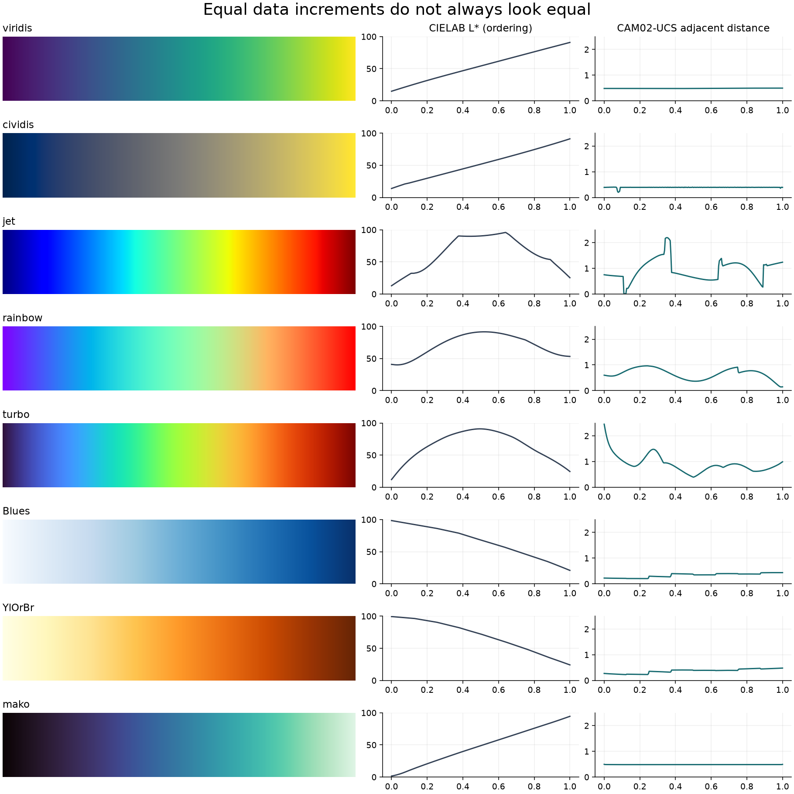

The image uses equal scalar increments. A smooth-looking hue journey is not
necessarily a smooth journey in perceived magnitude. Under the normal-vision
model, each of the three rainbow-like controls has more than 100 of its 255 adjacent
lightness steps opposed to its overall endpoint trend. These are reverse-direction
steps, not 100 separate turns in the curve.

| Map | Reverse L* steps | L* linear-fit RMSE | Adjacent-step CV | L* span |
|---|---:|---:|---:|---:|
| viridis | 0 | 0.43 | 0.012 | 75.95 |
| cividis | 0 | 0.46 | 0.055 | 77.30 |
| plasma | 0 | 1.51 | 0.010 | 78.94 |
| inferno | 0 | 1.41 | 0.011 | 97.78 |
| magma | 0 | 1.42 | 0.009 | 97.73 |
| mako | 0 | 0.55 | 0.002 | 92.95 |
| rocket | 0 | 1.22 | 0.003 | 92.10 |
| crest | 0 | 0.18 | 0.003 | 54.81 |
| flare | 0 | 0.68 | 0.004 | 54.13 |
| Blues | 0 | 2.74 | 0.243 | 77.49 |
| Greens | 0 | 3.20 | 0.273 | 74.06 |
| Purples | 0 | 2.84 | 0.313 | 80.65 |
| YlOrBr | 0 | 3.25 | 0.220 | 75.19 |
| YlGnBu | 0 | 3.64 | 0.267 | 85.70 |
| Greys | 0 | 4.39 | 0.465 | 100.00 |
| cubehelix | 0 | 2.75 | 0.337 | 100.00 |
| jet | **108** | 24.12 | 0.429 | 82.98 |
| rainbow | **130** | 16.01 | 0.311 | 51.43 |
| turbo | **129** | 21.70 | 0.359 | 78.91 |

ColorBrewer's sequential maps tested here preserve lightness order, but their
continuous interpolations have less even adjacent steps than the perceptually
designed baselines. This is a reason to distinguish **ordered** from
**uniform**, not to discard ColorBrewer. Its discrete schemes and explicit
sequential/diverging/qualitative classes remain valuable when matching the map
to the data's meaning. See the [ColorBrewer scheme guide](https://colorbrewer2.org/learnmore/schemes.html).

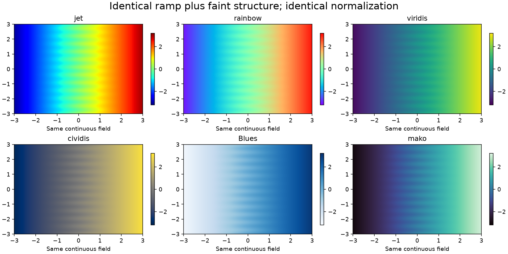

Every panel uses the same scalar field and normalization. Rainbow-like maps
introduce conspicuous bands that the field itself does not contain. This is the
kind of unequal visual emphasis Schwabish warns about on printed p. 47. Our
continuous-map recommendation is an experimental extension of that warning;
his sidebar itself favors discrete colors. Genuine thresholds should be shown
as explicit classes or contours with a stated rationale, not accidental hue
boundaries. Turbo is therefore not accepted as a general ordered-data repair
for jet in this workstream.

**Provisional decision:** cividis for the common cross-theme magnitude example;
viridis as an equally serious alternate, especially when its hue variation
helps. Mako/rocket are useful broad-range alternatives; crest/flare can suit
marks where a narrower lightness span avoids nearly white endpoints. Seaborn
explicitly distinguishes these applications in its
[palette guide](https://seaborn.pydata.org/tutorial/color_palettes.html).
No map is a default for unordered categories or cyclic phase.

## Do ramps grown from each theme's accent work?

We generated one light ramp and one dark ramp from each current accent using
Seaborn's palette constructors. All 18 are monotonic in normal vision and in
all three simulated vision conditions. They are legitimate research candidates,
but passing ordering alone does not make them better than a standard map.

| Theme | Light ramp step CV | Dark ramp step CV | Interpretation |
|---|---:|---:|---|
| Folio | 0.097 | 0.090 | Green can support a local ordered scale; retain a broad-range baseline for comparison. |
| Atelier | 0.032 | 0.087 | Light teal ramp is reasonably even in this model; dark counterpart is less so. |
| Nocturne | 0.089 | 0.087 | Brass/brown family is orderly; brightest data must not compete with brass UI emphasis. |
| Tufte | 0.111 | 0.098 | Neutral ramp adds no distinctive advantage; choose grayscale deliberately, not because UI ink is neutral. |
| Zephyr Reading | 0.100 | 0.125 | Dark blue ramp is the least uniform of these 18; do not inherit it as a default. |
| Simplex Reading | 0.121 | 0.069 | Red magnitude risks a semantic association with error/loss; it is not automatically a signed scale. |
| Pulse Reading | 0.027 | 0.071 | Light purple is a promising narrow-use alternative; still test range and mark visibility. |
| Litera Reading | 0.022 | 0.080 | Light blue gives good step evenness here, but the dark adaptation changes its range and role. |
| Darkly Reading | 0.081 | 0.084 | A usable hypothesis; native dark UI identity does not guarantee chart discrimination. |

The first four Reading dark ramps span only about 40–42 L* units, compared with
cividis's 77.30. Compressing the scale may be acceptable for a few ordered
classes, but it reduces available tonal variation for continuous magnitude.
The two modes also use different accent anchors: they are not merely the same
map on different backgrounds. Cross-mode numerical comparisons therefore need
a stable documented map, or an explicit reason for changing it.

**Provisional decision:** keep these as optional theme-specific candidates.
Do not install them as automatic scientific defaults. Start with matching plot
surfaces and typography; only replace the standard data map when the use case
benefits and the replacement passes its own tests.

## Diverging scales: evaluate both arms and the meaning of zero

A diverging map should change lightness toward a meaningful center and then
away from it. Measuring its whole length as if it were sequential would
incorrectly diagnose the legitimate central turn as a defect. We measured
128 samples on each side separately.

| Map | Left/right L* spans | Left/right step CV | Decision |
|---|---|---|---|
| BrBG | 72.75 / 74.66 | 0.219 / 0.200 | Useful brown/teal candidate with similar arm spans; current common specimen. |
| RdBu | 77.11 / 77.00 | 0.192 / 0.244 | Strong balanced-span alternative where red/blue semantics are suitable. |
| coolwarm | 50.25 / 50.25 | 0.164 / 0.219 | Balanced but narrower tonal span; compare carefully for subtle residuals. |
| PuOr | 63.84 / 87.51 | 0.113 / 0.271 | Attractive near Nocturne, but unequal arm span/step behavior argues against choosing by hue fit alone. |
| RdYlGn | 64.20 / 60.34 | 0.201 / 0.196 | Similar spans do not remove red/green discrimination risks; not the default. |
| seismic | 94.58 / 74.04 | 0.581 / 0.454 | Uneven steps and arm balance; defer for this general system. |

All these arms are monotonic under normal vision. That is only one condition.
Their pale centers can merge into light plot surfaces, while dark endpoints
can merge into dark ones. The specimens retain a visible rectangular heatmap,
colorbar and numeric labels; zero is a legitimate neutral value, not missing
data. A production helper must distinguish missing values with a separate
convention and preserve it in exports.

Use a meaningful center and explicit limits. Our example fixes `vmin=-1`,
`vcenter=0`, `vmax=1`. With asymmetric limits, a two-slope normalization gives
each side half the colorbar: equal raw increments on opposite sides can then
have different visual distances. That is a modeling decision to disclose,
not something a theme should quietly choose. Reversing a colormap preserves
its step statistics, but changes meaning; do not reverse it automatically
just because the page switches modes.

## Category cycles: neither brand aliases nor a familiar name is enough

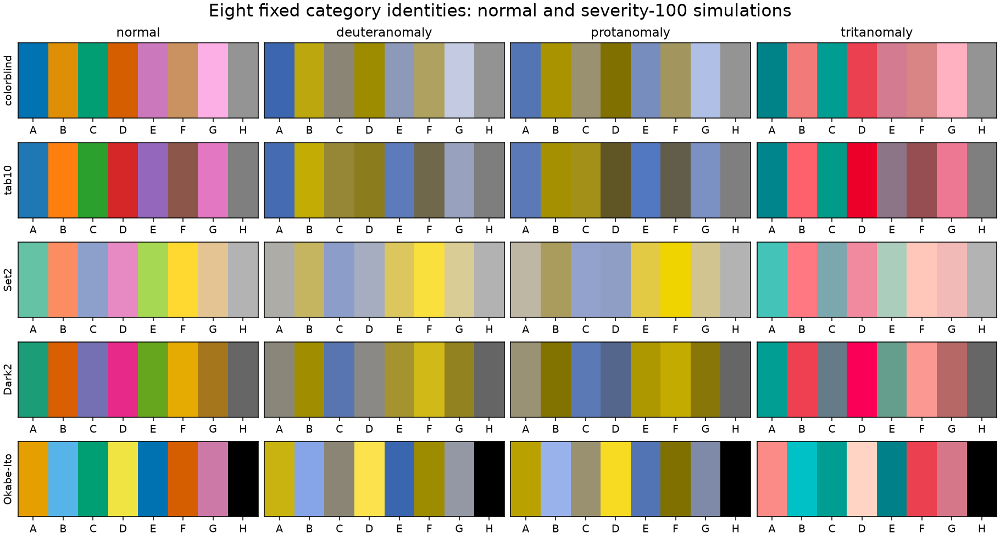

We tested Seaborn `colorblind`, Matplotlib `tab10`, ColorBrewer `Set2`/`Dark2`,
and the listed eight-color Okabe–Ito order. Three- and five-color tests use
the first colors of those fixed orders; they are not an optimization over
all possible subsets. The UI aliases are a deliberate failure control:
they duplicate colors in every theme, and four Reading themes collapse them
to a single color. They cannot encode five distinct identities.

| Eight-color cycle | Smallest pair distance, normal CAM02-UCS | Smallest pair distance across the 3 simulations | Minimum mark contrast on Atelier light paper | Colors below 3:1 there |
|---|---:|---:|---:|---:|
| colorblind | 12.99 | 5.84 | 1.65 | 5 |
| tab10 | 20.21 | 1.60 | 2.46 | 2 |
| Set2 | 17.78 | 1.86 | 1.34 | 8 |
| Dark2 | 16.74 | 2.19 | 2.00 | 2 |
| Okabe–Ito | 20.76 | 10.97 | 1.28 | 4 |

Distances describe relative separation, not a validated universal visibility
threshold. The same cycle can have distinct hues and still contain marks that
are too close to the background. Okabe–Ito has the strongest worst-pair result
in these eight-color simulations, yet its yellow is weak on light surfaces and
its black is weak on dark ones. Set2 has good dark-background contrast but
poor separation for some simulated pairs. None should be branded universally
safe based on this table.

The background dependence is concrete: on **Atelier dark**, the first three
`colorblind` colors have a minimum ratio of **3.12 on paper but 2.70 on panel**.
The same colors and data have crossed our thin-mark screening threshold merely
by moving into a panel. Text uses the separate 4.5 normal-text screen; 3:1 here
is a mark-risk screen, not a blanket WCAG conformance judgment for charts.

Our simulations use the Machado model at severity 100 through Colorspacious,
with display values clipped to sRGB after transformation; clipping fractions
are retained. Alpha blending and white veiling happen **before** simulation.
See the [Colorspacious tutorial](https://colorspacious.readthedocs.io/en/latest/tutorial.html)
for conversion conventions. Simulated vision is evidence about possible
confusions, not a substitute for readers with color-vision differences.

For ordered maps, cividis retains a lower step CV than viridis in each of the
three simulations here (roughly 0.08–0.18 versus 0.24–0.45); both remain
monotonic. Gamut clipping and viewing assumptions limit that comparison. It
supports cividis as the common demonstration, not an absolute accessibility
ranking of every possible chart.

**Provisional decision:** begin with small, explicitly assigned category sets;
compare `colorblind` and Okabe–Ito subsets on the actual surface, and always add
labels, dashes or markers. For more categories, consider panels or grouping
before adding indistinguishable colors. A future mode-specific cycle may
change shades, but must preserve category identity and avoid silently using
red for one category in light mode and another in dark. Selection remains
chart-dependent; the styles do not silently install a category cycle.

## Opacity, projection and exports change the answer

Atelier dark's five-color `colorblind` case falls from about **3.12** minimum
mark contrast at full opacity to **1.52** at alpha 0.4 on paper. An illustrative
20% white veil lowers it to about **1.42**. The veil is a simple linear-light
stress model, not a measured projector simulation. It demonstrates the loss
of contrast reserve; it does not predict a particular room.

Use opaque or sufficiently strong marks for projected lines, distinguish focus
with width/shape as well as color, and test at the size at which the audience
will see the chart. Scatterplot alpha can still communicate overplotting; its
visual cost must be evaluated in that actual mark geometry.

The background table records map endpoints and fractions below 3:1 against
paper and panel. Those values flag risk for **isolated thin marks**. A pale
heatmap cell beside darker neighbors can remain meaningful even when its
contrast against the page is low. Do not reject every continuous map by
applying text rules to each cell, or trim its endpoints without rechecking
lightness span and normalization.

Export with an explicit background. A transparent dark-mode chart can become
unreadable when placed on a white PDF page. Keep the numeric colorbar, limits,
missing-value policy and category assignment stable across SVG/PNG/PDF,
light/dark mode, and SmallDocs/Quarto. Print/grayscale needs a separate check;
this study measures L* but has not run physical print or projector trials.

## Nine theme decisions, with both modes visible

The specimens intentionally use the **same** cividis magnitude map and BrBG
residual map, while changing plot surfaces, text and the single-highlight
example. This lets us judge whether common scientific maps can belong to each
UI without tinting all data to match the brand. The line example uses direct
labels and distinct dash patterns; it is a focus/context treatment, not three
unordered categories.

### Folio

Retain green/warm-paper furniture and a restrained green focus. Consider rust
as an alternative focus, not a second universal meaning for negative values.
The neutral sans chart-label role complements editorial serif prose. Compare
the brand-green ramp for local ordered classes; retain cividis/viridis for
continuous comparisons. BrBG feels compatible but still requires meaningful
signed data. Light muted UI copy has little reserve; dark exports need their
own opaque green-black canvas.

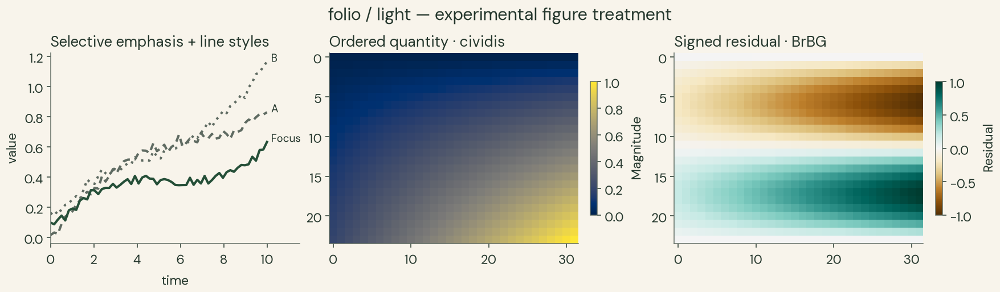
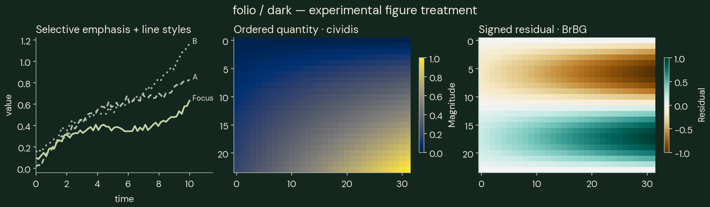

### Atelier

Advance first. Teal plot furniture works with a standard magnitude map without
forcing every series to teal. The light brand ramp is a credible optional
ordered alternative. Use cividis/viridis by default for now, and compare
BrBG/RdBu for signed quantities. Its paper/panel categorical failure above
makes surface-aware category selection essential in dark mode.

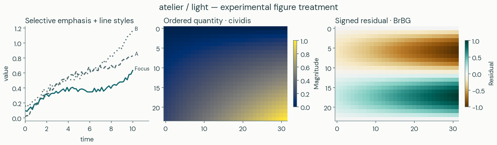
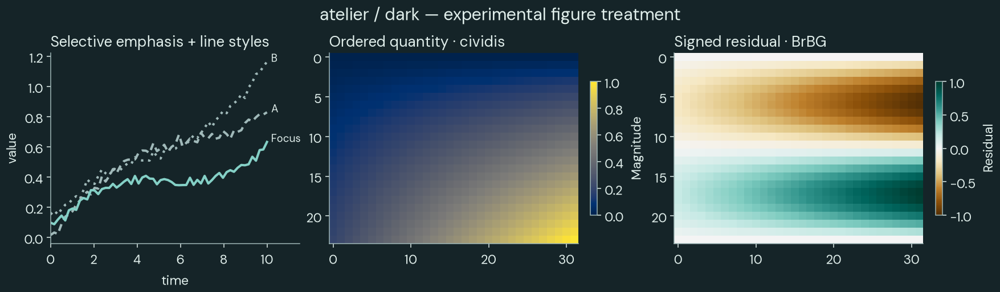

### Nocturne

Keep brass scarce and use it for the intended focus. Its bright chart endpoint
must not compete with many brass UI labels. The light brown and dark brass
accent ramps are different mappings; do not switch them during a numerical
comparison. PuOr is visually tempting but arm imbalance makes BrBG/RdBu more
credible first controls. Use sans labels with the theme's serif editorial
headings rather than rendering every tick in a display face.

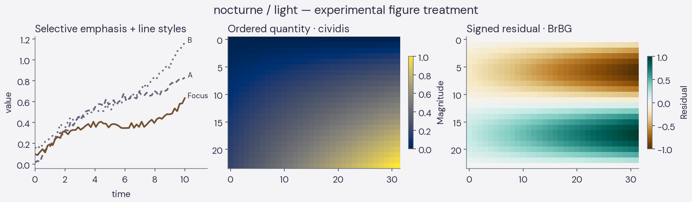
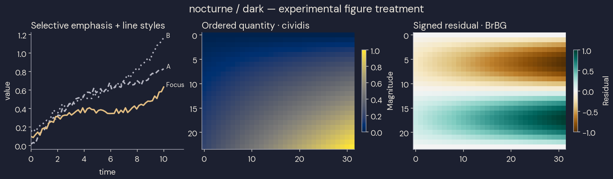

### Tufte

Keep neutral furniture and let data supply color. Current accent equals ink,
so the focus example intentionally remains monochrome and relies on line
styles/labels. A future optional highlight should be explicitly specified.
Greys is ordered but has substantially uneven steps in this sampling; neutral
branding is not a reason to prefer it over a well-designed magnitude map.
The figures use DejaVu Serif as a disclosed available plotting fallback for
ET Book, not an exact typeface match. Remove unnecessary UI cards/shadows as a
separate structural decision after selection.

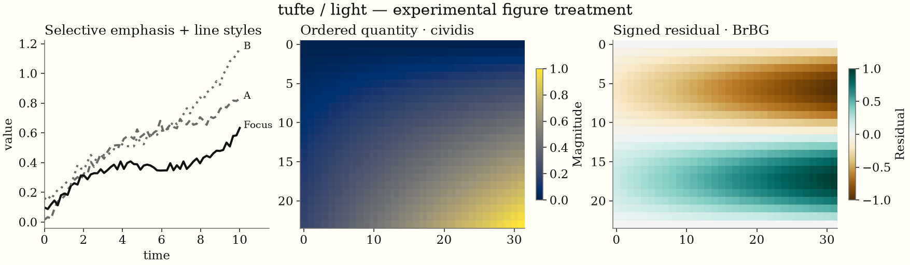
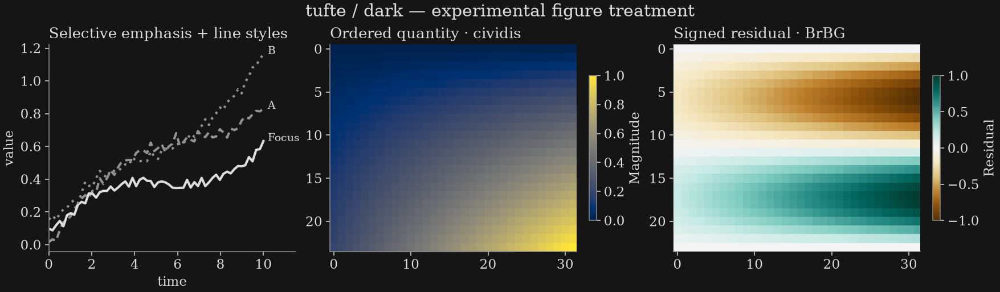

### Zephyr Reading

Use Inter for chart labels and blue for deliberate focus. Blues is an ordered
alternative, but its steps are less even than cividis/viridis. The dark brand
ramp is narrow and less even than its light partner. Repair dark accent text
on panels before exporting a full paired scheme; avoid assigning UI-blue an
unrelated categorical meaning on every figure.

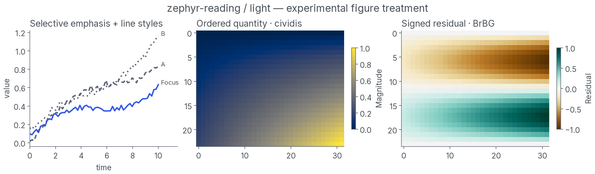


### Simplex Reading

Open Sans and restrained red emphasis work well on light paper. Brand red
should not automatically mean error, loss or negative residual. Prefer a
neutral scientific magnitude map and deliberate divergence semantics. Dark
accent text needs repair; the dark red ramp's reasonable step CV does not
repair that UI defect or broaden its limited lightness span.

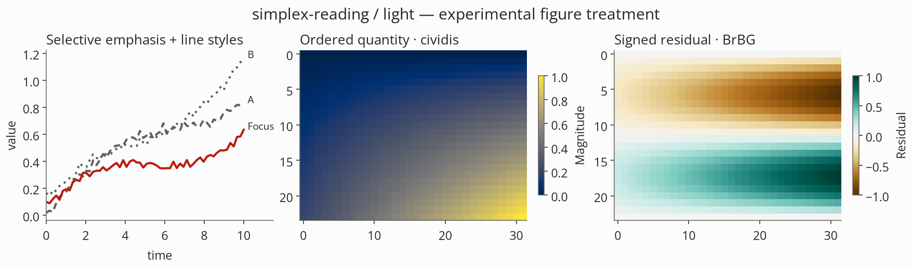
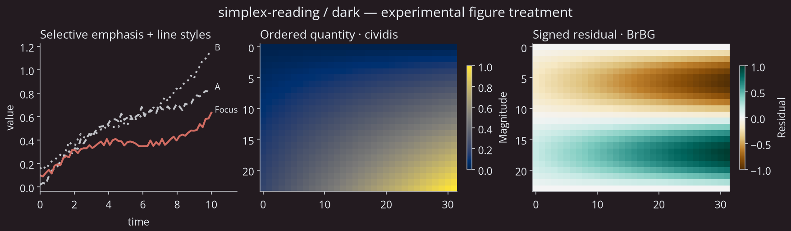

### Pulse Reading

Purple is useful selective emphasis. The light brand ramp is more even than
ColorBrewer Purples here, but neither should replace the broad-range baseline
solely for visual fit. Compare purple/rocket options for appropriate ordered
applications. The dark accent is already marginal on paper and fails on
panel: repair its text role independently of the plotted scalar map.


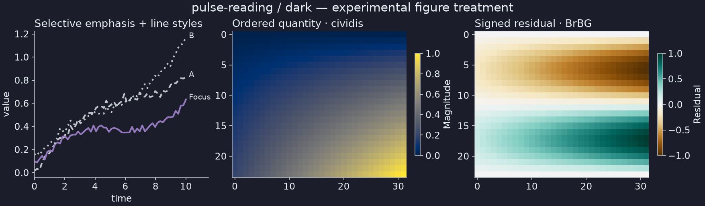

### Litera Reading

Preserve the distinction between serif prose and sans chart labels. The
specimens use DejaVu Sans for the portable sans role. Blue focus fits, while
standard maps avoid overloading blue with every data meaning. The light brand
ramp is promising in step uniformity, but its dark counterpart is narrow and
the dark panel-link role still needs repair. Judge the pair independently of
the source theme's strong reading layout, which htmpres does not import.

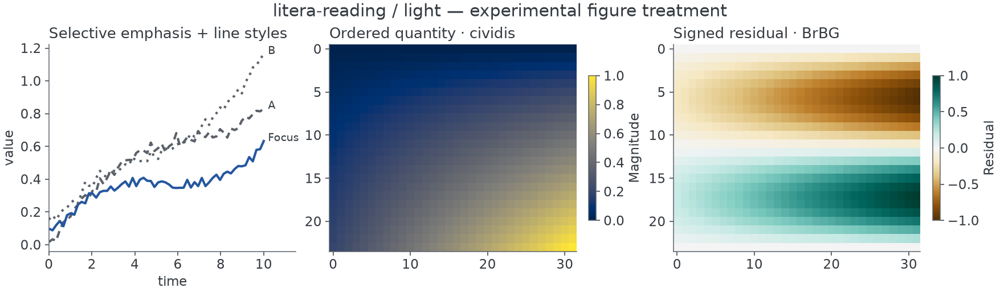
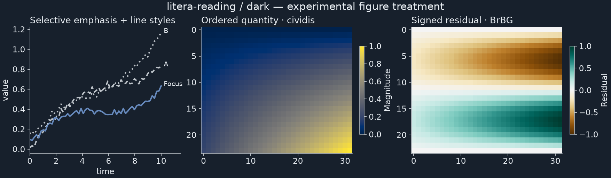

### Darkly Reading

Lato and charcoal support a clear dark plot. Use the main blue focus rather
than its very weak secondary blue; the present prototype does so explicitly.
Test category colors on both charcoal paper and lighter panels. Validate the
light adaptation as a separate design: the name “Darkly” supplies no evidence
for its light mode. Preserve opaque backgrounds when exporting dark figures.

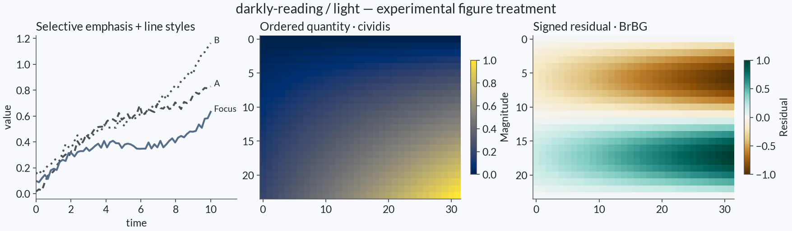
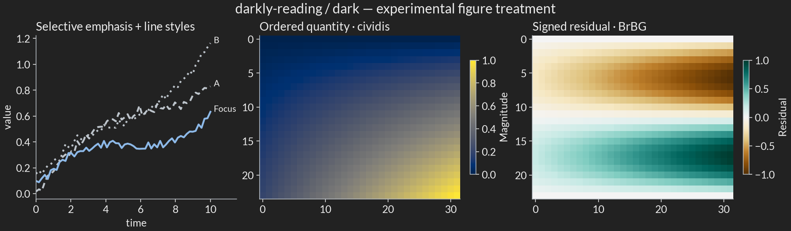

## What the experimental styles provide

The [candidate settings](results/candidate-styles.json) and 18 files in
`styles/` specify figure/axes backgrounds, text and tick colors, font role,
quiet spines, line width and opaque exports. They do **not** set the global
category cycle or choose a normalization for the caller. `font.size=12` in
these prototypes is a chart-layout starting point at the generated figure
size, not the final projected size; validate the placed chart after scaling.

Use Seaborn setup before the local Matplotlib style so Seaborn does not
subsequently overwrite the theme. Choose data colors explicitly:

```python
from pathlib import Path
import matplotlib.pyplot as plt
import seaborn as sns

sns.set_theme()
audit = Path("research/theme-audit")
with plt.style.context(audit / "styles/atelier-light.mplstyle"):
    fig, ax = plt.subplots(figsize=(7, 4))
    sns.heatmap([[0.1, 0.4], [0.7, 1.0]], cmap="cividis",
                vmin=0, vmax=1, ax=ax, cbar_kws={"label": "Magnitude"})
    fig.savefig("magnitude.png", dpi=180)
```

The experiment harness registers the repository's bundled DM Sans, Inter,
Open Sans and Lato and records resolved font hashes in
[plot-fonts.json](results/plot-fonts.json). A standalone `.mplstyle` names a
family but does not install/register its font; outside the harness, register
the bundled licensed files or select and disclose a fallback. Pulse/Litera
use DejaVu Sans and Tufte uses DejaVu Serif. Font availability is part of a
reproducible figure, not an incidental machine preference.

## Reproduce and inspect

From the repository root:

```sh
just --justfile research/theme-audit/justfile check
just --justfile research/theme-audit/justfile specimens
just --justfile research/theme-audit/justfile serve
```

`check` creates/synchronizes the local environment from `uv.lock`, regenerates
measurements and scientific figures, builds the three HTML reports, and runs
focused numerical and report checks. `specimens` invokes the existing full
catalog smoke renderer and prepares local light/dark slides plus contact sheets.
The separate browser helper under `integration_tests/theme-audit-browser.mjs`
checks the report assets and the actual mode/navigation flow through CUA.
Browser screenshots are observations and require that browser step; they are
not regenerated by the numerical test command. The saved contact sheets record
this audit's observed renderings. The two private books are not required to
reproduce calculations and are not distributed.

## Selection and the next implementation boundary

The provisional implementation order is **Atelier**, then **Folio or
Nocturne**, with **Tufte** as a distinct minimal option. All five Reading
alternatives remain equally investigated and eligible; select them for their
specific voice rather than because they share the Reading suffix.

After selection, make one coupled contract for the selected htmpres, SmallDocs
and Quarto families: surface/ink roles; accent text versus fill; text versus
plot font roles; focus/context colors; explicit category assignments;
sequential/diverging defaults; normalization; missing values; and export
backgrounds. Keep document and projection typography profiles distinct.
Reproduce native-source defects in both document renderers before changing
their CSS/Sass; htmpres's derived-mode defects may belong only in its adapter.

The evidence supports a **shared scientific palette policy with theme-specific
furniture**, plus optional tested brand ramps. It does not yet support shipping
nine unrelated universal scientific palettes, silently equating UI aliases
with categories, or declaring every candidate projection-ready. The remaining
selection and room tests are explicit next decisions, not missing numerical
work hidden by a pleasant swatch sheet.
