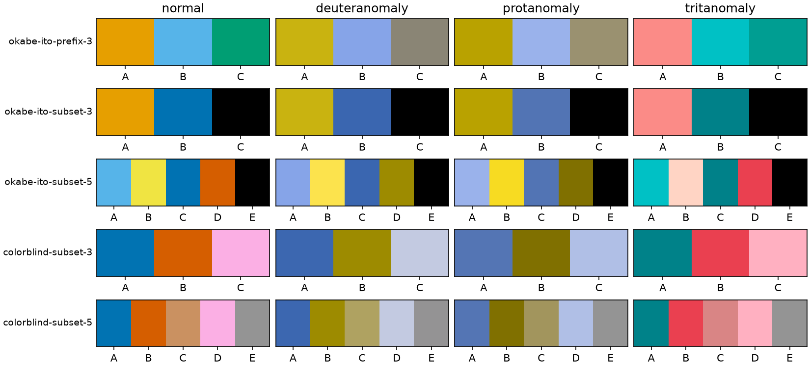
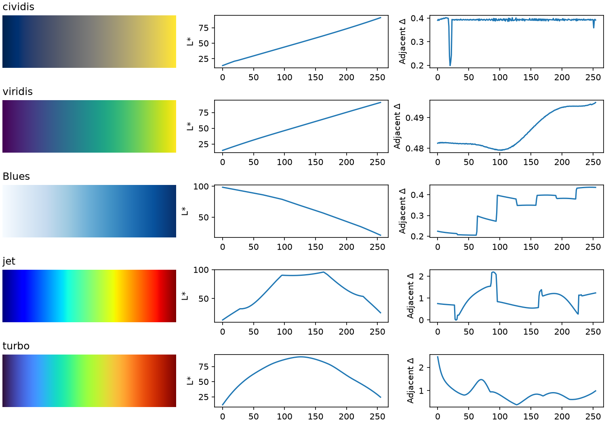
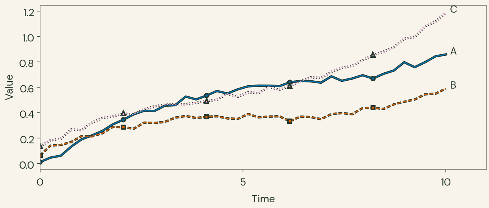
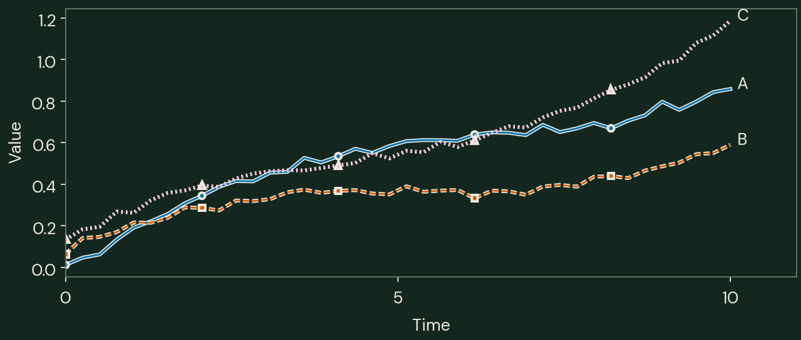

# Scientific palettes after the owned foundations

This is the current decision study for all nine revised themes, pinned to verified slide commit `04cef45c3374a018d3b32b9c53a2e4e43e7c88ec`. The recommendation is **shared scientific encodings with theme-specific furniture**, with a required rendering treatment for categorical lines. No theme UI ladder becomes an automatic data map. The [original Doc3](historical/03-scientific-palettes-pre-foundations.html), its conclusions and [baseline hashes](historical/baseline-hashes.json) remain historical evidence; their measurements are not the current results.

The [decision registry](runs/foundations-2026-11-09/decision-registry.json) is the package handoff. Its recommended supported defaults are the fixed `colorblind-subset-3` assignment with ink under-strokes/edged markers, `cividis` for magnitude, and `BrBG` for signed deviation. Named alternatives are explicit choices, never mode-dependent automatic reversals. Diagnostic pools remain available for research comparisons and are excluded from the recommended public-map whitelist.

## Source freeze and scope

The [provenance ledger](runs/foundations-2026-11-09/inputs/provenance.json) pins the nine upstream merged revisions, exact published manifests, actual slide adapter/profile source, font/license bytes, and a separately attributed research lock. Capture reads validated committed assets, excludes untracked files and symlink targets, and fails for dirty tracked inputs before writing. Current numerical reruns read only the copied inputs; they need no sibling checkouts or network. The [final evidence manifest](runs/foundations-2026-11-09/evidence-manifest.json) binds all generators, derived artifacts and this Markdown/HTML report without a self-hash cycle. The [run manifest](runs/foundations-2026-11-09/manifest.json) binds seed, backend/dependency versions, generator hashes and inputs. Font files and sample order are part of the result, not ambient host state.

The matrix contains nine themes × two modes × two surfaces × two profiles. There are 32,256 category-condition rows, 3,024 map/background rows, and 72 PNG/SVG/PDF diagnostic specimens. Color-only reading/presentation rows repeat the same measurements for deployment lookup; **they are not independent perceptual validations**. Real profile differences occur in font, type size, geometry and placement. Synthetic data and fixed geometry isolate comparisons; no reader study, projector or print trial was performed.

The refreshed UI-role checks keep ordinary text separate from marks: minimum primary/code ink contrast is 7.562; muted is 5.007; accent text is 5.001. These opaque role checks are not data-map tests or a repeat of the prior browser/control gate.

## A usable categorical recommendation

Category IDs A/B/C keep these exact colors in every theme/mode: `#0173b2`, `#d55e00`, `#fbafe4`. The subset is selected once from the fixed Seaborn colorblind pool by finite maximin CAM02-UCS distance over normal plus three severity 100 simulations, with a documented deterministic tie break. Its palette order and slot assignment are frozen in [palette-samples.json](runs/foundations-2026-11-09/results/palette-samples.json). Passing a different data order must not change a category's slot; duplicates and requests beyond capacity are rejected. The default domain has capacity three. The named five-category extension is explicit and conditional: its worst simulated separation is lower, so it carries five stable shapes/dashes/direct IDs and the same required ink treatment, with density/occlusion review. Eight-color pools remain diagnostic. [Five-category light](runs/foundations-2026-11-09/placements/folio-light-presentation-five.png) and [dark](runs/foundations-2026-11-09/placements/folio-dark-presentation-five.png) specimens show that bounded extension; they are not a universal legibility certification.

A bare thin-line cycle is **unsupported**: some colors nearly coincide with a background. Max-distance selection alone selected black for Okabe–Ito and visibly lost it on dark Folio. The bounded visibility alternative uses Dark2 indices 1/3/6. Its normal-vision worst surface contrast is 3.106, but its worst simulated separation is smaller. The [per-color screen](runs/foundations-2026-11-09/results/category-pool-visibility.csv) shows that no individual color in the three bounded pools clears the chosen opaque 3:1 screen over every simulated model/surface, so we do not pretend a new subset resolves all constraints.

| palette | worst_contrast | worst_distance |
| --- | --- | --- |
| Dark2-visibility-3 | 2.321 | 2.186 |
| colorblind-subset-3 | 1.345 | 29.639 |
| okabe-ito-subset-3 | 1.150 | 52.456 |

These are model comparisons, not universal perceptual cutoffs. The engineering 3:1 mark screen is a warning signal, separate from text/control requirements and separate from CAM02 separation. The supported treatment is a **2.5px color trace over a 5.5px theme-primary-ink under-stroke**, plus 7px markers with 1.5px ink edges, stable dashes/shapes and direct endpoint IDs. It preserves a visible trace skeleton when the color core is weak; labels/dashes alone cannot restore a vanished stroke. It does not guarantee hue identification for all observers or resolve occlusion at intersections. The package must apply the treatment operationally rather than expose a misleading bare default cycle.

The [actual-scale Agg pixel evidence](runs/foundations-2026-11-09/results/understroke-pixels.json) examines uniform core, uniform ink edge, antialiased edge and crossing regions separately. Antialiased pixels can approach the background; their ranges are observations, not an edge-wide 3:1 guarantee. At crossings the later trace occludes the earlier one. See [light](runs/foundations-2026-11-09/figures/understroke-pixels-light.png) and [dark](runs/foundations-2026-11-09/figures/understroke-pixels-dark.png). Filled marks need ink edges too; dense overlap remains a task-specific design decision.



*Diagnostic subsets and simulations. These swatches do not establish stroke visibility; the untreated maximin palettes remain comparisons.*

## Explicit decisions for all nine

All nine use the same named categorical treatment, cividis magnitude and BrBG deviation defaults. Furniture and concrete chart UI faces differ. The categorical column is the worst opaque color-core contrast across both surfaces/modes and all four vision models; the ink-edge column is the corresponding required ink's worst contrast. This does not conflate a strong edge with a strong color core.

| Theme | Concrete chart UI | Core minimum | Ink-edge minimum | Theme decision |
| --- | --- | --- | --- | --- |
| folio | DM Sans | 1.35 | 10.15 | Warm paper/green furniture, sans chart UI; rust is an explicit alternative focus. |
| atelier | DM Sans | 1.44 | 9.85 | Square teal furniture; keep scientific encodings independent of teal. |
| nocturne | DM Sans | 1.34 | 11.04 | Ink-blue/pearl furniture, scarce brass focus and sans chart UI. |
| tufte | ETBembo | 1.52 | 12.42 | Neutral unboxed furniture and real ETBembo UI; optional blue focus is explicit. |
| zephyr-reading | Inter | 1.50 | 7.48 | Inter UI; dark accent text is distinct from button fill. |
| simplex-reading | Open Sans | 1.46 | 12.08 | Open Sans UI; brand red never automatically means negative data. |
| pulse-reading | DejaVu Sans | 1.45 | 8.67 | Purple focus; disclosed portable DejaVu Sans for platform UI. |
| litera-reading | DejaVu Sans | 1.49 | 10.44 | Serif document prose remains distinct from portable sans chart UI. |
| darkly-reading | Lato | 1.37 | 11.37 | Lato UI; pale-blue focus rather than dark-blue button fill for thin marks. |

Pulse and Litera deliberately use a disclosed portable DejaVu Sans chart UI rather than claim a particular host platform/Georgia face. Tufte uses converted ET Book with internal family ETBembo 400/700. The [font resolution](runs/foundations-2026-11-09/results/font-resolution.json) records requested/resolved faces, weights, file hashes and notices; [conversion provenance](runs/foundations-2026-11-09/results/font-conversions.json) records WOFF source hashes and fontTools settings. Fallbacks come from exact locked Matplotlib package files, never host font lookup. Numeric ticks use ASCII minus because ETBembo lacks U+2212; actual displayed glyph coverage is checked. ETBook's nonessential `webf` table is ignored by PDF subsetting; outline/name/weight conversion is recorded.

## Sequential maps and diverging normalization

`cividis` is the common sequential default because its worst simulated adjacent-step CV is 0.183 versus 0.453 for viridis, with lower maximum clipping (0.242 versus 0.469). Both remain monotonic in every tested model. Viridis is more uniform in normal vision (CV 0.012 versus 0.055), so cividis is a deliberate simulation-robustness tradeoff rather than a universal winner; `viridis` is a useful alternative, with `mako`/`rocket` named choices. ColorBrewer Blues/Greens/Purples/YlOrBr/Greys test familiar ordered ramps. Optional theme accent ramps are measured alternatives, not UI-derived defaults. Use an explicit vmin/vmax and preserve orientation across modes. Continuous cell interiors need not all contrast 3:1 with the surrounding panel; boundary/context decisions remain separate from the ordered data encoding. Background contrast and clipping are recorded for every theme/surface/model in [map-backgrounds.csv](runs/foundations-2026-11-09/results/map-backgrounds.csv).

| map | arm | L_span | reversals | L_linear_rmse | step_cv | flat_steps |
| --- | --- | --- | --- | --- | --- | --- |
| cividis | whole | 77.304 | 0 | 0.460 | 0.055 | 0 |
| viridis | whole | 75.947 | 0 | 0.433 | 0.012 | 0 |
| Blues | whole | 77.495 | 0 | 2.744 | 0.243 | 0 |
| BrBG | left | 72.726 | 0 | 3.390 | 0.217 | 0 |
| BrBG | right | 74.684 | 0 | 2.998 | 0.200 | 0 |
| RdBu | left | 77.109 | 0 | 2.265 | 0.191 | 0 |
| RdBu | right | 77.001 | 0 | 2.779 | 0.243 | 0 |
| jet | whole | 82.977 | 108 | 24.121 | 0.429 | 2 |
| turbo | whole | 78.911 | 129 | 21.696 | 0.359 | 0 |

L* span/reversals/linear-fit RMSE and CAM02 adjacent-step CV answer different questions. Monotonic lightness does not prove uniformity; a low CV does not prove every task easier. Jet/rainbow/turbo controls expose strong reversals and step variation and are not approved sequential defaults. The [diagnostic plot](runs/foundations-2026-11-09/figures/map-diagnostics.png) and [full map metrics](runs/foundations-2026-11-09/results/map-metrics.csv) include all simulations and optional ramps.

`BrBG` is the common signed default with `RdBu`/`coolwarm` named alternatives. BrBG limits worst simulated arm-span imbalance to 4.34 L* versus 8.43 for RdBu and 13.38 for coolwarm, while retaining monotonic arms in all models. RdBu has better normal-vision span balance and lower worst step CV, but reaches higher simulated clipping; coolwarm has smaller normal L* spans and one simulated arm reversal. BrBG's worst step CV is higher than RdBu's, so this is a balanced-arm/range choice, not perceptual dominance. Both arms are tested including the same exact center. To avoid a 256-entry lookup duplicating the right endpoint at 129 samples, the actual rendered/frozen LUT is 257 entries: componentwise encoded-sRGB interpolation from the pinned source 256, with shared index 128. This is an explicit derived map definition, not a claim to unmodified ColorBrewer samples. Metrics use those exact two 129-entry arms. Arm span and CV are reported separately; center neutrality and arm balance do not follow from monotonicity alone.

Use `TwoSlopeNorm(vmin=..., vcenter=..., vmax=...)` with all limits explicit. It maps the center to 0.5; asymmetric limits do **not** make equal signed magnitudes equally distant. [Normalization examples](runs/foundations-2026-11-09/results/normalization-examples.csv) include (-1, 0, 1) and (-2, 0, 1); tests verify endpoints, exact center and invalid ordering. Missing values use opaque muted furniture plus a contrasting cross/hatch, never the diverging center color. Under/over values use explicit endpoint clipping; package-facing special-value policy is machine-readable.



*Normal-vision diagnostic curves compare lightness ordering and step variation; simulated results are retained in the tables.*

## Alpha, veiling and simulations

The ordinary Matplotlib Agg source-over operation is modeled in **gamma-encoded sRGB**, not linear light. All 27 mark/background/alpha pixel comparisons agree within 0.003922 per channel (allowed 2/255); the [validation table](runs/foundations-2026-11-09/results/agg-alpha-validation.json) also shows why the linear-light alternative is different. Alpha 0/1, transfer-function round trips and the two midpoint predictions are direct invariants. Pixel interiors and antialiased edges are separate evidence.

For every category condition, composite first; then apply the named illustrative white veil in linear light; then simulate the final marks **and actual background** with the same Machado type/severity 100; then clip and record fractions. Recompute both surface contrast and category distance after this pipeline. Both encoded and linear-light alpha are compared at 0.7/0.4; veil strengths 0.1/0.2 and one combined alpha 0.4/veil 0.2 case are explicit, not projector calibration. Clipping/model extremes limit interpretation. There is no universal color-vision accessibility certification here. [Category metrics](runs/foundations-2026-11-09/results/category-metrics.csv) retain all conditions and surfaces.

## Typography, real placement and exports

Chart labels/ticks/legends map to reading UI 16px and presentation label 24px. Plot headings use 30/36px; metadata 14/24px. Deliberate body annotations use the specific foundation body role: 20px for the serif reading profiles, 18px for the other reading profiles, and 30px for presentation. Per-theme numeric mappings are in the registry. Deck/display 48px is not the plot-title default. Real regular and heading faces are used; furniture stays independent from data encoding.

The calculation is `effective CSS px = points × measured placed width / (72 × figure width inches)`. An 8-inch plot at 1152px therefore needs 12pt text to yield 24px; shrinking it reduces the effective size. The [72 diagnostic sheets](runs/foundations-2026-11-09/gallery.html) are 640px reading or 1152px presentation, with every actual Text face/size checked and opaque PNG/SVG/PDF exports. Their presentation contact sheets are 1152×806px and **do not fit a slide**; they are diagnostic comparisons only.

The [reading acceptance page](runs/foundations-2026-11-09/placements/reading.html) places the wide plot at 640px. The [actual light slide](runs/foundations-2026-11-09/placements/slide-light/index.html) and [dark slide](runs/foundations-2026-11-09/placements/slide-dark/index.html) were rendered with the verified pinned htmpres checkout from saved QMD. The purpose-sized plot is 1152×489.6px, fitting the 1152×592 content region of a native 1280×720 slide. Images are responsive inside smaller slide shells: 24px is claimed only when measured plot width is 1152px; at smaller widths the effective size is 24×actual_width/1152. Sidebar/browser chrome can reduce the slide, so viewport dimensions alone do not prove native placement. [Geometry and regeneration command](runs/foundations-2026-11-09/placements/geometry.json) preserve that distinction. The browser review measured a native 1280×720 slide and 1152×489.59 plot at 1680×1000 viewport, preserving 24px labels and 64px side insets. At the reduced 1280×720 browser viewport, the actual slide was 1008×567 and plot 880×374, giving 18.333px effective labels without clipping. Reading images loaded at 640×272, preserving 16px labels. The [durable browser evidence](runs/foundations-2026-11-09/placements/browser-evidence.json) includes relative-path screenshots and measurements. Reduced viewports scale the image and type together. Each saved slide has a static mode-matched bitmap; the UI mode toggle does not recolor embedded pixels.





*Matching light/dark examples. Inline previews may scale; intended 24px labels are verified only by the separate measured placement evidence.*

## Reproduce without overwriting history

From this research directory:

```sh
just current
uv run --frozen python current_treatment.py
uv run --frozen python build_current_report.py
just check
```

`current` regenerates only the versioned run and standalone placements from copied inputs. `check` builds reports and runs tests; it never invokes historical measurement/foundation generators. `just historical-reproduce` is the explicit opt-in baseline regeneration path and uses frozen historical inputs. The archived original source files and lock remain in historical/inputs; ordinary current verification cannot overwrite baseline results/styles/figures. Tests bind their saved hashes.

To regenerate actual slide HTML only, use `uv run --frozen python build_current_placements.py --renderer PINNED_CHECKOUT` at the exact verified revision. This optional integration step requires that checkout; the numeric/figure run does not. HTML and required runtime assets are saved beside the specimens. PNG/SVG/PDF backgrounds, source hashes, sample order, fixed seed, fonts, licenses and placed-text records are inspectable artifacts. Numerical/sample/font results are reproducible; PDF/SVG container metadata and identifiers may differ across reruns, and the final evidence manifest binds the actual generated bytes.

## Evidence and remaining decisions

The numerical results support a common named map policy and theme-specific furniture for all nine. Required categorical under-strokes are a concrete rendering obligation, not a footnote. Human discrimination, dense overlaps, responsive size changes, projection and print remain use-context evaluations. The next plotting package should consume the registry and enforce explicit normalization/category domains/treatment, while preserving the diagnostic controls for research only.

Primary method references: [Matplotlib colormap guidance](https://matplotlib.org/stable/users/explain/colors/colormaps.html), [TwoSlopeNorm](https://matplotlib.org/stable/api/_as_gen/matplotlib.colors.TwoSlopeNorm.html), [Seaborn palette guidance](https://seaborn.pydata.org/tutorial/color_palettes.html), [Colorspacious CVD simulation](https://colorspacious.readthedocs.io/en/latest/tutorial.html#simulating-colorblindness), and the [Machado model](https://www.inf.ufrgs.br/~oliveira/pubs_files/CVD_Simulation/CVD_Simulation.html). Source-book references and the original interpretive claims remain in the linked historical Doc3; this current study does not replace those sources with model scores.
